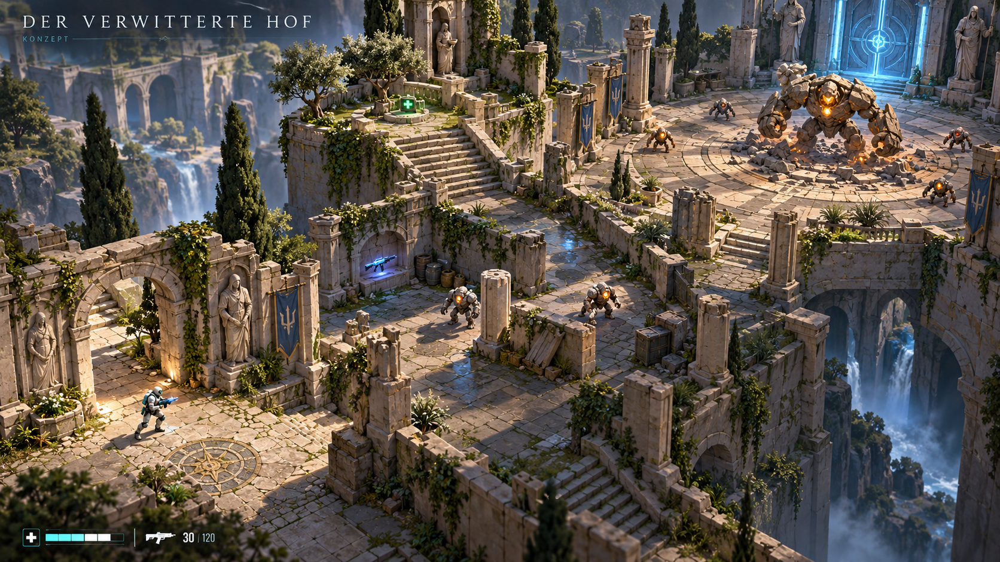
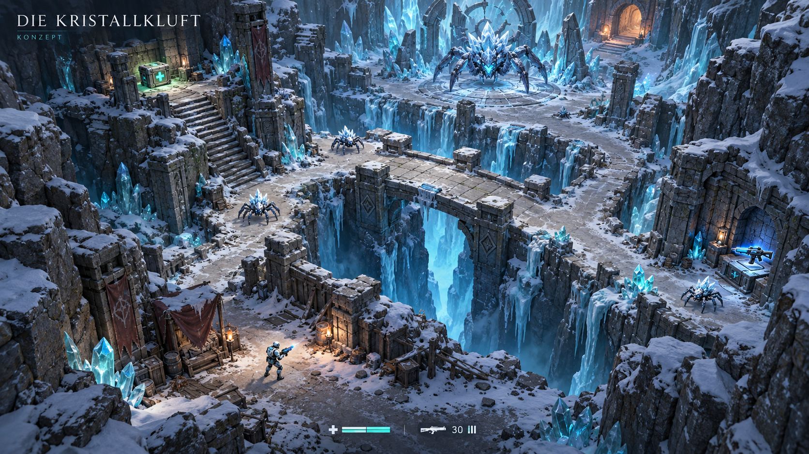
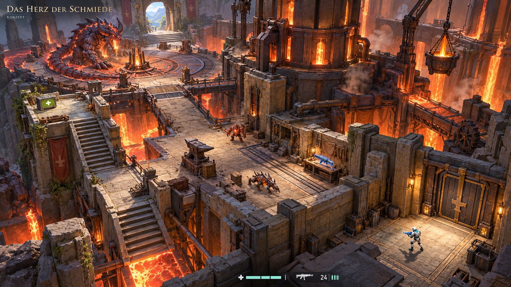

# Drei kleine Adventure-Level – Konzeptbilder

**Überholt:** Vom Nutzer wegen unrealistischen Produktionsniveaus und fehlender
konkreter Levelübersicht als Planungsgrundlage zurückgewiesen. Maßgeblich ist der
[konkrete Level-1-Plan](../../planning/LEVEL_1_STONE_ADVENTURE.md).

27. Oktober 2026. Auf Nutzerwunsch drei Mockups für eigene Level pro Boss mit
Vorhof, Erkundung, weiteren Gegnern und einem abschließenden Bossbereich.
Erstellt mit dem eingebauten image_gen-Tool. [Vollständige Bildprompts](PROMPTS.md).

Die Bilder sind visuelle Zielentwürfe, keine Screenshots des implementierten Spiels.
Sie liegen in Detailgrad und Assetqualität deutlich über dem aktuellen Prototyp.
Wegeverbindungen, Sichtbarkeit, Kollision und Leistung müssen beim späteren
spielbaren Aufbau gesondert geprüft werden. Keine Adventure-Level-Implementierung
oder Erweiterung der freigegebenen Meilensteine durch diese Bildentwürfe.

## Der verwitterte Hof

Ankunft durch einen gebrochenen Torbogen → Ruinenpassage mit kleinen Steinwächtern
und Waffenfund → optionale Heilungsterrasse → Siegelhof mit großem Wächter → Tor
zur Kristallkluft. Warmer Naturstein, Bewuchs und sichtbare massive Höhenwände.

## Die Kristallkluft

Geschützter Höhleneingang → kleine Kristallspinnen auf versetzten Wegen → Brücke
über die Schlucht und seitliche Vorratsnischen → größere Kammer mit Frostspinne →
warmer Ausgang zur Schmiede. Engere Wege, klare Höhenwechsel und kaltes Licht.

## Das Herz der Schmiede

Wartungsvorhof → Werkhöfe mit kleineren Glutgegnern → alternative Wege um den
Ofen und erhöhte Versorgung → Kernkammer mit Glutwurm → Ausgang ins Tageslicht.
Breite Gassen, Schmiedegeräte, gut lesbare warme Wandflächen und begrenzte Lavakanäle.

