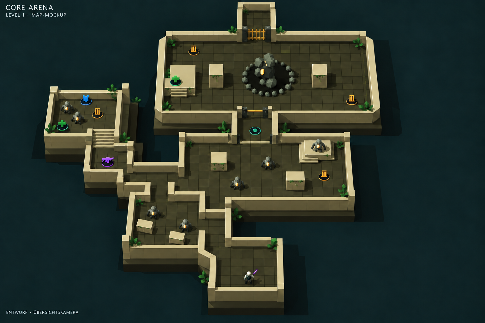
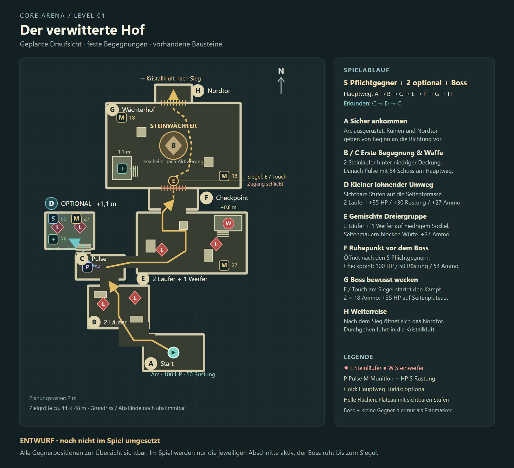

# Level 1: Mockup und Map-Skizze

Stand: 27. Oktober 2026. **Visuelle Planung, kein implementiertes Level.**

Grundlage ist der [konkrete Ablaufplan](../../planning/LEVEL_1_STONE_ADVENTURE.md).
Diese Ansichten ersetzen die früheren, vom Nutzer als zu aufwendig zurückgewiesenen
Adventure-Konzeptbilder. Die Freigabe umfasst die Visualisierung, noch keinen Spielumbau.

## Mockup auf vorhandenem Grafikniveau

Das generierte Bild verwendet einen [echten aktuellen Spiel-Screenshot](../../qa/plateau-walls/stone-platform-isometric.png)
als Stilreferenz und die folgende Skizze als Layoutreferenz. Schlichte Quader,
sichtbare Plateau-Wände, wenige Pflanzen und facettierte Steine sind bewusst die Basis.
Die kleinen Steingegner sind geplante Varianten, keine bereits vorhandenen Gegner.

Die Kamera zeigt für die Planung das ganze Level; im Spiel soll sie den Spieler
durch die Abschnitte begleiten. **Für Wege, Durchgänge, Höhen und Fundorte ist die
Skizze maßgeblich:** einzelne Öffnungen und Wandanschlüsse bleiben im generierten
Mockup vereinfacht und sind kein verlässlicher Bauplan. Der Boss ist zur Orientierung
als ruhender Steinkörper sichtbar, nicht gleichzeitig mit allen kleinen Gegnern aktiv.

## Genaue Raumfolge und Belegung

- Hauptweg: A → B → C → E → F → G → H.
- Optional: C → D → C, mit niedrigen Stufen und zusätzlichen Vorräten.
- B: 2 Steinläufer. E: 2 Steinläufer + 1 Steinwerfer. D: 2 optionale Steinläufer.
- Zusammen 5 Pflichtgegner, 2 optionale Gegner und 1 Boss, ohne Zusatzwellen.
- F: Checkpoint nach den Pflichtgegnern; bewusster Bossstart am Siegel, Ausgang nach Sieg.
- Alle Waffen-/Lootorte, Mengen und geplanten Plateauhöhen sind in der Skizze markiert.

Grundriss und Breiten sind Entwurfswerte. Die dargestellten Umfassungsmauern
begrenzen Räume; im Spiel müssen Durchgänge, Blick auf den weiteren Weg und
Kamera-Verdeckung im begehbaren Zwischenstand abgestimmt werden.

## Dateien und Prüfung

- [Mockup PNG](level-1-mockup.png): eingebautes image_gen mit Screenshot-/Layoutreferenzen.
- [Skizze PNG](map-sketch.png) und [editierbares SVG](map-sketch.svg).
- [Generator](draw-map.mjs): `node docs/concepts/level-1-layout-v1/draw-map.mjs --render`.
- [Vollständige Prompts einschließlich Korrekturen](PROMPTS.md).

Skizze mit Chromium gerendert und visuell geprüft: Beschriftungen, fünf Pflichtgegner,
zwei optionale Gegner, Boss, alle Ressourcen und Raumfolge mit dem Ablaufplan abgeglichen.
Mockup visuell mit der tatsächlichen Spieloptik verglichen; Grenzen oben dokumentiert.
Keine Laufzeitdateien verändert und keine neuen Gameplay-/Browser-Spieltests erforderlich.
