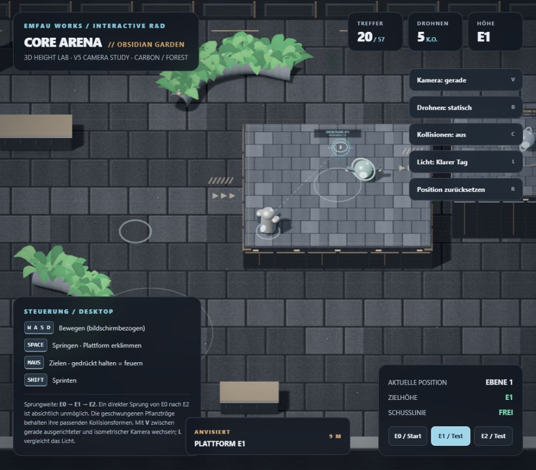
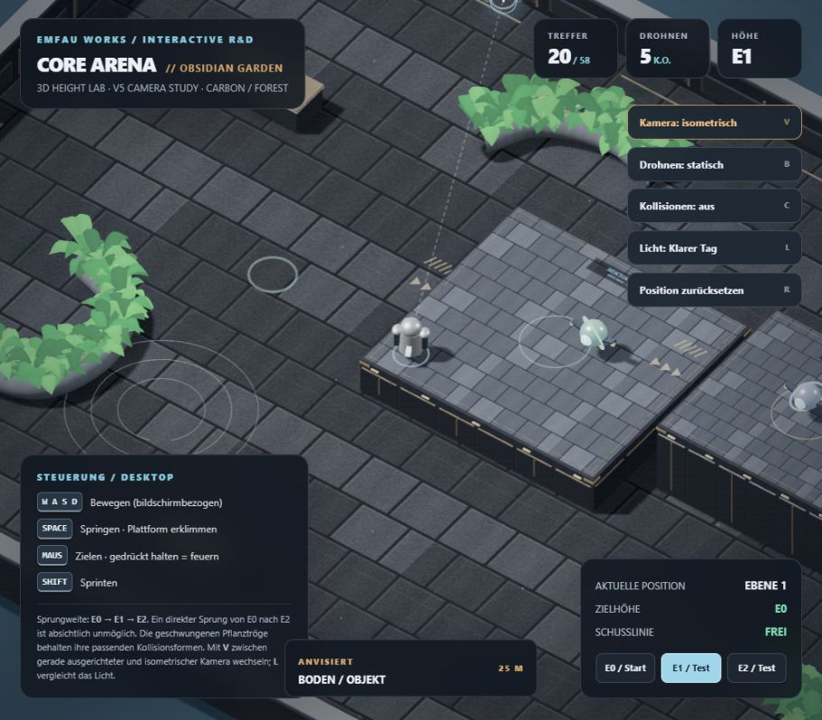

# CORE ARENA 3D Analyse und Übernahme

Stand: 20. Oktober 2026. Status: Planung zur Freigabe. Keine Implementierung.

CORE ARENA 3D sollte die erprobten Regeln und Entwurfsmuster von CTF-3.0 selektiv übernehmen und eine neue räumliche Simulation erhalten. V5 liefert eine brauchbare Referenz für Kamera, Materialwirkung, Bewegung und Höhen-Aiming. Weder ein Austausch des Phaser-Renderers noch das Aufteilen der HTML-Datei genügt als Produktionsarchitektur.

Die zusammengehörigen Ergebnisse sind:

- [Architekturentscheidung](ARCHITECTURE_DECISION.md)
- [Meilensteine und Qualitätssicherung](MILESTONES_AND_QA.md)
- [Erster Umsetzungsauftrag M0](M0_IMPLEMENTATION_BRIEF.md)

## Ausgangsstand und Quellen

Das angegebene Ziel ist **`emfau88/CoreArena-3D`**, exakt mit dieser Schreibweise. Die GitHub-Abfrage vom 20.10.2026 meldete ein leeres Repository; `docs/VISION.md` auf `main` lieferte „This repository is empty“. Die Unterlagen liegen dagegen im lokalen Ordner `Core_Arena_3D_Agent_Starter` und im mitgegebenen ZIP vor. Vor M0 ist der Remote-Stand erneut abzugleichen. In dieser Analyse wurde kein Repository initialisiert, verändert oder veröffentlicht.

Grundlage sind die vollständig gelesenen lokalen Dateien [VISION.md](../VISION.md), [IMPLEMENTATION_PLAN.md](../IMPLEMENTATION_PLAN.md), README und der V5-Prototyp. `AGENT_START_PROMPT.md` wurde als mitgelieferter Kontext gelesen. Maßgeblicher Arbeitsauftrag bleibt die Nachricht des Nutzers: ausschließlich Analyse und Planung, anschließend Freigabe abwarten.

CTF-Quellcode und Tests wurden gezielt über GitHub am festgehaltenen Commit **`9794575fa6241f47845fb85352316564789e8d1c`** untersucht. Ein zusätzlich gesichteter lokaler CTF-Checkout enthält abweichende Arbeitsstände und ist keine Portierungsquelle. Es wurden dort weder Dateien geschrieben noch Tests, Installation, Fetch, Checkout oder Commits ausgeführt.

Die [CTF-README](https://github.com/emfau88/CTF-3.0/blob/9794575fa6241f47845fb85352316564789e8d1c/README.md) und [kanonische Release-Roadmap](https://github.com/emfau88/CTF-3.0/blob/9794575fa6241f47845fb85352316564789e8d1c/docs/CORE_ARENA_RELEASE_ROADMAP.md) wurden berücksichtigt. Die Roadmap beschreibt weiterhin offene Produktabnahme und Apex-Freigabe. Ihre Kopfzeile nennt noch einen älteren Integrationsstand; das ist keine verlässliche aktuelle Branch-Auskunft. Das dortige Verbot eines Enginewechsels betrifft die bestehende 2D-Version und wird nicht als Verbot des ausdrücklich gewünschten separaten 3D-Projekts interpretiert.

## V5 tatsächlich vorhandener Umfang

Referenz: [Core_Arena_3D_Obsidian_Garden_V5.html](../../references/Core_Arena_3D_Obsidian_Garden_V5.html), 844 Zeilen. SHA-256: `74786c9b7a0ac1e228a6d4a9f126d0787f45a7a97046f02bb27a8243e7f84642`.

| Bereich | Befund | Konsequenz |
| --- | --- | --- |
| Darstellung | Three.js 0.145.0 aus CDN; prozedurale Stein-/Metalltexturen, instanzierte Blätter, Schatten und zwei Lichtstimmungen, ab Zeile 105 | Materialabsicht und Gestaltung übernehmen; aktuelle lokale Bibliothek separat visuell abgleichen |
| Kamera | Orthografisch; Standardoffset `(0,52,51)`, alternativ `(30,52,41)`; Übergang und Follow, Zeilen 134–140 und 745–755 | Gute Referenz für Blickrichtung, Bildausschnitt und bildschirmbezogene Eingabe |
| Höhen | Boden E0, Plattformen bei 2,05 und 4,10 Einheiten, Zeilen 320–322 | Geeignete Ausgangsgrößen für das neue Höhenlabor |
| Bewegung | Geschwindigkeit 7,2, Sprint 10,8; vertikale Geschwindigkeit und Gravitation; Bodenauflage über Plattformrechtecke, Zeilen 644–711 | Spielgefühl als Startwert; Kollisionsverfahren ersetzen |
| Schießen | Ein wiederholter Strahltest, 0,125 s Cooldown, Drohnen mit vier Treffern und Respawn; Zeilen 573–642 | Diagnosewaffe, kein fertiges Waffen- oder Matchsystem |
| Höhen-Aiming | Kameraray auf Zielmeshes; bei Drohnen Zielzentrierung auf deren Mitte; separater Mündungsray prüft Deckung | Prinzip zweier Strahlen behalten; automatische Zielzentrierung nicht unbemerkt als präzises freies Aim übernehmen |
| Gegner | Drei statische oder sinusförmig bewegte Drohnen, Zeilen 546–564 und 713–723 | Keine Kampf-Bots, Wegsuche, Teamrollen oder faire Wahrnehmung |
| Physik | Eigene Kreis-/Rechteck-/Kapsel-Auflösung in XZ; Hindernisse werden anhand der Fußhöhe übersprungen; keine vollständige Körper-/Deckenprüfung | Kein allgemeiner 3D-Character-Controller; Überhänge und Körperfreiheit benötigen neue Behandlung |
| Geometrie | Separate Arrays `aimMeshes`, `shootMeshes`, `colliders`; Pflanztröge als sichtbare Röhren und abgetastete Kollisionskapseln | Bereits sinnvoll angenähert, aber noch keine einheitliche räumliche Wahrheit für sämtliche Systeme |
| Laufzeit | Variables, auf 45 ms begrenztes Frame-Delta; neue Aim-Line-Geometrie pro Frame, Zeilen 622–623 und 830–834 | Fester Simulationstakt und wiederverwendete Puffer vor größerem Combat |
| Produktumfang | Keine Spieler-HP, gegnerischen Angriffe, Pickups, Teams, Matchzeit, Matchwertung, Karriere oder Persistenz | V5 ist ein Höhen- und Darstellungsversuch, kein fast fertiges 2v2 |

Die theoretische Sprunghöhe aus `10,8² / (2 × 22,6)` beträgt ungefähr 2,58 Einheiten. Das passt zu Stufen von 2,05 und schließt einen direkten Höhengewinn von 4,10 aus. Diese Rechnung ersetzt keine Prüfung von Anlauf, horizontaler Reichweite, Kanten und Landung.

### Browserbeobachtung in dieser Analyse

Der unveränderte Prototyp wurde über einen lokalen HTTP-Server im eingebauten Chromium-Browser bedient. Beobachtet wurden Szenenstart, beide Kameras, Bewegung auf E1, ein Sprung von der E2-Testposition mit Luftanzeige, die E1-/E2-Testpositionen sowie ein tatsächlicher E0→E1-Sprung mit anschließender Anzeige „EBENE 1“. Vom E0-Start wurde die E1-Drohne mit vier Treffern eliminiert; die Anzeige zeigte `4 / 6` und `1 K.O.`. Eine Abfrage der erfassten Warnungen/Fehler war zu diesem Zeitpunkt leer.

Das ist ein begrenzter Referenzcheck. Ein verlässlich wiederholter E1→E2-Traversal, systematische Deckungsfälle, ein Chrome-/Edge-Vergleich und ein Performanceprofil sind noch nicht abgenommen. Die Testposition-Schaltflächen gelten ausdrücklich nicht als Traversalnachweis. Aufnahmen dokumentieren die Darstellung, nicht die vollständige Spielbarkeit:

## CTF tatsächlich vorhandener Umfang

Der Vorgänger besitzt einen substantiellen rendererunabhängigen Kern: Actor-Lifecycle, Health/Armor, Waffen und Munition, Pickups und Todes-Drops, TDM/CTF/One Flag, Score und Statistik, Botkoordination, Navigation sowie einen separaten Karrierebereich. Die Core-/Adapter-Trennung ist ein gutes Vorbild.

Die räumlichen Verträge sind dennoch 2D: `ActorState.position` und `velocity` enthalten nur `x,y`; `WorldGeometry` enthält Rechtecke und Lücken. `applyJumpMovement` berechnet `sin(progress × π) × height`, statt eine Figur mit vertikaler Geschwindigkeit auf verschiedenen Standflächen zu bewegen. Schuss- und Pickupprüfungen verwenden ebenfalls 2D-Geometrie. Ein zusätzliches `z` im Typ würde diese Annahmen nicht beheben.

Die Laufzeit nimmt ein begrenztes variables Delta entgegen. Die neue 60-Hz-Simulation ist deshalb eine bewusste Weiterentwicklung, keine bereits vorhandene Eigenschaft.

### Übernahmematrix

„Direkt“ bedeutet eine geometriefreie Funktion oder Regel mit angepassten Imports und passenden Tests. Es bedeutet keine unveränderte Kopie kompletter Dateien samt Abhängigkeitsbaum. „Adaptieren“ erhält die Semantik und ersetzt die räumlichen oder infrastrukturellen Verträge.

Alle folgenden Quellpfade beziehen sich auf [CTF-3.0 am Audit-Commit](https://github.com/emfau88/CTF-3.0/tree/9794575fa6241f47845fb85352316564789e8d1c).

| System und Quellpfad | Entscheidung | Konkreter Umfang | Zeitpunkt |
| --- | --- | --- | --- |
| `src/core/scoring/scoreBoard.ts` | **Direkt** | Positive Integer-Punkte, eindeutige Award-Keys, Schutz vor Doppelwertung; isolierte Typen übernehmen | M2 |
| `src/adapters/phaser/desktopWeaponControls.ts` | **Direkt** | Trotz Pfad kein Phaser-Import: Auswahl, Mausrad, Auto-/Einzelfeuer, Fallback; Waffen-IDs vereinheitlichen | M2 |
| `src/core/bots/BotDifficulty.ts`, Archetypen | **Direkt, Teilmenge** | Vier verhaltensbasierte Persönlichkeitsprofile und stabile Identitäten; nicht den kompletten Difficulty-Katalog kopieren | M2/M4 |
| `src/core/actors/actorLifecycle.ts` | **Adaptieren** | Armor vor HP, Spawn-Schutz, genau ein Tod pro Leben, Respawn und Events erhalten; 3D-Spawn, Impulse und Inventarreset neu anbinden | M2 |
| `src/core/modes/TeamDeathmatchMode.ts`, `matchState.ts` | **Adaptieren** | 120 s / 10 Eliminierungen als Startregel; Gleichstand, Zeitende und idempotente Killwertung; an neuen World-State anschließen | M2 |
| `src/core/events/gameEvent.ts`, `src/core/stats/matchStats.ts` | **Adaptieren** | Ereignisfluss und Statistikprinzip; typisierte 3D-Nutzlasten und eindeutige Match-/Tick-/Sequenz-IDs | M2 |
| `src/core/weapons/ArenaWeaponCatalog.ts`, `combat/V1WeaponConfig.ts` | **Adaptieren** | Waffenidentität, Munition, Feuermodus und Cooldowns; Reichweite/Tempo nicht blind von Pixeln in Meter umrechnen | M2 |
| `src/core/combat/v1Weapons.ts`, `NearestValidEnemyResolver.ts` | **Neu räumlich implementieren** | 3D-Mündung, Zielpunkt, zulässiger Zielbereich, Deckung, Projektilstart; Arc-Lash-Zielregel bewusst entscheiden | M1/M2 |
| `src/core/combat/updateProjectiles.ts` | **Neu räumlich implementieren** | Sweeps, erste Kollision, Kugelradius, spätere Explosion und Deckungsprüfung; Damage-/Cooldown-Invarianten übernehmen | M2 |
| `src/core/pickups/updatePickups.ts`, `PickupConfig.ts` | **Adaptieren** | Maxima, Respawn, Teilaufnahme; statt Kreisen echte Trigger mit Höhe und Flächenzugehörigkeit | M2 |
| `src/core/pickups/weaponDeathDrops.ts` | **Adaptieren, später** | Exakte Restmunition und begrenzte Lebensdauer; sichere 3D-Ablage, kein Drop im Fallraum | nach M2, eigener kleiner Auftrag |
| `src/core/actors/actor.ts`, `movement/*`, `world/worldGeometry.ts` | **Neu** | Vec3, Kapsel, Standfläche, Gravitation, Luftsteuerung, Körperfreiheit, Kollision und Sturz | M0/M1 |
| `src/core/runtime/GameplayCoreRuntime.ts` | **Adaptieren als Muster** | Input → Simulation → Events/Snapshot behalten; feste Ticks und definierte Reihenfolge neu | M0–M2 |
| `src/core/bots/BotTargetSelector.ts` | **Adaptieren** | Gedächtnis und Zielbindung erhalten; Sicht-/Näheprüfung auf 3D und beobachtbare Daten beschränken | M2 |
| `src/core/bots/BotDifficulty.ts`, Difficulty-Werte | **Adaptieren** | Reaktion, Streuung, Vorhalt und Entscheidungstakt neu kalibrieren; notwendige Sprünge auf allen Stufen erlauben | M2 |
| `src/core/bots/BotDecisionUtility.ts`, `BotStrategicPlanning.ts` | **Adaptieren** | Utility-Wahl, Bindung und Notfallübersteuerung; 3D-Distanz, Wegkosten und Ressourcenverfügbarkeit | M2/M3 |
| `src/core/bots/BotTeamCoordinator.ts`, Modus-Controller | **Adaptieren** | Rollen, Rollenbindung, Runner/Escort/Defender und begrenzte Notfallreaktion; keine alten Koordinaten/Mapsonderfälle | M2/M3 |
| `src/core/bots/GridBotNavigator.ts`, `BotLocalMovement.ts` | **Neu** | Navigation je begehbarer Fläche, gerichtete Verbindungen, validierte Sprünge und 3D-Ausweichen; Recovery-Prinzip übernehmen | M1-Probe/M2 |
| `src/core/world/maps/*`, `worldMapValidation.ts`, `worldMapQuality.ts` | **Neue Karten und Validatoren** | Gemeinsame Arena-Beschreibung, Clearance, erreichbare Ressourcen, alternative Routen; keine Extrusion alter Hintergrundbilder | M0–M3 |
| `src/core/modes/ClassicCtfMode.ts`, `OneFlagMode.ts`, `objectives/*` | **Adaptieren** | Zustandsautomaten, Drop/Return/Capture, Trägerwechsel; 3D-Berührung und sichere Rückgabe neu | M3 |
| `src/meta/league/leagueSeason.ts`, `leagueCareer.ts`, `leagueCatalog.ts` | **Adaptieren, zurückstellen** | Tabellen-/Ergebnis-/Recruitmentregeln; neue Map-IDs, kleiner Circuit, injizierte Uhr; keine komplette Sechs-Match-Karriere | M4 |
| `src/meta/league/leagueStorage.ts`, `src/careerSaveGuard.ts` | **Adaptieren, zurückstellen** | Revision, atomarer bestätigter Zustand und Idempotenz; eigenes Saveformat und eigener Namespace | M4 |
| `src/adapters/*` Ports | **Muster übernehmen** | Schmale Grenzen für Input, Rendering, Audio und Diagnose; nur aktuell benötigte Ports anlegen | ab M0 |
| `src/adapters/phaser/*` Renderer, HUD, Kamera, Audio | **Neu** | Three-Darstellung und kompaktes HTML-HUD; Phaser-Szenen und Spriteeffekte passen nicht | M0–M3 |
| 2D-Maps, Fighter-Sprites, bestehende WAVs | **Vorerst weglassen** | Geprüfte Gestaltungsideen nutzbar; 2D-Assets ersetzen keine 3D-Welt; Audioherkunft einzeln klären | später |
| Mobile, Portale, Steam, Accounts, Multiplayer, Apex | **Vorerst weglassen** | Keine frühe Infrastruktur oder Platzhalterprodukte dafür bauen | nach Produktvalidierung |

### Wertvolle Tests und ihre Grenzen

| Vorhandene Tests | Was übernommen werden sollte | Was neu nachgewiesen werden muss |
| --- | --- | --- |
| `tests/desktop-weapon-controls.test.ts` | Auswahl, Wrap-around, verfügbare Waffen, Klick/Halten, Priorität | Neuer Inputadapter und echte Browserbedienung |
| `tests/gameplay-core.smoke.test.ts`, `tests/p0-gameplay.test.ts` | Countdown, Cooldowns, Matchende, Score, Lifecycle als fachliche Fälle | Tests aus großen Alt-Fixtures lösen; neue 3D-Welt und feste Ticks |
| `tests/death-weapon-drops.test.ts`, `tests/arena-weapon-expansion.test.ts` | Inventar-/Munitionsinvarianten und später Dropregeln | Höhen, Deckung, Sweeps und sichere Dropflächen |
| `tests/bot-ai-v2.test.ts` | Reaktionsverzug, Utility-Bindung, Rollen, Gedächtnis, Recovery | Keine übernommenen Erwartungen wie „Easy springt nie“; Höhen- und Sichtfälle |
| `tests/bot-simulation.test.ts`, `tests/premium-bot-audit.ts` | Seed-Szenarien, Langläufe, Entscheidungs-Traces und messbarer Fortschritt | Neue Map-/Difficulty-Matrix und reale Captures |
| `tests/bot-traversal-smoke.test.ts` | Jede freigegebene Verbindung einzeln befahren | Derselbe 3D-Motor wie beim Menschen, Abbruch und Wiederanlauf |
| `tests/e2e/premium-arenas.spec.ts` | Ladefehler, sichtbarer Canvas, passende Assets | Canvas-Sichtbarkeit beweist keine Bewegung, Treffer oder gespielte Matchrunde |
| `tests/e2e/career-flow.spec.ts` | Menüs, Recruitment und Persistenz | `finishLeagueMatch` injiziert Resultate über `v2-match-state`; zusätzlich echte Matchdurchläufe erforderlich |
| `tests/career-save-safety.test.ts`, `tests/career-progression-core.test.ts` | Revisions-/Doppelresultat-/Fehlerfälle | Eigener Namespace und neue 3D-Kataloge, erst M4 |

Die alten Tests wurden für dieses Audit gelesen, nicht erneut ausgeführt. Historisch dokumentierte grüne Läufe werden nicht als aktueller oder neuer 3D-Testnachweis ausgegeben.

## Vier Entscheidungen mit besonderer Tragweite

1. **Arc Lash ist im Original automatisch zielwählend.** `fireWhip` wählt über `resolveNearestValidEnemy`; das Mouse-Aim bestimmt dort nicht den Treffer. Vorschlag für M2: unbegrenzte kurze Arc Lash mit begrenztem Zielkegel um das Mausziel und echter 3D-Sichtprüfung. Das ist eine explizite Gameplay-Anpassung zugunsten der gewünschten Aim-Präzision und vor M2 im Spieltest zu bestätigen. Alternative wäre die alte Rundum-Zielhilfe mit deutlich geringerer Aim-Bedeutung.
2. **Easy darf die Höhenwelt nicht verlieren.** Der alte Wert `canUseJumpLinks: false` würde in einer neuen Karte wichtige Ebenen und Objectives unzugänglich machen. Alle Stufen erhalten notwendige sichere Wege; Easy wählt weniger riskante Abkürzungen und reagiert langsamer.
3. **Saves müssen das alte Spiel schützen.** Beide GitHub-Pages-Projekte liegen bei Veröffentlichung unter demselben Origin `emfau88.github.io`. Neue Schlüssel beginnen mit `core-arena-3d.`; kein `localStorage.clear()`, kein automatischer Import und kein Schreiben in `core-arena.*`.
4. **Audio ist nicht automatisch freigegeben.** Die [Provenienzdatei](https://github.com/emfau88/CTF-3.0/blob/9794575fa6241f47845fb85352316564789e8d1c/docs/ASSET_PROVENANCE.md) hält für die 17 bestehenden WAV-Dateien fehlende belastbare Einzelnachweise fest. Für den ersten Slice nur neue oder einzeln belegte kurze Sounds verwenden; vorhandene Dateien nicht pauschal kopieren.
