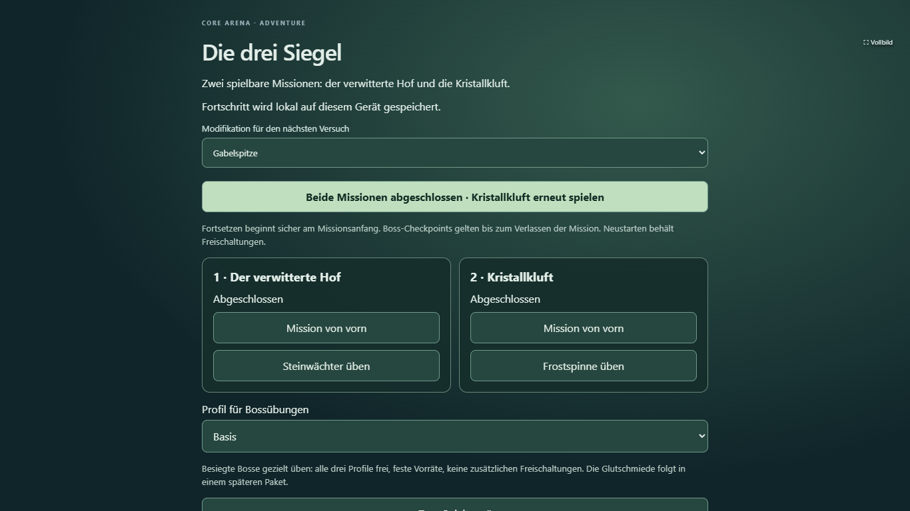
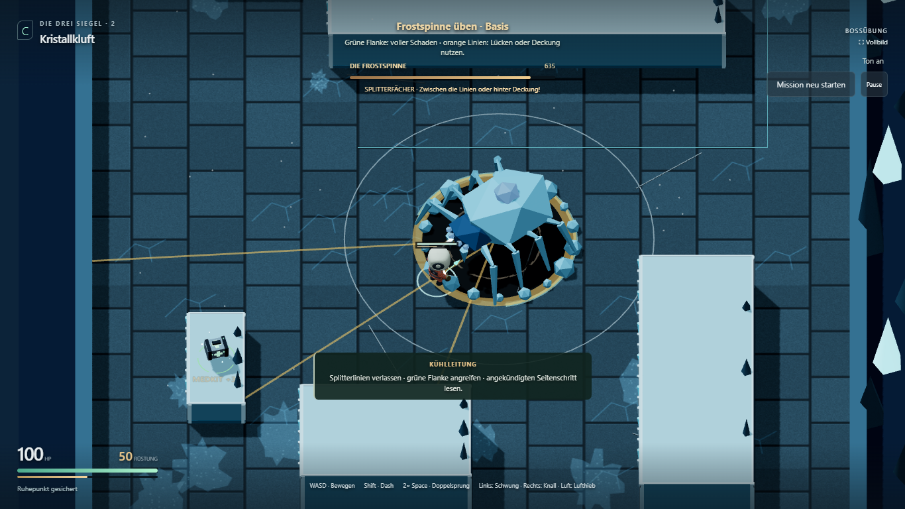
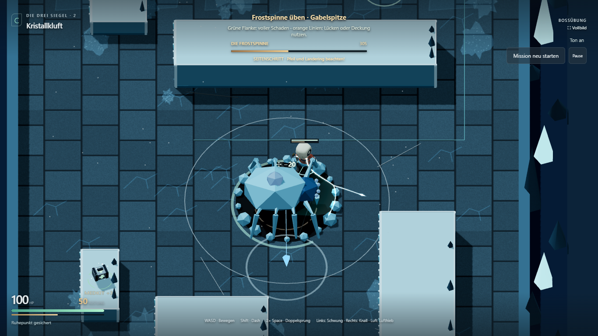
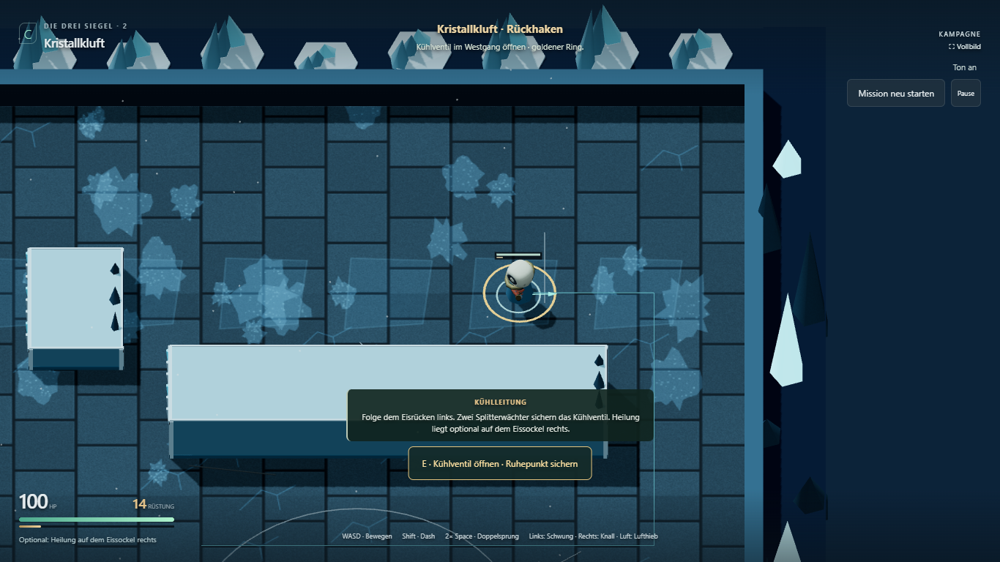
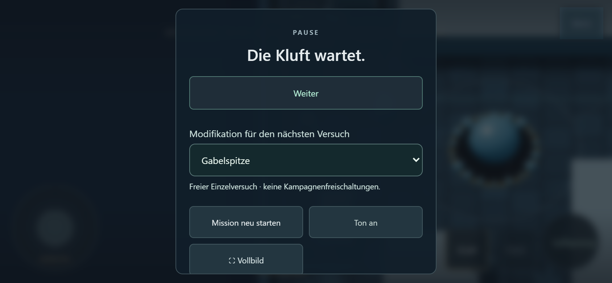

# Adventure A8.3 und A9.1–A9.2

Stand: 6. November 2026. Branch `codex/adventure-environment-test`.

## Ergebnis und Freigabe

Der Nutzer hat die empfohlenen Meilensteinfreischaltungen und anschließend A8.3,
A9.1 und A9.2 ausdrücklich beauftragt. Die Freischaltungs-/Save-Grundlage wurde
zuerst als `e13217b` committed und gepusht; die Kampagnenoberfläche und Frostpakete
folgen darauf. F bleibt die erste Mission. Kamera, Links-nach-rechts-Steuerung,
Dash, Doppelsprung und Peitschenbewegungen behalten ihre bisherigen Regeln.

Dieser Auftrag zieht den Ausbau vor die noch offenen menschlichen Urteile vor.
**G2/G3/G4 und T3/G5 sind damit nicht bestanden.** Technische Tests mit
automatischen Tastatur-/Mauseingaben ersetzen keinen menschlichen Spieltest.
Glutwurm, dritte Mission und finaler Release gehören weiterhin zu A10/A11.

## Spielen

- [Kampagnenmenü: beginnen, fortsetzen, Mission neu starten, Boss üben](https://emfau88.github.io/CoreArena-3D/adventure-environment/?mode=pve&adventure=1&combat=prototype&campaign=menu)
- [Kristallkluft direkt testen, ohne Save oder Freischaltung](https://emfau88.github.io/CoreArena-3D/adventure-environment/?mode=pve&level=frost&adventure=1&combat=prototype&trial=frost-mission)
- [Frostspinne allein testen](https://emfau88.github.io/CoreArena-3D/adventure-environment/?mode=pve&level=frost&adventure=1&combat=prototype&trial=frost)

Handy: im Querformat spielen. Das Kampagnenmenü funktioniert auch im Hochformat.
Diese Links verwenden dieselbe aktuelle Vorschau; es entstehen keine weiteren
Umgebungsvarianten. Arena/Legacy und die ältere T2-Vorschau bleiben separat.

## Freischaltung und Speicherung

| Ereignis | Dauerhaftes Ergebnis |
|---|---|
| Start | Basisprofil verfügbar |
| Steinwächter besiegt | Rückhaken und Stein-Bossübung verfügbar |
| Hofausgang erreicht | Kristallkluft und Fortsetzen in Map 2 verfügbar |
| Frostspinne besiegt | Gabelspitze und Frost-Bossübung verfügbar |
| Kluftausgang erreicht | Beide Missionen abgeschlossen; Wiederholung möglich |
| Tod / Missionsneustart | Keine Freischaltung geht verloren |

Ein Profil wird für den **nächsten** Versuch gewählt. Eine Auswahl im Pausenmenü
ändert den laufenden Kampf nicht. Übungen besiegter Bosse bieten alle drei Profile
mit festen 100 HP / 50 Rüstung. Übungen und freie Einzeltests schreiben keine
Kampagnenbelohnungen. Es gibt keine Währung, Kaufkosten oder Stat-Upgrades.

`corearena.adventure.prototype.campaign.v1` enthält ausschließlich `version`,
`completed`, `defeated`, `next` und `selectedMod`. Verfügbare Mods werden aus
Bossmeilensteinen abgeleitet. HP, Position, Gegnerzustände und Sitzungscheckpoints
werden nicht gespeichert. Fortsetzen startet sicher am Missionsanfang.

Der Decoder akzeptiert nur bekannte IDs und eine gültige Missionsreihenfolge.
Defektes JSON startet sicher neu. Eine unbekannte Version wird nicht überschrieben.
Verweigerter oder voller Speicher blockiert das Spiel nicht; die Oberfläche meldet
den Ausfall. Kartenwechsel innerhalb der laufenden App erhalten den Fortschritt
auch dann im Speicher. Ein vollständiger Reload ohne funktionierenden lokalen
Speicher kann ihn nicht erhalten. Es gibt keine Cloud-/Gerätesynchronisierung.

## Frostspinne: eigenes Kampfprofil

Die bestehende Frostgeometrie und das vorhandene prozedurale Spinnenmodell werden
weiterverwendet. Der Legacy-Boss behält sein bisheriges Profil mit 650 HP; die neue
Adventure-Frostspinne hat 720 HP und ein explizites `frostProfile`.

| Regel | Adventure-Frost |
|---|---|
| Splitterfächer | Drei gebundene Richtungen bei −0,6 / 0 / +0,6 rad; 72 Ticks Warnung, 32 Schaden; reale Deckung und ausreichende Sprunghöhe schützen |
| Biss | Schmale, gebundene Spitze (±0,55 rad); 42 Ticks Vorbereitung, 6 aktive Ticks, 28 Schaden; anschließend Gegenangriff |
| Kristallausbruch | 72 Ticks Vorwarnung, Zielposition bleibt gebunden; 35 Schaden, Radius 2,4 m plus vorhandene Spielertoleranz |
| Flanke | Ab 60° seitlich/hinten voller Schaden; frontal außerhalb der Erholung 15 %; grüne Bodenmarkierung |
| Seitenschritt | Eine zusätzliche Bewegungsregel nach Ausbruch/Erholung: 42 Ticks Warnung, 24 Bewegung, 42 Erholung; höchstens 4,2 m |

Alle Angaben basieren auf 60 festen Simulationstakten pro Sekunde. Der Seitenschritt
prüft Boden, Hindernisse und Spielerabstand. Bei nachträglicher Blockade bricht er
in Erholung ab; kein Durchspringen oder nachträgliches Aufholen der Strecke.

### Sieben Darstellungskriterien: technische Vorprüfung

| Kriterium | Vorhandener Nachweis / Grenze |
|---|---|
| Vorbereitung, Aktivzeit, Erholung | Warnformen und Animation hängen an denselben Phasen/Ticks wie Schaden; Biss, Fächer, Ausbruch und Schritt durch Regeltests und aufgezeichnete Browsersequenzen geprüft |
| Eigenständige Bewegung | Achtbeinige Silhouette, seitliche Schwachstelle und markierter Seitenschritt unterscheiden sich vom Steinwächter |
| Gewicht / Bodenkontakt | Abwechselnde Beinpaare beim Laufen, Absenken beim Aufladen und Setzen in der Erholung; bestehendes Rig, keine neue Animationsdatei |
| Trefferreaktion | Körperrückstoß, Peitschenkontakt und geschützter/voller Schaden werden angezeigt; HP sinken erst bei echten Kontakten |
| Silhouette / Gefahr | Schmale Bissspitze, drei einzelne Splitterlinien, Ausbruchkreis und Bewegungsziel; verdeckende alte Zielkugeln aus der neuen Ansicht entfernt |
| Ton | Drei getrennte synthetische Frost-Cues für Vorbereitung, Auslösung und Schritt; AudioContext und Pegel technisch erfasst. Klangqualität ist noch menschlich zu beurteilen |
| Konsistenz | Bestehende Kristall-/Eismaterialien und gemeinsame Peitschen-/Trefferdarstellung; normale Seitenkamera und Touch-Ansicht geprüft |

Die Bilder und gespeicherten Videos sind Vorprüfmaterial, kein subjektives
Lesbarkeits-, Schwierigkeits- oder Animationsurteil einer Testgruppe.

## Kurze Kluftmission

Der vorhandene Grundriss bleibt erhalten. Zwei stationäre Splitterwächter bereiten
das Verlassen einer gebundenen Schusslinie beziehungsweise Nutzen von Deckung vor.
Jeder hat 72 HP, eine Sekunde Warnung und einen langsamen einzelnen Splitter
(18 Schaden). Solange dieser fliegt, wird keine neue Richtung gebunden.

Der Hauptweg führt um den westlichen Eisrücken zum Kühlventil. Nach beiden Wächtern
lässt es sich am goldenen Ring öffnen. Es stellt 100 HP / mindestens 50 Rüstung her
und aktiviert den Sitzungscheckpoint im Zentralhof. Dort startet der Boss. Retry
überspringt die Anreise und setzt Boss sowie Ressourcen frisch zurück. Die Heilung
auf dem Eissockel und die vorhandene Rüstung bleiben optionale Abstecher.

Nach dem Bosssieg öffnet sich der markierte Ausgang im Nordosten. Erst sein Betreten
schließt die Mission ab. Es gibt keine zweite Konsole-Kern-Relais-Kette und keine
zusätzliche erforderliche Bewegungsfähigkeit. Nach Map 2 führt der Button zurück
zur Kampagne, solange die Glutschmiede noch nicht umgesetzt ist.

## Prüfung

- `npm test`: **125/125** bestanden. Enthalten sind Save-Whitelist, doppelte
  Meilensteine, fremde Schlüssel, defekte/unbekannte/verweigerte Speicherung,
  Frostwinkel, gebundene Bissrichtung, echte Deckung, Schrittblockade,
  Wächterprojektil, Checkpoint/Reset, Legacy-Isolation und 30/60/144-Hz-Replays.
- Typecheck und Environment-Testbuild bestanden. Der bestehende große
  Physik-/Rendererchunk bleibt ein späteres Ladebudget-Thema.
- Vollständiger Browserlauf mit echten Eingaben: Stone-Anreise → Boss → Kern/
  Relais/Ausgang → Frost → Reload/Fortsetzen → freie Steinübung mit Gabelspitze
  ohne Änderung des Kampagnenprofils → Rückhakenwahl → Frost-Anreise/Ventil →
  echter Tod → Checkpoint-Retry → Frostsieg → Ausgang → Reload → Gabelspitze.
- Getrennte Basis-/Gabelspitzen-Siege gegen Frost; beide freien Versuche hinterlassen
  keinen Kampagnen-Save. Kein Test setzt Boss-HP oder einen Sieg im Browser.
- Legacy-Frost mit 650 HP und Arena-Training starten weiterhin. Eine stumme
  Frost-Gegenprobe mit Angriffen ohne Bewegung endet durch regulären Schaden im Tod;
  bloßes Klicken ersetzt die geprüften Ausweichreaktionen in diesem Fall nicht.
- Browser-Savefälle: leer, beschädigt, unbekannte Version, verweigerter Zugriff und
  schreibgeschützter/voller Speicher; Fehleranzeige und Navigation bleiben nutzbar.
- Touch-Emulation 844×390: Sprung, Angriff, Auswahl erst beim Neustart, zehn Resets,
  Hochformatpause, Rückkehr in beide Menüs. Nach Aufwärmen stabil **86 Geometrien /
  14 Texturen** bei den zehn Frostneustarts; kein Wachstum. Menüs bleiben scrollbar.

Die regelbasierten Frostkämpfe dauerten einschließlich Auftauchen rund **20,5 s mit
Basis**, **22,8 s mit Gabelspitze**, **27,2 s mit Rückhaken nach Retry**. Alle endeten
bei 100 HP / 50 Rüstung. Diese präzise reagierenden Testläufe beweisen Erreichbarkeit,
keine faire menschliche Schwierigkeit und keine Rangfolge der Mods. Die Gegenangriffe
nutzen auch den unveränderten Überkopf-Knall; es ist kein reiner Seitenschwungvergleich.

Im Frostkampf wurden ungefähr 24.200 Dreiecke und 418–428 Renderaufrufe erfasst.
Das sind Ressourcenstichproben, keine FPS-Zusage für Mobilgeräte. Echte Android-/
iPhone-Prüfung, menschliche Erstlesbarkeit und abschließende Balance bleiben offen.

Reproduzierbare Browserfälle: `tests/e2e/adventure-campaign.spec.ts` mit
`adventureCampaignControls.ts`; lokale Testserver wie in der README. Diagnosezugang
ist ausschließlich im Testbuild vorhanden. Videos, Phasenbilder und JSON-Traces
liegen nach dem Lauf unter `test-results/`; die oben eingebetteten Bilder sind versioniert.

## Einordnung

A8.3 und A9.1/A9.2 sind technisch fertig. Die Roadmap zählt damit 16 technisch
fertige, zwei menschlich offene und acht noch nicht begonnene Pakete. Als nächster
Inhaltsblock ist A10.1 vorgesehen. Es werden keine neuen Assets aus fremden Spielen
übernommen und keine weitere Umgebungsvariante neben F eingeführt.
