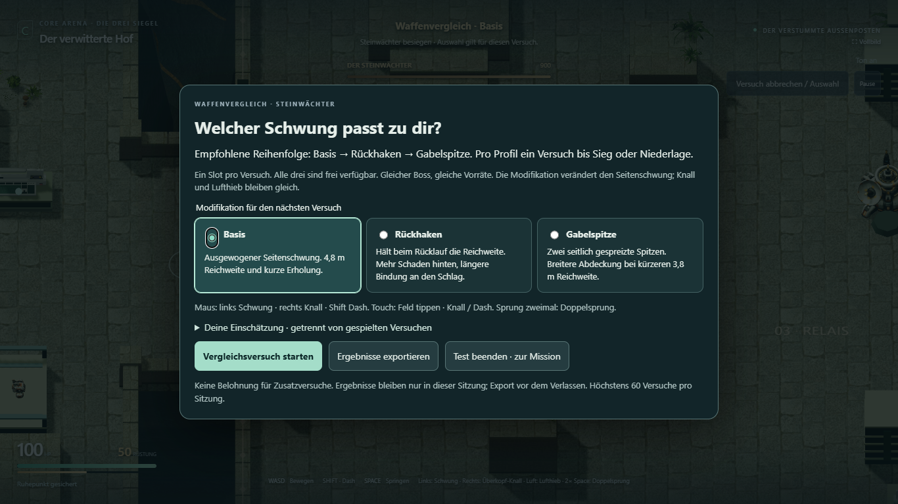
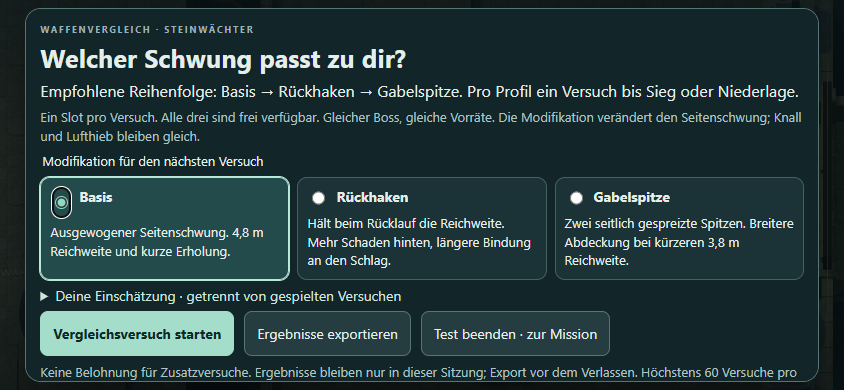

# A8.1 / A8.2 – Begrenzter Waffenvergleich

Stand: 6. November 2026. Auftrag: „mach weiter mit A8.1 - A8.2“.
Eigener Vergleich in der gewählten Umgebung **F · Wächterklamm**, auf
`codex/adventure-environment-test`. Kamera und Links-nach-rechts-Führung bleiben erhalten.
Dieser Auftrag erlaubt den begrenzten Versuch bereits jetzt; er ersetzt kein
menschliches G2-/G3-Urteil aus A7.2. Es entstehen keine zusätzlichen Umgebungsvarianten.

[Waffenvergleich spielen](https://emfau88.github.io/CoreArena-3D/adventure-environment/?mode=pve&level=stone&adventure=1&combat=prototype&environment=warden-ravine&trial=mods)
· [Normale Mission F](https://emfau88.github.io/CoreArena-3D/adventure-environment/?mode=pve&level=stone&adventure=1&combat=prototype&environment=warden-ravine)

## Umfang und Regeln

Ein Slot vor jedem Versuch, Basis plus zwei Alternativen. Die normale Mission
startet weiterhin mit der Basis. Im Entwicklungs-Bosslabor gibt es ebenfalls
die Mod-Auswahl. Nur der Seitenschwung ändert sich; Überkopf-Knall, Lufthieb,
Sprung, Dash und Bossregeln bleiben gleich. Alle Größen unten sind Regelwerte
vor der Schadensminderung des geschützten Bosskerns, keine gemessenen DPS.

| Profil | Mechanischer Unterschied | Preis / Nachteil | Maximales Budget pro Ziel und Schwung |
|---|---|---|---|
| Basis | Bisheriger Schwung, maximal 4,8 m Stranglänge; Rücklauf zieht auf 2,2 m ein | Weniger Abdeckung der äußeren Flanke im späten Rücklauf | 22 vorwärts + 14 rückwärts; 42 Ticks / 0,70 s |
| Rückhaken | Hält im Rücklauf 4,5 m; Rückfenster Ticks 25–39 statt 21–31 | Nur 12 Vorwärtsschaden; späterer Rücktreffer, nächster Angriff erst nach 54 Ticks / 0,90 s | 12 + 24; kein zusätzliches Gesamtschadensbudget |
| Gabelspitze | Zwei Spitzen, ab 62,5 % Stranglänge bis ±0,28 rad gespreizt | Kürzere 3,8 m Stranglänge, kleineres Schadensbudget; näher herangehen | 20 + 12 insgesamt, auch wenn beide Spitzen dasselbe Ziel treffen; 42 Ticks / 0,70 s |

Rückhaken verlangt, den späteren äußeren Rücklauf auf das Ziel auszurichten.
Gabelspitze erreicht seitlich liegende Ziele bei kürzerer Distanz und verlangt
eine nähere Position. Regeltests zeigen diese Raumunterschiede mit konkreten
Trefferpunkten; ob sie am großen Steinwächter interessant genug sind, bleibt
eine menschliche Frage. Die Gabel hat bei großen Einzelzielen möglicherweise
zu wenig Nutzen. Das ist ein Kürzungskandidat, kein Anlass für weitere Mods.

Beide Mods lassen sich durch Dash/Pause abbrechen. Die verbleibende Erholungszeit
bleibt dabei erhalten. Beide Stränge werden vom gemeinsamen Ursprung an durch
echte Weltkollision gekürzt; ein Hindernis vor der Gabelung blockiert beide.
Trefferlisten werden je Ziel und Phase geteilt. Die zweite Spitze verwendet
dieselbe Geometrie für Darstellung und Treffer, mit sechs zusätzlichen sichtbaren
Segmenten und ohne verdoppelten Stamm. Keine externen Assets, kein zusätzlicher
Texturdownload und kein allgemeines Inventarsystem.

## Vergleichsablauf

Jeder Start erzeugt frische Simulation, Waffen-, Bewegungs- und Kampfzustände:
Steinwächter mit 900 LP, Spieler mit 100 LP / 50 Rüstung, gleicher Startpunkt,
gleiche ursprüngliche Vorräte, keine Pulse-Ergänzung. Die Anreise ist bereits
erledigt. Auswahl nur zwischen Versuchen; die Auswahloberfläche hält den Kampf
an. Sieg oder Niederlage beendet den Versuch, ein Neustart protokolliert Abbruch.

Nach je einem beendeten Versuch pro Profil wird der Start ausdrücklich zu
**„Freiwilligen Zusatzversuch starten“**. Niemand muss ihn benutzen. Abgebrochene
Pflichtversuche zählen nicht als abgeschlossen. Zusatzstarts, abgeschlossene
Zusatzversuche, Profilwahl und Freitextgründe werden getrennt erfasst. Eine
geäußerte Wiederholungsabsicht und eine bevorzugte Freischaltregel stehen in
eigenen Feldern und werden nicht als gespielte Wiederholung gewertet.

Ergebnisse existieren nur im Arbeitsspeicher der Sitzung; JSON-Export per Knopf.
Für Mods und Ergebnisse kein Local Storage oder Savegame; kein Loot, RNG, Kauf,
Grind oder Online-Telemetrie.
Beim Neuladen/Verlassen gehen nicht exportierte Ergebnisse verloren. Die Sitzung
ist auf 60 Versuche begrenzt. Der Export enthält den Build-Commit und Sourcehash.

## A8.2: aktueller Entscheidungsstand

**Aktualisierung nach Nutzerentscheidung vom 6. November 2026:** „ok so umsetzen
comitten und pushen und dann weiter mit a8.3 un dan a9.1 - a9.2“. Damit sind
Meilensteinfreischaltungen gewählt und ihre Umsetzung freigegeben: Rückhaken
nach Steinwächter, Gabelspitze nach Frostspinne, ein Slot vor dem nächsten Versuch,
dauerhaft auf diesem Gerät, Basis immer verfügbar. Bossübungen erlauben alle Mods.
Die folgende ursprüngliche Vergleichsbeschreibung bleibt als Testprotokoll erhalten;
die drei menschlichen Nutzenbefunde wurden noch nicht erhoben. G4 wird deshalb
nicht als menschlich bestanden geführt. Der Mod-Vergleich bleibt frei zugänglich.

Erster Implementierungsschritt: idempotente Meilensteinregeln, Auswahl im Pausen-
und Retrymenü, Freischalthinweis beim Steinwächter-Sieg sowie kleiner versionierter
Save-Adapter. Fortsetzen und Bossübungszugänge folgen im unmittelbar beauftragten
A8.3-Paket. Regel-/Speicherfehlerfälle und Typecheck sind geprüft.

**Für den ursprünglichen Versuch festgelegt:** sofortige freie Auswahl aller drei Profile,
keine Progression. **Die endgültige Produktentscheidung ist offen.** Es gibt noch
keine drei menschlichen Vergleichsbefunde und keinen positiven G4-Entscheid.
Eine Freischaltökonomie wird damit nicht vorweggenommen.

| Mögliches Endmodell | Zu prüfender Nutzen | Konkrete Regel bei späterem Auftrag |
|---|---|---|
| Nur Basis | Sind die Alternativen verzichtbar? | Beide Mods und Auswahl streichen |
| Freie Auswahl ohne Progression | Entstehen verschiedene freiwillig gewählte Spielweisen? | Alle drei vor jedem Versuch frei, Basis immer verfügbar |
| Deterministische Meilensteine | Verbessert eine gestaffelte Einführung die Kampagne? | Rückhaken nach Boss 1, Gabelspitze nach Boss 2; ein Slot vor jedem Versuch; Tod nimmt nichts weg |

Keine Kosten für Niederlagen. Die Meilensteinfrage ist zunächst hypothetisch:
ein funktionierender Drei-Boss-Kampagnenlauf ist noch nicht vorhanden. Sie darf
nicht als gemessener Motivationsgewinn ausgegeben werden. Bei fehlendem Nutzen
Mods vereinfachen oder streichen. Speicherung gehört zu A8.3 und braucht für
Mods zusätzlich den positiven G4-Entscheid sowie einen eigenen Auftrag. Falls
Mods bleiben, müssen Basis und beide Varianten an allen späteren Bossen geprüft
werden; Basis bleibt überall siegfähig.

## Menschlicher T3-Vergleich – vorbereitet, noch offen

Mindestens drei Personen, derselbe Build und vergleichbare Eingewöhnung.
Je Person zunächst jedes Profil bis Sieg/Niederlage, Reihenfolge wechseln:

| Person | Linkparameter | Empfohlene Reihenfolge | Menschlicher Befund |
|---|---|---|---|
| 1 | `trial=mods&order=1` | Basis → Rückhaken → Gabelspitze | Offen |
| 2 | `trial=mods&order=2` | Rückhaken → Gabelspitze → Basis | Offen |
| 3 | `trial=mods&order=3` | Gabelspitze → Basis → Rückhaken | Offen |

Danach ein gleich langes freiwilliges Fenster anbieten, ohne Belohnung und ohne
zum Weiterspielen zu drängen. Beobachten: tatsächliche Zusatzstarts/-abschlüsse,
Profilwahl, Positionswechsel, bewusstes Rücktreffen, Abbrüche. Separat fragen:
Was war anders? Warum dieses Profil? Würdest du noch spielen? Welche Auswahlregel
passt besser? Ergebnisse exportieren, Gerät/Testerkennung separat und anonym
im Testprotokoll ergänzen. Keine Namen werden vom Spiel erhoben.

G4 erst mit Nutzerentscheidung schließen: ein Modell samt Regel oder bewusster
Verzicht. Agentenläufe und geäußerte Absichten ersetzen die drei Personen nicht.

## Technische Prüfung

115 Regeltests bestanden, darunter acht neue Mod-/Versuchsregelfälle; Typecheck
und Environment-Testbuild erfolgreich. Drei Browserfälle in Chrome bestanden:
zehn Neustarts über die echte Oberfläche mit identischen Start-Snapshots,
Bossvergleich mit Export sowie Touch-Auswahl/Angriff/Abbruch in 844 × 390.

| Agentenlauf | Ergebnis | Gesamte Simulationszeit einschließlich Auftauchen | LP / Rüstung am Ende | Vorwärts- / Rücktreffer |
|---|---|---|---|---|
| Basis | Sieg | 47,62 s | 100 / 50 | 44 / 17 |
| Rückhaken | Sieg | 48,17 s | 95 / 0 | 41 / 25 |
| Gabelspitze | Sieg | 48,37 s | 100 / 50 | 40 / 22 |

Normale Maus-/Tastatureingaben, kein Setzen von HP, Position oder Waffenstatus.
Gemischte Angriffe einschließlich unverändertem Knall/Lufthieb; bei Gabelspitze
ging die Steuerung näher heran. Ein Durchlauf pro Profil ist ein Funktions- und
Basis-Siegnachweis, keine belastbare Balancerangliste. Die getrennten Regeltests
belegen speziell die veränderten Seitenschwünge. Anschließend wurde ein freiwilliger
Gabelstart abgebrochen: korrekt als **1 gestartet / 0 abgeschlossen** exportiert.
Das ist ein technischer Prüffall, kein menschlicher Wiederholungswunsch.

Der erste automatisierte Basislauf verlor; die Teststeuerung sprang zu spät und
kehrte bei Bodenausbrüchen zur Gefahrenstelle zurück. Die Teststeuerung wurde
korrigiert; die Spielregeln wurden dafür nicht abgeschwächt.

[Export dieses Agentenvergleichs](adventure-a8/agent-comparison.json).
Der Export nennt den geprüften Sourcehash; danach wurde nur noch die kompakte
Auswahlansicht für kurze Touch-Displays angepasst und separat erneut geprüft.

Reproduzierbare Fälle: `tests/adventure-mods.test.ts` und
`tests/e2e/adventure-mods.spec.ts`. Keine echten Handy-Leistungsdaten und noch
kein menschlicher Spaß-/Balancebefund.
