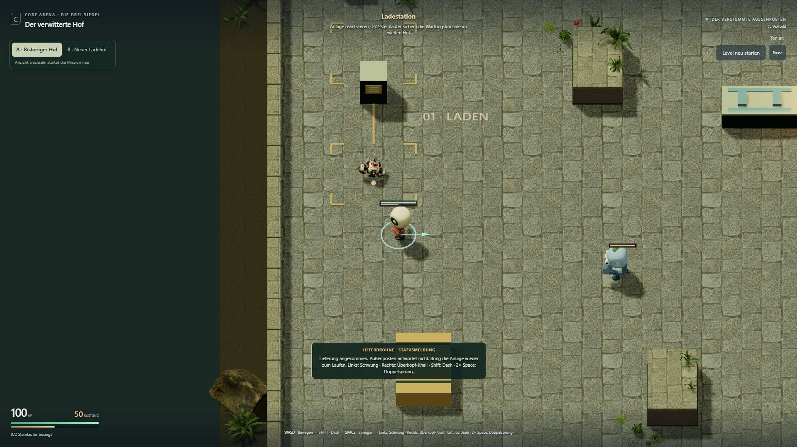
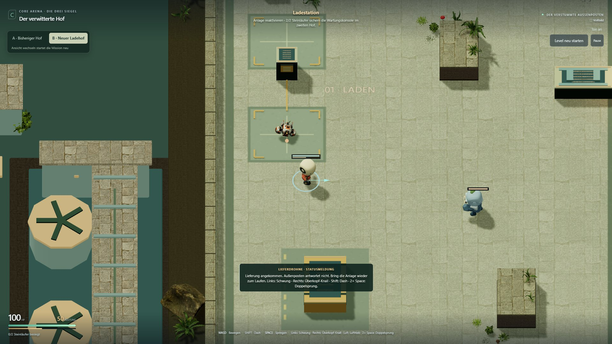
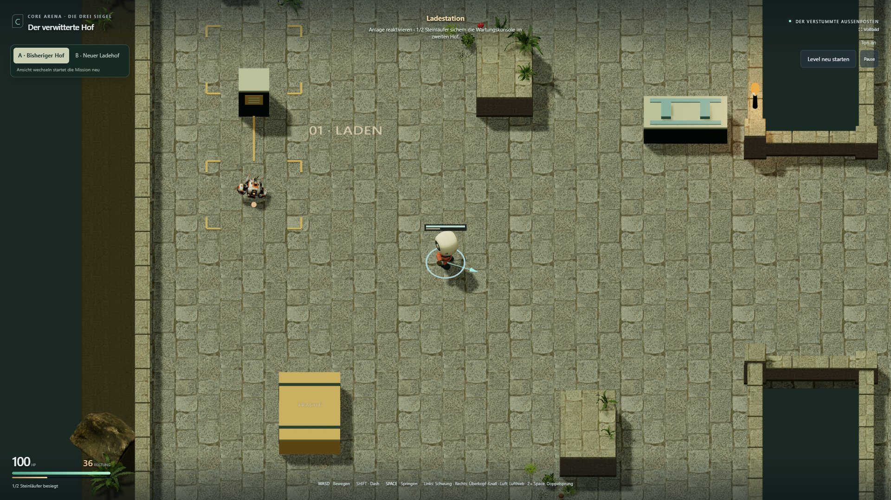
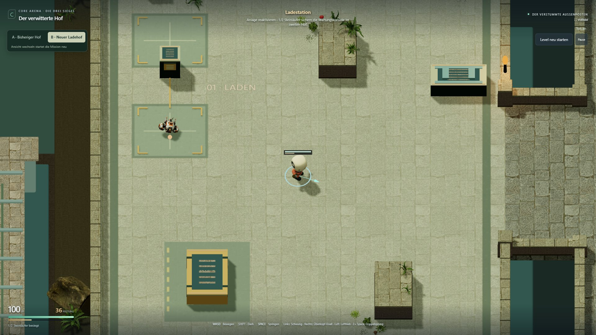

# Isolierter Ladehof-Test: Umsetzung und Vergleich

Stand: 4. November 2026 · [Bulk-Roadmap](../planning/ADVENTURE_ENVIRONMENT_TEST_ROADMAP.md)

Der Kandidat ergänzt einen tiefer liegenden Versorgungshof, ein Ladeobjekt mit zwei
Lüftern, ruhigere Bodenfelder und Details an vorhandenen Stationen. Kamera,
Links-nach-rechts-Steuerung, Grundriss, Kollision, Gegner und Missionsregeln entsprechen
der Referenz. Die persönliche Entscheidung über die Gestaltung gehört zu **U6**.

**Status: U0–U4 umgesetzt; U5 geprüft, Leistungsfreigabe offen.** Der Kandidat
ist für den persönlichen Vergleich spielbar. Er wird nicht als vollständig
technisch abgenommen bezeichnet: Das relative Framezeitbudget wird in einzelnen
Paaren weiterhin überschritten. Die absoluten Frame-, Simulations- und Drawcall-
Grenzen sind in der letzten Messreihe eingehalten.

## Isolation und Wiederholung

- Ausgangscommit: `2912461f86e0ef76010dafb05f336a7917e37605`.
- Branch: `codex/adventure-environment-test`.
- Eigener Worktree: `C:/Users/madde/.codex/worktrees/adventure-environment-test/CoreArena 3D`.
- Der ursprüngliche Arbeitsbaum samt seinen Dokumentationsänderungen bleibt erhalten.
- Kein Push, Merge oder Deployment; der öffentliche T2-Kanal wird nicht verändert.
- Getesteter Codecommit: `555988e1cd266eb6a4d6ce512a5f4563202594b8`.
- Abschließendes Missions-QA-Skript: `a745f6b547f9b67e9577ebbd145cee2e6b9e91c9`.
- Quellhash des Builds: `8f2ad01acd712fcb61c98fc872190dd68285fbfa318c4254adffc00ade8c3026`.
- [Buildnachweis](adventure-environment-test/build.json); nachfolgende Dokumentationscommits ändern diese Spielversion nicht.

Im Test-Worktree `npm ci`, `npm run build:environment-test` und
`npm run preview:environment-test` ausführen. Der Preview-Port ist **8751**, der
separate Entwicklungsport **8750**. Beide Varianten starten dieselbe Prototypmission:

- [A – bisheriger Hof](http://127.0.0.1:8751/CoreArena-3D/?mode=pve&level=stone&adventure=1&combat=prototype&environment=reference)
- [B – neuer Ladehof](http://127.0.0.1:8751/CoreArena-3D/?mode=pve&level=stone&adventure=1&combat=prototype&environment=outpost-test)

Oben links wechseln. Jeder Wechsel lädt die Mission neu. Die Auswahl liegt nur
in der URL; der Versuch legt keine Local-/Session-Storage-Einträge an. Fehlende
oder ungültige Auswahl startet A. Erkundung, Bosslabor und Legacy erhalten keine
Versuchsdarstellung. In Standard-, Test- und öffentlichem Preview-Build ist B
auch mit dem URL-Parameter wirkungslos und sein Modul nicht im Build enthalten.

## Was die Bulks tatsächlich liefern

| Bulk | Umsetzung und Befund |
|---|---|
| U0 | Separater Worktree/Branch/Build, eingefrorene Ausgangsversion und A/B-Einstiege. Diagnosezugriff im Versuchsbuild enthält ausschließlich `read`. |
| U1 | Zwei Objektanordnungen erprobt. Der zunächst weiter entfernte Träger wurde näher an die Ankunft gerückt. Die vorhandene Kamera zeigt den Außenraum besonders links vom Start; deshalb entsteht dort ein abgesenkter Versorgungshof. |
| U2 | Eigene Stein-/Technikpalette, gemalte Ladefelder mit vorhandener Steintextur, wiederverwendbare Stützen, Sockel, Wandfelder, Abdeckungen und Verkleidungen. Keine separate Assetdatei nötig. |
| U3 | Ladeobjekt, Fundamente, gestaffelte Mauern, Frachtgruppen und zusätzliche Buschinstanzen. Details der bestehenden Ausstattung bleiben an ihren ursprünglichen Positionen. Der Übergang endet am Ladehof; Wartungs- und Wächterhof behalten ihre Materialien. |
| U4 | Versorgung aus → Konsole aktiv → Relais online. Statusstreifen und zwei gegenläufige Lüfter lesen den echten Missionszustand. Eine zusätzliche Bewegungsart, keine neue Lichtquelle. Pause friert die Animation ein; Neustart und Retry stellen den passenden Zustand wieder her. |
| U5 | Vollständiger Missionslauf, zehn Neustarts, Touch und gezielte Regressionen bestanden. Messung durchgeführt; relative Leistungsgrenze noch verfehlt, daher technische Abnahme offen. |
| U6 | Offen: persönlicher A/B-Spielvergleich und Entscheidung über Beibehalten, Nacharbeit oder Verwerfen. |

Die Böden und breiten Oberseiten des Außenhofs liegen unter der bestehenden Absturzgrenze von −6 m. Sie erzeugen
keine neuen begehbaren Plattformen. Oberseitendetails an bestehenden Objekten sind
wenige Zentimeter hoch und folgen ihren bisherigen Volumen. Neue Schattenlichter,
Postprocessing und dekorative Hindernisse in der Kampfmitte gibt es nicht.

## Technik und Assets

Das B-Modul wird dynamisch nur im Modus `environment-test` geladen. Eine optionale
Materialauswahl im gemeinsamen Hof-Renderer ersetzt gezielt den Ladehofboden;
ohne diese Auswahl bleibt der Referenzpfad unverändert. Die Dekoration schreibt
keinen Spielzustand. Der Diff enthält keine Änderungen an `src/core`, `src/physics`,
`src/arena` oder `src/render/camera.ts`.

Statische Bauteile werden in drei Texturgruppen zusammengeführt. Ihre feste
Flächenbeleuchtung ist in Vertexfarben eingerechnet; Basic-Materialien benötigen
keine weitere Lichtberechnung oder Schattenpässe. Der neue Boden nutzt Lambert-
Beleuchtung mit Figurenschatten, ohne Normalmap. Die vorhandenen Hofmauern behalten
ihre gemeinsamen Materialien und Schattenpässe. Pflanzen verwenden Instanzen
geladener Geometrie. Die einzige zusätzliche Textur entsteht als 1024 × 704 Canvas zur Laufzeit.
Gemeinsam verwendete Originaltexturen werden nicht verändert. Szenengeometrien,
Materialien und Texturen werden über die vorhandene Szenenentsorgung freigegeben.

Neue Formen und Bodenlayout wurden für Core Arena erstellt. Wiederverwendet werden
Poly Haven **Rock Tile Floor**, **Stone Wall 02** und AssetQuest **Blackberry Bush 1b**.
Die übrigen vorhandenen Modelle behalten ihre bisherigen Quellen. Keine Modelle,
Texturen oder Quelltextteile von 10GAG wurden übernommen.
[Herkunftsnachweise](../../src/experiments/adventureEnvironment/CREDITS.md).

## Funktionsprüfung

Bestanden: **106/106 Unit-Tests**, Typecheck sowie `build`, `build:test`,
`build:adventure-preview` und `build:environment-test`. Die vorhandene Warnung
über große Three-/Rapier-Chunks bleibt bestehen. Die gebauten Standardkanäle
starten auch mit B-Parameter ohne Versuchsmodul, Versuchs-UI oder zugehörige Requests.

Gezielte bestehende Browserfälle: **2/2 bestanden** in Chrome bei 1366 × 768:
Legacy-Kameraauswahl über Neustart hinweg sowie Arena-Lobby, Match-HUD, Pause,
Moduswahl und separater Adventure-Einstieg.
[Regressionsprotokoll](adventure-environment-test/regression.json).

`node --import tsx scripts/qa/environmentVerify.ts --journey-only` prüft die
gebauten Artefakte und spielt B mit Tastatur-/Zeigereingaben. Der Diagnosezugriff
liest ausschließlich; kein Teleport, HP-Setzen oder Überspringen der Missionsregeln.

Bestanden: Tod vor dem Checkpoint, beide Läufer, optionale Reserve, Konsole,
Rückkehr mit Standby-Anzeige, Pause, Boss-Tod, Retry mit 75 Rüstung und besiegten
Läufern, vollständiger Bosskampf, Kernaufnahme, Relais, Rückkehr mit Online-Anzeige,
Ausgang und anschließender Neustart. Keine JavaScript-Fehler. Der tatsächliche
Abschluss und Retry-Zustand stehen in [journey.json](adventure-environment-test/journey.json).

Ein Wiederholungslauf erreichte den Relaiszustand nicht. Die damalige Testposition
lag am Rand des Interaktionsradius. Der Test prüft die Kernaufnahme jetzt separat
und tritt vor dem Tastendruck näher an das Relais; Missions- und Interaktionslogik
bleiben unverändert. Der [ursprüngliche Fehllauf](adventure-environment-test/relay-input-failure.json)
bleibt dokumentiert. Ohne damaligen Zustandssnapshot ist seine genaue Ursache
nicht rückwirkend bewiesen.

Zehn vollständige Neustarts nach diesem Durchlauf: jeweils **386 GPU-Geometrien,
58 Texturen, 895 Szenenobjekte und 83 Listener**. Renderdreiecke schwanken gering
mit Animation/Culling; sie sind kein Zähler für lebende Ressourcen. Die Prüfung
vergleicht daher Geometrien, Texturen, Objekte und Listener.

Touch-Emulation: **844 × 390** und **667 × 375**, Geräte-DPR 2; die vorhandene
Begrenzung der Touch-Renderauflösung auf DPR 1 bleibt bestehen. Doppelsprung, sichtbare
Bedienelemente, Pause, Hochformat-Sperre, Rückkehr ins Querformat und A/B-Wechsel
bestanden; Kameramodus jeweils `side`. Dies ersetzt keinen Test auf realen Handys.

## Vergleichsmessung

Profil: lokales Vite-Preview über Loopback, Chrome 156 headless, Windows,
AMD Radeon Graphics über ANGLE/Direct3D 11,
1920 × 1080, DPR 1. Ausgangsaufnahme: drei Durchläufe, p95 **8,3–8,4 ms**.
[Originalmessung](adventure-environment-test/baseline.json).

Frühere Messreihen überschritten das Zusatzbudget von 2 ms.
Zunächst wurden die Außenmaterialien vereinfacht. Anschließend sprang auch A
innerhalb eines Laufs von etwa 8,6 auf 11 ms. Die Ursache dieser Schwankung ist
nicht bewiesen. Diese Befunde bleiben erhalten:
[erste Reihe](adventure-environment-test/performance-before-optimization.json),
[Reihe nach Materialoptimierung](adventure-environment-test/performance-after-lighting-optimization.json).

Die abschließende Messung startet deshalb jeden Durchlauf in einem frischen
Browserprozess, kehrt die Reihenfolge des mittleren A/B-Paars um und erfasst je
Vergleichspunkt 600 Frameintervalle nach Aufwärmen. Positionen: Start `(0, 33)`
und Hofmitte `(0, 27)` nach regulärem Kampf gegen den ersten Läufer. Keine anderen
Browserprüfungen laufen parallel. Die ursprünglichen Grenzwerte bleiben bestehen.

`node --import tsx scripts/qa/environmentVerify.ts --performance-only` liefert
folgende Werte. Es endet wegen des überschrittenen relativen Budgets ausdrücklich
mit einem Fehlerstatus; der Fehler wurde nicht unterdrückt.

| Paar | A Start p95 | B Start p95 | Differenz | A Mitte p95 | B Mitte p95 | Differenz |
|---|---:|---:|---:|---:|---:|---:|
| 1 | 8,4 ms | 11,1 ms | **+2,7 ms** | 8,4 ms | 11,1 ms | **+2,7 ms** |
| 2, Reihenfolge B/A | 8,6 ms | 11,1 ms | **+2,5 ms** | 11,1 ms | 11,1 ms | 0,0 ms |
| 3 | 11,0 ms | 8,5 ms | −2,5 ms | 11,1 ms | 8,5 ms | −2,6 ms |

Alle Einzelwerte: [performance.json](adventure-environment-test/performance.json).
B erreicht maximal p99 **13,9 ms** und Simulations-p95 **1,5 ms**. Zusätzliche
Renderaufrufe: **+8 am Start**, **+5 bis +6 in der Mitte**, bei einem Budget von +20.
Am Start etwa **655.400 statt 633.500** gerenderte Dreiecke und **43 statt 42**
Texturen. Die Objektzahl beträgt 895 statt 884. Diese Werte gelten für diesen
Bildausschnitt, nicht pauschal für die ganze Mission.

Kaltstart A **2.411–3.168 ms**, B **1.784–3.670 ms**; Warmstart A **1.191–1.201 ms**,
B **1.530–3.510 ms**. Die breite Streuung wird nicht zu einem verlässlichen
Ladezeitgewinn oder -verlust zusammengefasst. Neue externe Modell-/Bilddateien:
**0 Byte**. Das B-spezifische JavaScript-Modul ist etwa **6,1 kB unkomprimiert**;
Vergleichs-UI und CSS kommen gemeinsam für A/B hinzu. Die zusätzliche Canvastextur
belegt Arbeitsspeicher/GPU-Speicher, auch wenn sie keinen Bilddownload benötigt.

Die Optimierungen umfassen Materialbündelung, feste Vertexbeleuchtung, gemeinsame
Mauerdurchläufe und diffuse Bodenbeleuchtung. Vorherige Ergebnisse bleiben erhalten:
[frische Browser vor Bündelung](adventure-environment-test/performance-fresh-browser-before-batching.json),
[nach Bündelung](adventure-environment-test/performance-after-batching.json),
[gemeinsame Mauern](adventure-environment-test/performance-shared-walls.json).
Ein gesonderter [CPU-Trace](adventure-environment-test/cpu-profile.json) vor der
letzten Bodenvereinfachung zeigt im Mittel etwa **3,42 ms pro Spielschleife** in
beiden Varianten. Er grenzt die Ursache ein, ist aber keine GPU-Zeitmessung.

**Offene Nacharbeit:** Render-/GPU- und Browser-Pacing-Kosten unter stabilen
Testbedingungen getrennt messen und die relative Grenze nachweislich einhalten.
Kein künstliches FPS-Limit, keine Änderung der Simulation und keine nachträgliche
Anhebung des Budgets. Aus der wechselnden Reihenfolge der schnelleren Variante
wird weder Gleichstand noch eine Freigabe abgeleitet.

Frameintervalle belegen keine freie GPU-Kapazität; echte Handy-Leistung und
abweichende Geräte bleiben ungemessen. Kalt-/Warmstartzeiten betreffen nur den
lokalen Server, keine öffentliche Internetverbindung.

## Sichtprüfung und persönliche Bewertung

Start, Hofmitte, beide Seitenränder, Übergang und Rückkehr werden aus der echten
Spielkamera aufgenommen. Kein Screenshot nutzt eine eigens verschobene Kamera.
Animationen und Kampfablauf können die Bildzeitpunkte leicht unterscheiden.
Der Dekorations-Seed ist fest. Die versetzte Hintergrundebene und der ruhigere
Boden sind sichtbar; Spielmitte und Interaktionsobjekte bleiben frei.

| Referenz A | Versuch B |
|---|---|
|  |  |
|  |  |

[Ursprüngliche Ankunft vor dem Eingriff](adventure-environment-test/baseline-arrival.jpg),
[Standby bei Rückkehr](adventure-environment-test/standby-return.jpg),
[Online bei Rückkehr](adventure-environment-test/online-return.jpg),
[Missionsabschluss](adventure-environment-test/mission-complete.jpg),
[Touch 844](adventure-environment-test/touch-844.jpg),
[Touch 667](adventure-environment-test/touch-667.jpg).

| Zusätzlicher Blickpunkt | A | B |
|---|---|---|
| Kameraferner Rand `(−12, 27)` | [Bild](adventure-environment-test/reference-back.jpg) | [Bild](adventure-environment-test/outpost-test-back.jpg) |
| Kameranaher Rand `(12, 27)` | [Bild](adventure-environment-test/reference-front.jpg) | [Bild](adventure-environment-test/outpost-test-front.jpg) |
| Übergang `(0, 17)` | [Bild](adventure-environment-test/reference-exit.jpg) | [Bild](adventure-environment-test/outpost-test-exit.jpg) |

Diese zusätzlichen Aufnahmen entstehen nach regulärem Besiegen beider Läufer,
damit kein Rückstoß am Übergang den Vergleichspunkt verschiebt.
[Positionen, Kameramodus und Zustände](adventure-environment-test/views.json).
Die Ankunftsaufnahme entsteht davor, bei unverändertem Missionsstart.

Die Bilder sind eine technische Eigenkontrolle. Ob der Hof stimmiger wirkt und
der Gewinn den zusätzlichen Detailgrad rechtfertigt, entscheidet U6. Insbesondere
die helle Bodenpalette, das sichtbare Stück des Ladeobjekts beim Start und die
Stärke der Statusreaktion sollten im direkten Spielvergleich beurteilt werden.
