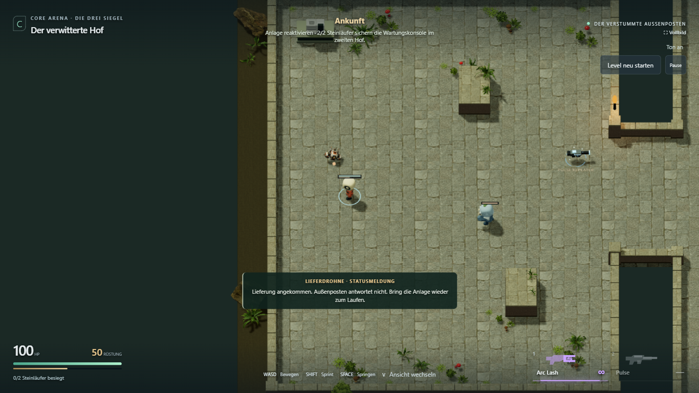
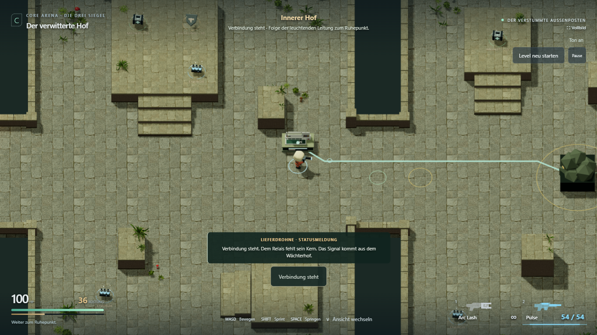
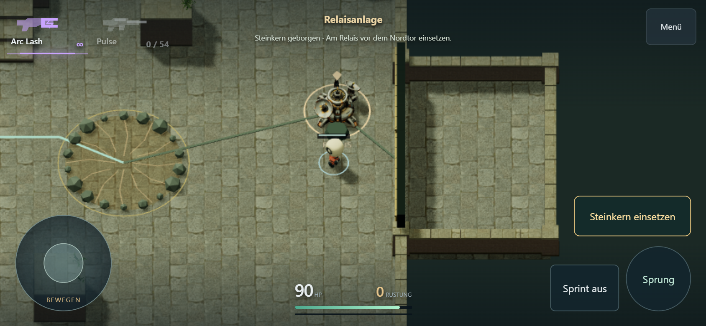
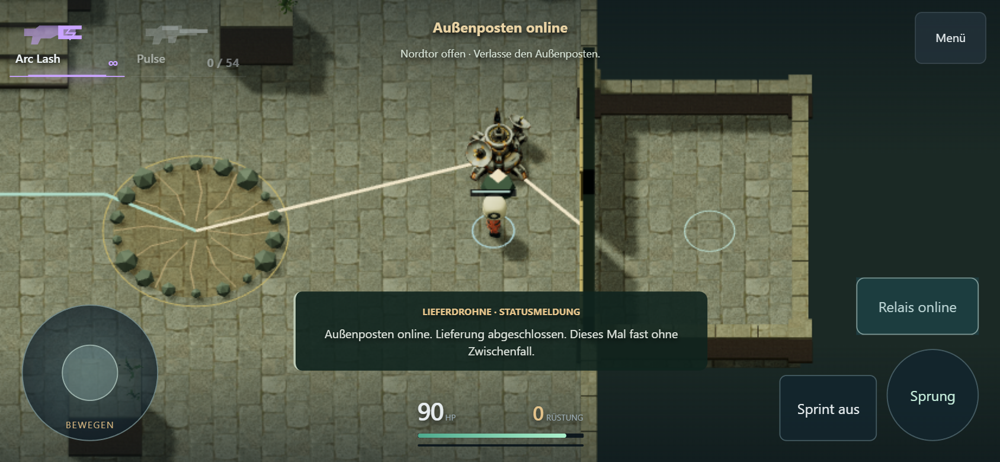
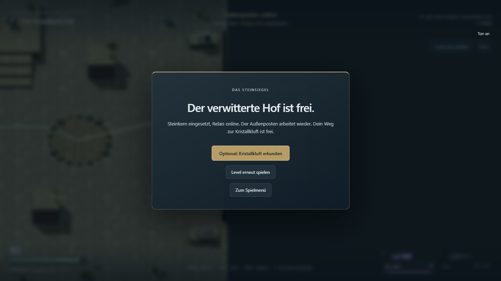

# L1.6a – Der verstummte Außenposten

Stand: **30. Oktober 2026. Nur L1.6a umgesetzt und technisch geprüft.**
Vor Beginn und nochmals vor Abschluss: lokales `main` und GitHub-`main` bei
`d82588a59ae674e7d3d439bf5cba060284ecacd7`; zu Beginn sauberer Arbeitsbaum.
Zum Zeitpunkt dieses Berichts waren L1.6b, L1.6c und L1.5b offen und nicht
freigegeben. **Nachtrag:** L1.6b wurde anschließend separat freigegeben und
[umgesetzt/geprüft](BOSS_PRESSURE_RESULT.md); L1.6c und L1.5b bleiben offen.

## Spielbares Ergebnis

1. Eine beschädigte Lieferdrohne am Start gibt den kurzen Auftrag, den
   verstummten Außenposten wieder in Betrieb zu nehmen.
2. Die vorhandene Wartungskonsole im zweiten Hof steht jetzt bei **(-3; -8)**.
   Nach beiden Steinläufern lässt sie sich mit **E** oder der kontextabhängigen
   **Touch-Taste** bedienen. Statuslicht und Leitung werden aktiv; der Zugang
   zum Wächterhof öffnet. Der bestehende Checkpoint folgt unmittelbar danach.
3. Das Betreten des letzten Hofs weckt den vorhandenen Boss. Nach dem Sieg
   öffnet die Rückzugssperre; der bereits vorhandene Steinkern muss geborgen werden.
4. Das Relais bei **(-3; -39)** nimmt den Kern per E/Touch auf. Eingesetzter Kern,
   leuchtende Leitung, Ton und Statusmeldung bestätigen die Reaktivierung.
   Erst jetzt öffnet das Nordtor. Tatsächliches Durchgehen beendet das Level.

Das HUD zeigt durchgehend den nächsten Missionsschritt. Vier kurze Meldungen
begleiten Ankunft, Konsole, erstes Boss-Erwachen und Relaisaktivierung.
Interaktionen verlangen Nähe, Bodenhöhe und freie Sicht. Wiederholtes Bedienen
erzeugt keinen doppelten Fortschritt. Boss-Retry erhält die aktive Konsole und
befreite Anreise; vollständiger Neustart setzt die ganze Mission zurück.

Verwendet werden die bestehende Retro-Tech-Konsole und ausschließlich zwei
bereits importierte Hexwars-GLBs: Hover-Bot und Relais, zusammen **5.824.268 Bytes**.
Die Modelle bleiben unverändert; Platzierung, Skalierung und Kollision liegen
in CoreArena. Kein Kauf, kein neuer Gegner und kein allgemeines Quest-System.
Grundriss, Kampfwerte, Waffen, Kamera und Bewegung bleiben unverändert.
CTF-3.0 und das Quellprojekt Hexwars wurden nicht verändert.

## Prüfung

- `npm test`: **55/55 bestanden**. Missionsreihenfolge, Reichweite/Höhe/Deckung,
  erforderlicher Kern und Relais, wiederholtes Bedienen, Tod vor dem Checkpoint,
  Boss-Retry, physischer Ausgang und vollständiger Reset abgedeckt.
- `npm run build:test` und `npm run build`: bestanden, einschließlich Typecheck.
  Die bereits vorhandene Vite-Warnung zum großen Three/Rapier-Bundle bleibt.
- **Fünf sichtbare Chromium-Browserfälle** mit echten Maus-/Tastatur- beziehungsweise
  Touch-Eingaben bestanden. Getestet wurde ausdrücklich `adventure=1` auf dem
  gebauten lokalen Preview unter `/CoreArena-3D/`, nicht die ältere Bossarena.
  Die Diagnose liest Zustände; die Browserläufe injizieren weder Schaden noch Fortschritt.

| Browserfall | Ergebnis |
| --- | --- |
| Desktop, 1366 × 768 | Menü → zwei Läufer/Pulse → gesperrter Bosszugang → Konsole → Checkpoint → Tod → Retry → Boss-Sieg → Kern → noch gesperrtes Nordtor → Relais → Ausgang → vollständiger Reset → Spielmenü bestanden |
| Touch-Emulation, 844 × 390 Querformat | Ganze Missionskette einschließlich Tod/Retry, Kern, Relais, physischem Ausgang und Reset bestanden; Bewegen und Schießen laufen während Konsolenbedienung und nach Loslassen des dritten Fingers weiter |
| Desktop-Kampfregression | Beschuss-Aggro, tatsächliche Eingangssperre, Plateau-Bodenausbruch und Ausweichen bestanden |
| Desktop-Erkundungsroute | Alle Höfe, Vorräte, Treppen/Plateaus, Kamerawechsel, Pause und Neustart bestanden |
| Touch-Bewegungsregression | Joystick, Sprint mit zweitem Finger, Waffenaufnahme/Schuss, Terrasse, Sprung, Menü/Kamera und Neustart bestanden |

Windows; Playwright-Projekt `chromium-1366`, sichtbarer Chromium **156.0.8078.4**.
Touch-Kontext mit `hasTouch`, `isMobile`, Geräte-DPR 2; das Spiel begrenzt seine
mobile Render-Pixeldichte weiterhin auf 1. Keine erfassten Laufzeitfehler;
die beiden Missionsläufe prüfen zusätzlich Konsole und HTTP-Fehlerantworten.
[Missionsbericht](adventure-mission/mission-report.json) ·
[Regressionsbericht](adventure-mission/regression-report.json).

Während der Prüfung korrigiert: Der bisherige automatisierte Querweg bei
Z = -38,5 lief durch den neuen Relaiskörper; die geprüfte freie Route liegt
bei Z = -37. Ein erster Mehrfingertest beendete versehentlich Bewegungs- und
Schussfinger statt nur des Interaktionsfingers. Nach Korrektur des Testskripts
bestand der ganze Touch-Ablauf; die Eingabeimplementierung musste dafür nicht
geändert werden. Diese ersten Fehlschläge sind keine als Erfolg gezählten Retries.

**Grenzen:** Touch-Emulation ist kein Android-/iPhone-Test. Kein neuer
Balancevergleich und keine Leistungs- oder persönliche Spielabnahme behauptet.
Diese Punkte gehören weiterhin zu den noch offenen Paketen und Nutzerfeedback.

## Aufnahmen

Ankunft mit beschädigter Drohne und Auftrag:

Konsole aktiviert, Verbindung zum Boss sichtbar:

Touch: Kern geborgen, Relais bedienbar, Tor noch geschlossen:

Touch: Relais online und Ausgang offen:

Vollständiger Abschluss:

