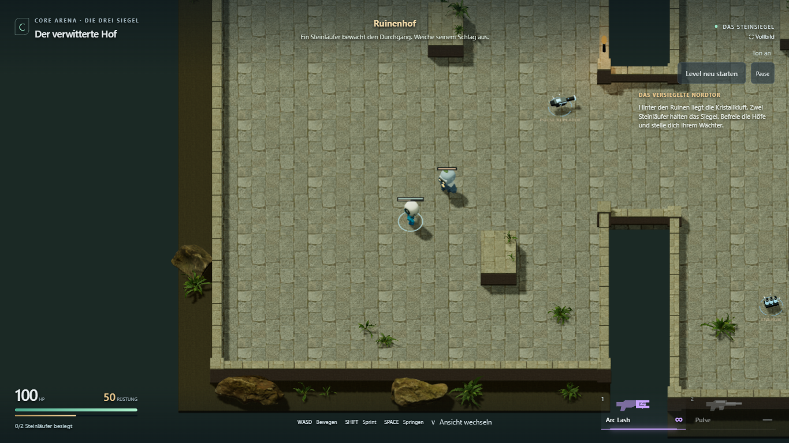
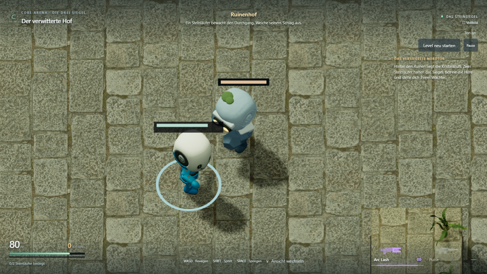
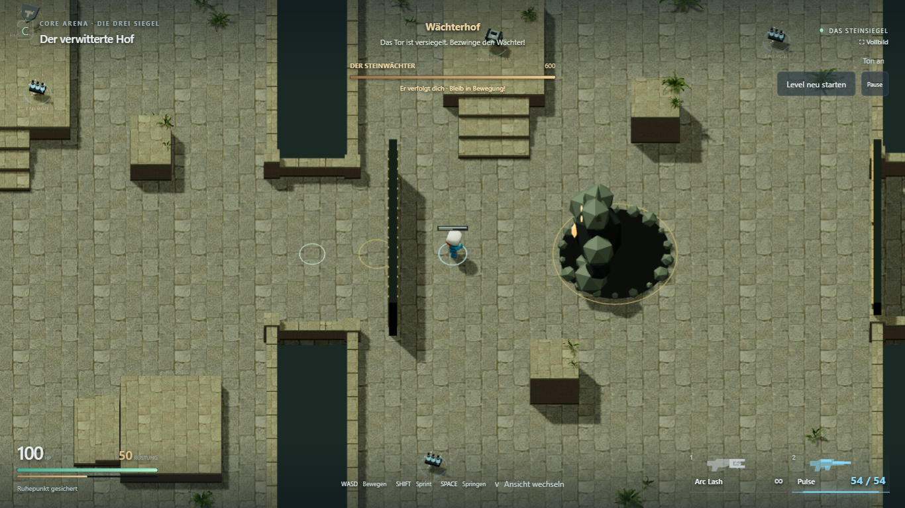
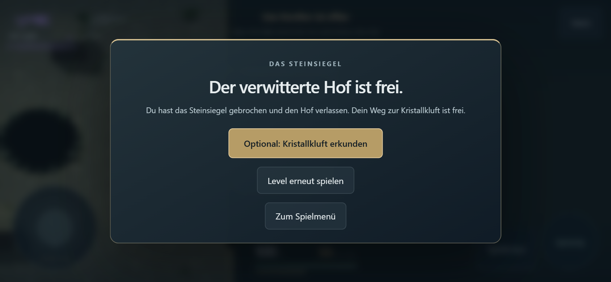

# Bosstempo und KayKit-Wächterpuppen

29. Oktober 2026. Freigegebener Schritt **L1.5a umgesetzt und technisch geprüft**.
Die endgültige Schwierigkeit, persönliche Sichtung und Handy-Leistungsabnahme bleiben offen.

[Spielen](https://emfau88.github.io/CoreArena-3D/?mode=pve&level=stone&adventure=1)
· [Roadmap](../planning/LEVEL_1_STONE_ADVENTURE.md)

## Steinwächter

| Verhalten | Vorher | Jetzt |
| --- | ---: | ---: |
| Ausholen des Faustschlags | 0,60 s | 0,35 s |
| Erholung nach Faustschlag | 0,40 s | 0,25 s |
| Zusätzliche Schlagpause | 1,50 s | 0,65 s |
| Erholung nach Spezialangriff | 1,50 s | 0,80 s |
| Verfolgung | 2,6 m/s | 3,1 m/s |

Bei durchgehendem Nahkontakt und ohne Spezialangriff dazwischen wiederholt sich
der Faustschlag nach 1,25 statt 2,5 Sekunden. HP, Schaden, Reichweite sowie die
Warnzeiten der großen Angriffe bleiben unverändert. Die Faust erreicht ihre
Kontaktpose auf dem Schadens-Tick; auch der Sound verwendet dieselbe Konfiguration.
Die Anpassung gilt gezielt für das Adventure, nicht für Frost/Glut oder die alten Arenen.

**Balancebeobachtung:** Der stationäre Vergleich mit präzisem Pulse-/Arc-Dauerfeuer
gewann weiterhin mit **30 HP, 0 Rüstung und vier Treffern**. Der aktive Desktoplauf
mit Ausweichen und Springen gewann mit **90 HP, 0 Rüstung und einem Treffer**.
Die vereinbarten Werte machen die normalen Schläge schneller, erzwingen aber noch
keine Niederlage bei jedem stationären Dauerfeuer. Das frühere vorgeschlagene
Abnahmeziel „Stehenbleiben verliert“ ist deshalb ausdrücklich noch offen.
Insbesondere der Ablauf der großen Angriffe bietet weiterhin Feuerfenster.

## Kleine Gegner

Beide Steinläufer verwenden eigene Instanzen des vorhandenen KayKit-Mannequins:
21 Knochen, rund 1,72 m Höhe und eine etwas breitere Silhouette. Die Spielerfigur
behält ihre eigene Darstellung und ihre getrennten Lauf-/Zielanimationen.

- Auf Nutzerrückmeldung zur Lesbarkeit: kühler blaugrauer Stein mit hellen Kanten
  und dunkleren Beinen. Die ähnliche Farbzeichnung des Bodens ist entfernt;
  nur feines Relief und Rauheit nutzen das vorhandene Poly-Haven-Steinmaterial.
- Knochengebundene Schulter-/Unterarmplatten, größere kantige Fäuste, bernsteinfarbene
  Augen und Brustkern sowie sparsame Moospolster auf Kopf und Schulter.
- Eigene Animationen für Idle, Gehen, Treffer, unbewaffneten Faustschlag und Tod.
  Die größte Vorwärtsstreckung von `Melee_Unarmed_Attack_Punch_A` bei 0,5 s Clipzeit
  wird auf den echten Schadenszeitpunkt nach 24 Simulationsticks abgebildet.
  Animationen lösen selbst keinen zusätzlichen Schaden aus.
- Gegneranzahl, 70 HP, Tempo, Nahkampfwerte, Navigation und feste Standorte bleiben bestehen.
- Zusätzliches offizielles CC0-GLB: **999.416 Bytes**, nur beim Adventure-Einstieg.
  [Originalquelle, Lizenz, Archivhash und Anpassungen](../../public/assets/kaykit/CREDITS.md).

## Prüfung

- Bestehende 48 Kerntests erfolgreich; zusätzlicher Adventure-Bosstest besteht:
  erster Treffer nach 21 Ticks, zweiter nach weiteren 75, kein früherer/mehrfacher
  Treffer, Richtung nach Ausholen fest, Abstand/Höhe/Seitenausweichen wirksam,
  Verfolgung 3,1 m/s und Rückkehr aus Spezial-Erholung nach 48 Ticks.
- Test- und Produktionsbuild einschließlich TypeScript erfolgreich. Bekannte
  Größenwarnung des gemeinsamen Three/Rapier-Chunks unverändert.
- Vier Browserfälle im sichtbaren Chromium bestanden: vollständiger Desktoplauf,
  vollständiger Touchlauf (844 × 390), Spielerrotation in acht Richtungen und neuer
  Wächtertest. Beide Komplettläufe enthalten reguläre Kämpfe, echten Boss-Tod,
  Checkpoint-Retry, aktive Ausweich-/Sprungeingaben, Sieg und physischen Ausgang.
- Wächtertest: tatsächliche Skelettinstanzen, Gehen, getrennte Zustände beider Gegner,
  Kontaktpose auf dem Schadens-Tick, keine PropertyBinding-/HTTP-/Seitenfehler.
  Nach der letzten Farb-/Gesichtskorrektur gezielt erneut bestanden.

```text
npx playwright test tests/e2e/guard-presentation.spec.ts tests/e2e/adventure-fight.spec.ts tests/e2e/fighter-look.spec.ts --grep "stone KayKit|menu entry|touch full level|eight directions" --project=chromium-1366 --trace=off
```

[Spielablauf-Bericht](boss-and-guards/gameplay-report.json)
· [abschließende Darstellungsprüfung](boss-and-guards/presentation-report.json).
Keine Teleports, HP- oder Munitionsinjektionen in den Browser-Spieltests.
Touch-Emulation ist kein Leistungstest auf einem echten Smartphone.

## Aktuelle Spielaufnahmen

Normale seitliche Adventure-Ansicht:



Detail: dieselbe seitliche Blickrichtung, nur die Testkamera näher herangezoomt.
Keine andere Karte oder veränderte Spielposition:






