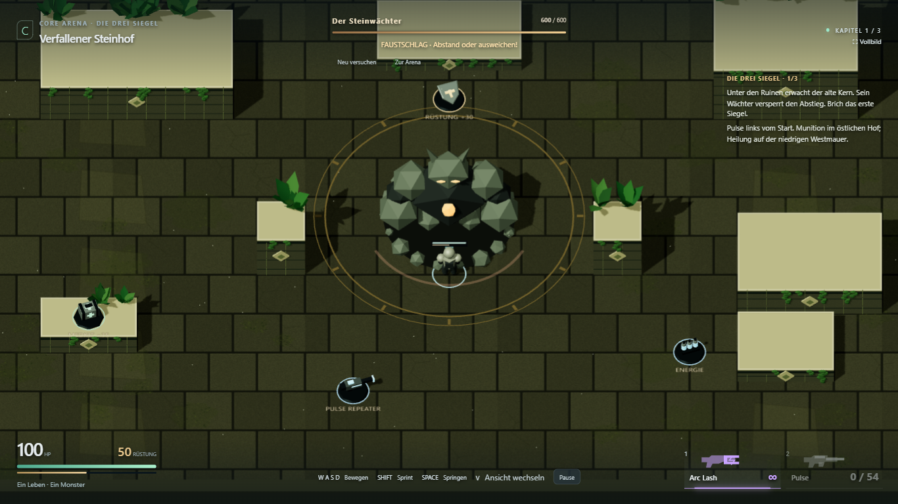
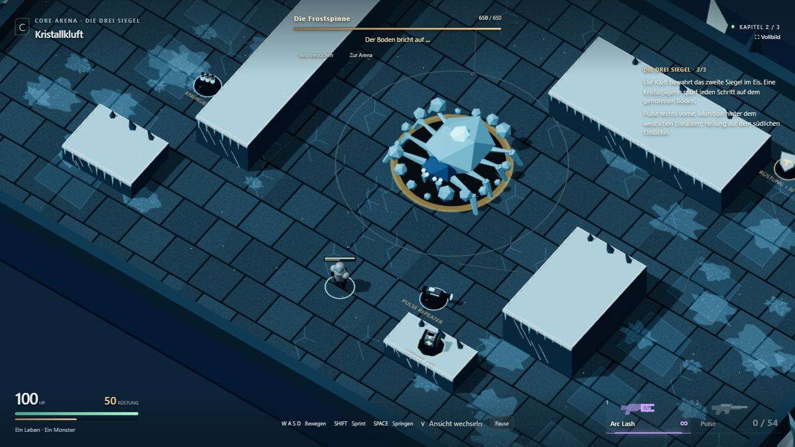
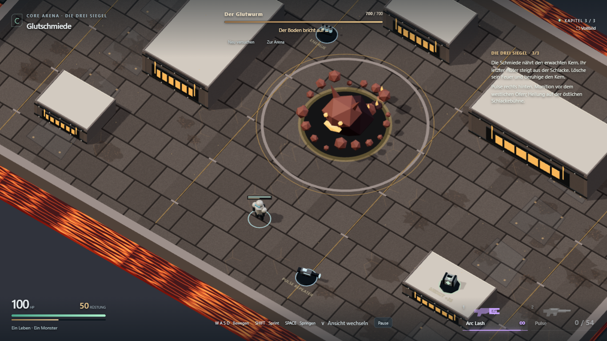

# Normale Bossangriffe, Kartenwege und Vorräte

27. Oktober 2026. Umgesetzt und technisch geprüft; persönliche Balance-Abnahme offen.

## Spielverhalten

Alle Bosse erhalten wiederkehrende normale Nahkampfangriffe zwischen ihren bestehenden
Spezialangriffen. Vorbereitung und Frontbogen zeigen die festgelegte Schlagrichtung.
Beim eigentlichen Kontakt wird genau einmal Reichweite, Winkel, Höhe und echte
Rapier-Deckung geprüft. Es gibt keinen dauerhaften Kontaktschaden. Nach dem Schlag
folgen Erholung und Cooldown; Tod, Sieg und Neustart behandeln auch diesen Zustand.

| Boss | Normaler Angriff | Vorbereitung | Schaden vor Rüstung |
| --- | --- | --- | --- |
| Steinwächter | Faustschlag | 0,60 s | 20 |
| Frostspinne | Biss | 0,45 s | 16 |
| Glutwurm | Vorstoß | 0,65 s | 24 |

Die Gegner nähern sich jetzt auf Nahkampfdistanz. Die Spezialangriffe bleiben erhalten;
normale Schläge unterbrechen ihre Verfolgungsphase, ersetzen aber keinen Spezialangriff.

Die Innenaufbauten unterscheiden sich deutlicher: offener Ruinenhof mit einer
Stufenterrasse, langer westlicher Eisrücken mit versetzten Eisflächen, breite
Ofenblöcke und Gassen. Die äußere Arenagröße bleibt gleich.

Startwaffe ist Arc Lash. Pulse liegt pro Karte an eigener Stelle und wird nach
Aufnahme mit 2 oder dem Waffenbutton gewählt. Munition und Rüstung haben ebenfalls
eigene Positionen. Je ein Medkit liegt auf einer niedrigen, erreichbaren Plattform.
Der Einstiegshinweis beschreibt die Vorratsorte. Pickup-Beschriftungen verwenden
die tatsächlichen Mengen statt bisher fest eingetragener Werte.

## Prüfung

- `npm test`: **39/39 Kern-/Physiktests bestanden**. Zusätzliche Fälle für alle drei
  Nahkampfprofile, Vorbereitung, einmaligen Treffer, Wiederholung nach Cooldown,
  Abstand, Ausweichen hinter den Gegner, Höhe, reale Deckung, Reset und Rüstungscap.
  Alle Pickup-Positionen wurden gegen ihre tatsächliche Standfläche geprüft.
- Die vorhandenen isolierten Spezialangriffstests deaktivieren ausschließlich dort
  den neuen Nahkampf, damit sie weiterhin nur den jeweiligen Zauber prüfen. Die
  ursprünglichen Gesamtschaden-Erwartungen schlugen zunächst durch zusätzliche
  reguläre Nahkampftreffer fehl. Nahkampf und vollständiger Kampf werden separat geprüft.
- **8/8 unterschiedliche Browserfälle ohne Retry bestanden:** alle drei regulären
  Boss-Siege mit tatsächlicher Waffenaufnahme und Kampagnenwechsel; Verfolgung und
  Treffer beim Gehen; normaler Schlag gegen Stillstehen sowie echter Seitenschritt;
  Niederlage, Pause und Restart; Touch-Joystick → Pulse aufnehmen → Waffenbutton →
  Schuss; Vollbild; Touch-Treffer in der Glutschmiede; Sprung auf die Steinplattform.
- Nach der abschließenden Beschriftungskorrektur zwei betroffene Browserfälle erneut
  geprüft und frische Aufnahmen erstellt. Dabei scheiterte der Seitenschritttest
  einmal: Er wartete vor der Ausweich-Eingabe auf die Screenshot-Datei und reagierte
  dadurch zu spät. Eingabe nun vor der Aufnahme ausgelöst; gezielter Nachlauf unten
  dokumentiert. Kein künstlich gesetzter Treffer oder Sieg.
- Produktionsbuild und TypeScript-Prüfung bestanden. Bekannte Bundlegrößenwarnung bleibt.
- Chromium 1366×768, Touch-Emulation 844×390/DPR 2. Kein neuer Test auf echten Handys.

[Kampagnenlauf](boss-basics/campaign-results.json),
[Nahkampf/Touch/Plattformen](boss-basics/basic-results.json),
[abschließende Sichtprüfung](boss-basics/final-results.json).
[Gezielter Seitenschritt-Nachlauf: 1/1 bestanden](boss-basics/dodge-followup.json).

