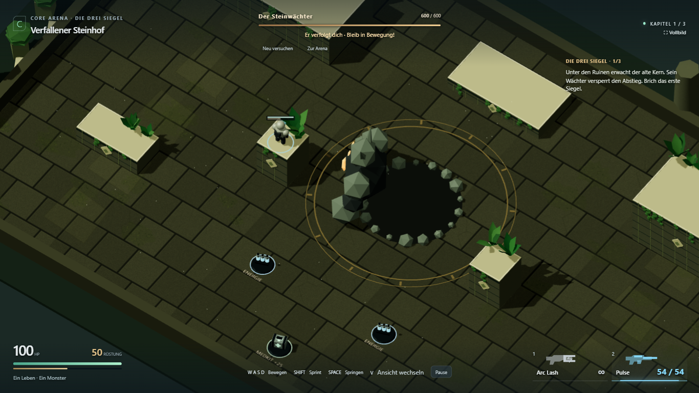
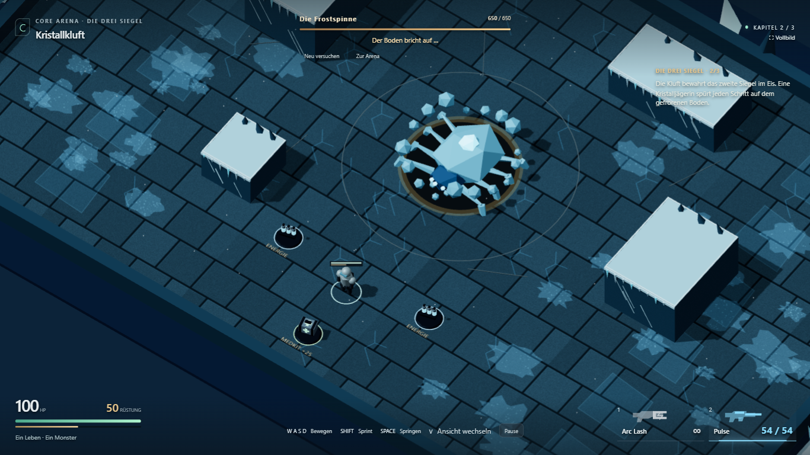
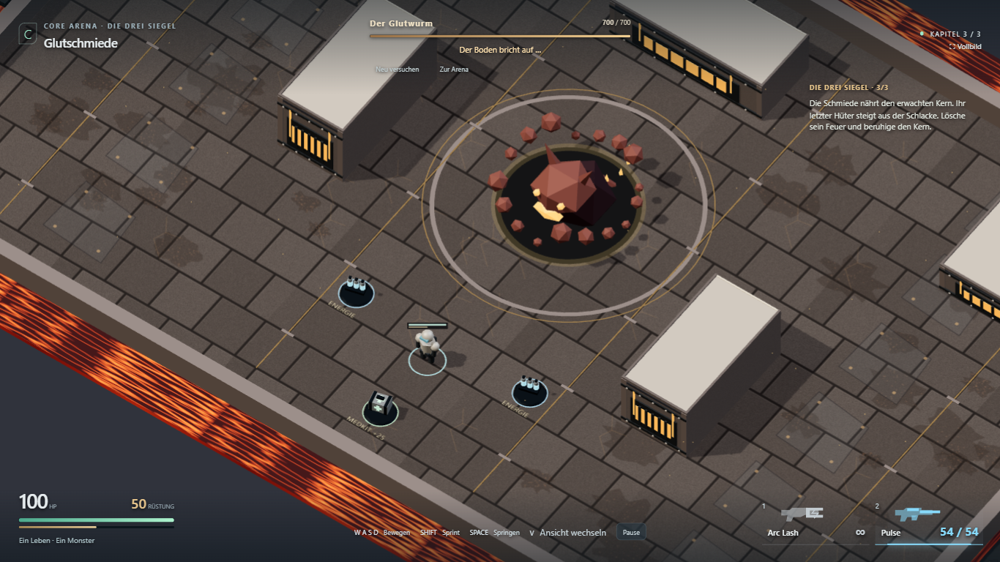
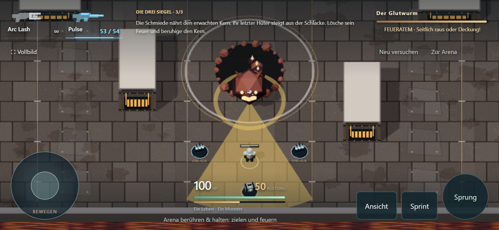

# Kartendetails und lesbare Höhen

27. Oktober 2026. Umgesetzt und technisch geprüft; persönliche Sichtabnahme offen.

## Umfang

- Steinhof: Mauerfugen, eingelassene Reliefs, herabhängender Efeu, dezentes Moos,
  verwitterte Randsteine und schwebende Pollen.
- Kristallkluft: Eiszapfen, Frostkrusten und Eisrisse, Kristalle am Rand und leichter Schnee.
- Glutschmiede: vergitterte Ofenöffnungen, Metallbänder/Nieten, Rohrdetails,
  Boden-Serviceplatten, Schlacke am Rand sowie Glut und leicht pulsierende Ofenfarbe.
- Wiederholte Dekoration wird gemeinsam als InstancedMesh gerendert. 64 kleine
  Umgebungspartikel pro Karte, keine zusätzlichen Schattenlichter oder Abhängigkeiten.
- Physik, Laufwege, Trefferregeln und Kampfwerte bleiben unverändert. Große neue
  Kulissenelemente stehen außerhalb der umschlossenen Spielfläche.

## Direkte Rückmeldungen eingearbeitet

Der erste Detailentwurf bestand die Gameplay-Prüfung, wirkte optisch jedoch wie
schwebende Flecken. Dieser Entwurf wurde vor Veröffentlichung überarbeitet:
Moos/Frost/Schmutz sind jetzt in die tatsächliche undurchsichtige Bodentextur
eingearbeitet. Keine separate transparente Bodenschicht und keine weichen Leuchthöfe.
Fugen, Schatten und Perspektive bleiben Bestandteil derselben Oberfläche.

Die Plattformen haben helle freie Landeflächen, dunklere Seiten und klare Randsteine.
Bewuchs und Kristalle stehen am hinteren Rand, statt die gesamte Oberseite zu füllen.

## Nachweise

- Produktionsbuild und TypeScript-Prüfung bestanden; bekannte Bundlegrößenwarnung bleibt.
- Nach der Korrektur **4/4 Browserfälle ohne Retry bestanden**:
  `npx playwright test tests/e2e/scenery.spec.ts tests/e2e/campaign.spec.ts tests/e2e/immersive.spec.ts --project=chromium-1366`.
- Alle drei Bosse mit normalen Maus-/Tastatureingaben besiegt, Kartenwechsel und Abschluss.
- Tatsächlicher Sprung vom Boden auf `pillar-left`; Standfläche per lesender Diagnose geprüft.
- Aufnahmen aller drei Karten in beiden Perspektiven; Sichtprüfung der Bodenanbindung und Kanten.
- Vollbild ein/aus und Touch-Treffer im Querformat. Chromium, Desktop 1366×768,
  Touch 844×390/DPR 2; kein neuer Test auf echter Smartphone-Hardware oder Leistungsbenchmark.
- [Laufstatistik](campaign-scenery/browser-results.json).

