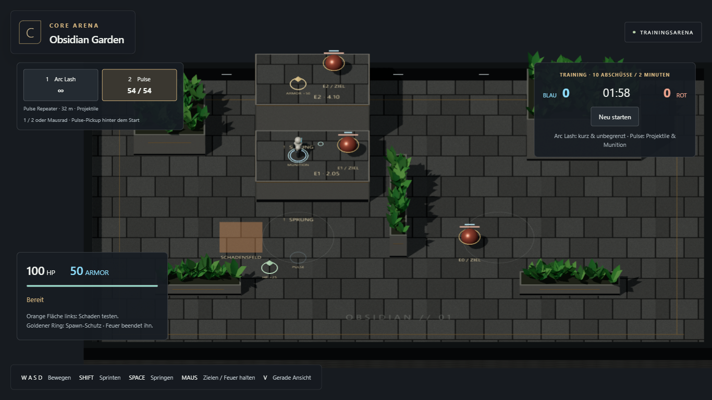
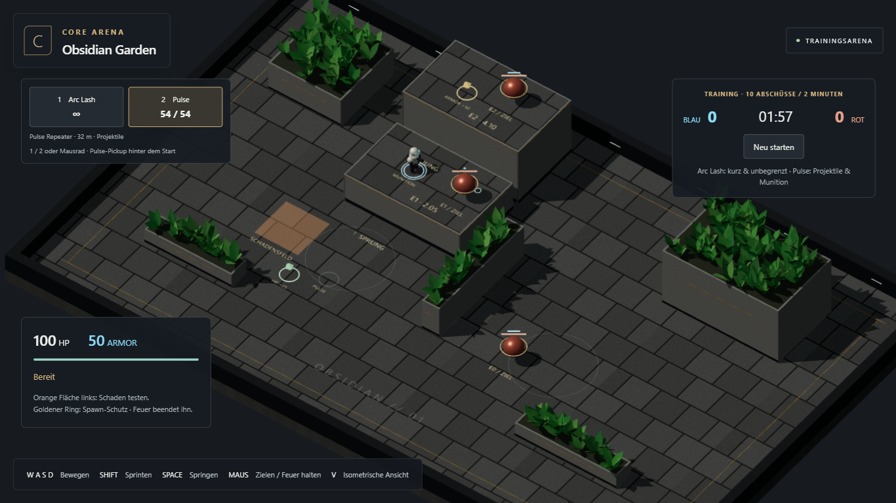

# Nacharbeit: Richtungszielen auf derselben Höhe

21. Oktober 2026. Konkrete Spielrückmeldung: Cursor vor oder hinter einem Gegner verfehlt ihn trotz scheinbar passender Schussrichtung.

## Ursache und Änderung

Der bisherige Kamerastrahl wählte einen Bodenpunkt; die Waffen feuerten von der erhöhten Mündung zu diesem Punkt nach unten. Dadurch landeten Schüsse vor dem Ziel im Boden oder liefen unter dessen Trefferkörper hindurch.

Bei einer nach oben gerichteten Bodenoberfläche auf Spielerhöhe (Höhentoleranz 0,35 m für den Kapselabstand) schneidet die Zielberechnung den Kamerastrahl jetzt mit der horizontalen Ebene auf Waffenhöhe. So entspricht die Richtung auch in der isometrischen Ansicht dem Cursor, ohne den seitlichen Versatz einer bloß angehobenen Bodenkoordinate. Der ursprüngliche Oberflächentreffer bleibt für den Cursor erhalten; ein eigener `firePoint` steuert Waffe und Figur. Sehr kurze Zielabstände erzeugen keine Nullrichtung an der Mündung.

Arc und Pulse nutzen diese Richtung über den Cursor hinaus bis zu ihrer bisherigen Reichweite. Kein neues Gegner-Snapping, keine größeren Trefferkörper und keine geänderten Waffenwerte. Mündungsprüfung und physische Wand-/Projektilkollision bleiben aktiv. Ein Gegner in der Flugbahn wird nicht als blockierende Deckung markiert. Direkte Körpertreffer, Ziele auf anderen Höhen, Wände und Zielen während größerer Sprunghöhen behalten ihre räumliche Zielregel. Maus und Touch verwenden dieselbe Berechnung.

## Nachweis

- **28/28 Kern-/Physiktests bestanden.** Neu: Cursor vor/hinter dem Gegner auf E0/E1/E2 in beiden Kamerawinkeln mit beiden Waffen; Wandblockade; seitliches Vorbeischießen; andere Zielhöhe bleibt echtes 3D-Aim.
- Typecheck, Testbuild und Produktionsbuild bestanden.
- **4/4 sichtbare Chromium-Browserabläufe bestanden**, ohne Retry: neuer Richtungsziel-Test sowie M2.2-Waffen-/Höhenablauf, M2.3-Botduell und Touch-Regression.
- Neuer Ablauf: Trainingsmatch starten, Pulse zu Fuß aufnehmen, regulär auf E1 springen, vier einzelne Pulse-Schüsse mit Cursor vor/hinter dem Höhenziel in beiden Kameras. Jeder Cursor trifft nachweislich die Plattform statt den Gegner; jeder Schuss verursacht genau zehn Schaden am Gegner. Anschließend ein Arc-Schuss mit Cursor vor dem Gegner, 35 Schaden. Ausschließlich echte Maus-/Tastatureingaben und lesende Diagnose, keine injizierten Treffer. Keine Seitenfehler.

[Kompakter Browsernachweis](directional-aim/browser-results.json)

Persönliche Bestätigung des Spielgefühls steht noch aus. M2.4 bleibt ungeöffnet; dies ist eine gezielte Nacharbeit auf Nutzerfeedback.
