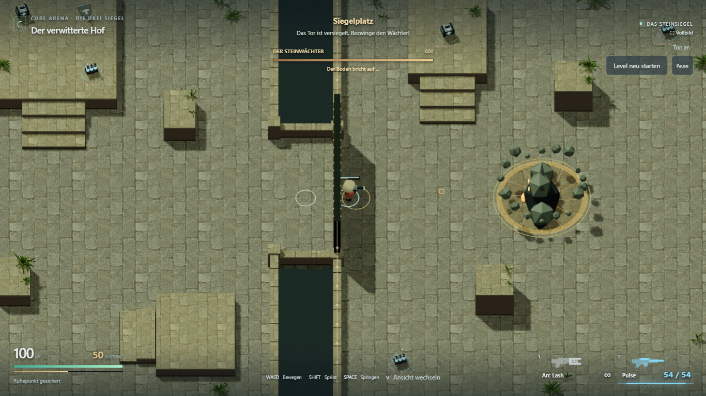
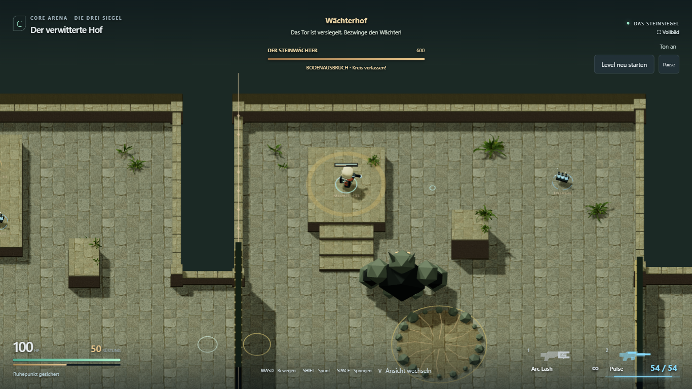
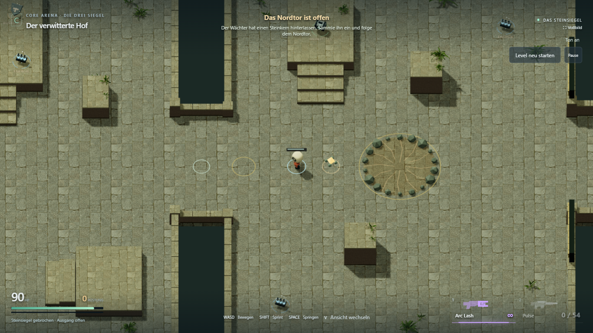

# Kampf-Nachbesserung · 29. Oktober 2026

[Adventure spielen](https://emfau88.github.io/CoreArena-3D/?mode=pve&level=stone&adventure=1)

## Änderungen

- **Eingang:** Die Sperre stand bei Z = −18 innerhalb des Hofs. Sie sitzt jetzt
  direkt im Durchgang bei Z = −16. Über den niedrigen Seitenmauern läuft ein
  sichtbares, durchsichtiges Siegel weiter. Kollision und Darstellung stimmen
  überein; 4,4 m Höhe verhindert auch den Sprung über den angrenzenden Eckpfeiler.
  Vor Aktivierung, nach Niederlage und nach Sieg ist die Eingangssperre offen.
- **Austrittsstelle:** Der schwarze Kreis wurde beim Steinwächter durch eine
  steinfarbene Fläche mit Bruchlinien und vorhandenen Randbrocken ersetzt.
  Im Adventure nutzt sie die bereits lokal vorhandenen Hoftexturen. Keine
  zusätzliche Texturdatei oder schwebende Dekorfläche.
- **Plateaus:** Steht der Spieler auf einer erhöhten Oberfläche über 0,65 m,
  bereitet der Adventure-Boss nach einer Sekunde Verfolgung einen Bodenausbruch
  vor. Der Warnpunkt liegt auf der tatsächlichen Oberfläche und bleibt dann
  fest. Die 1,25 s Warnzeit und 65 Schaden bleiben unverändert. Bei dauerhaftem
  Stehen folgen Treffer ungefähr alle 3,45 s. Normale Sprünge lösen diese
  Auswahl nicht aus; Bodenschockwellen dürfen weiterhin übersprungen werden.
- **Drop:** Nach dem Sieg bleibt am Todesort ein goldener Steinkern mit
  Steinsplittern, Bodenring und aufsteigenden Partikeln. Hingehen sammelt ihn ein,
  mit Klang, HUD-Bestätigung und Eintrag im Levelabschluss. Optionales Andenken
  dieser Runde: kein Inventar, kein permanenter Bonus, kein blockierter Ausgang.
  Ein vollständiger Neustart setzt ihn zurück.
- **Kleine Wächter:** Ein gültiger Spielertreffer alarmiert den Gegner auch
  außerhalb seiner normalen Aktivierungszone. Er verfolgt im eigenen Hof;
  der erste Wächter darf dabei bis in den Ankunftsbereich laufen. Die alte
  Stillstandsgrenze bei 14 m Entfernung entfällt. Kartenkollision, Nahkampf-Reichweite
  und feste Schlagrichtung bleiben gültig. Ein entfernter Schütze wird am
  erreichbaren Rand des eigenen Hofs verfolgt, nicht quer durch Leerräume.

## Prüfung

- `npm test`: **52/52 bestanden**. Neue Regressionen verwenden echte Rapier-
  Kollision für Tor/Lauf/Sprint/Sprung an neun Querpositionen, erhöhten
  Bodenausbruch mit Ausweichen sowie Verfolgung nach Fernbeschuss bis zum
  Nahkampftreffer. Drop-Aufnahme, Höhentrennung und Reset sind ebenfalls geprüft.
- Testbuild und Produktionsbuild mit TypeScript-Prüfung bestanden.
- Drei sichtbare Chromium-Spieltests mit echten Eingaben bestanden:
  vollständiger Desktop-Durchlauf einschließlich Tod, Retry, Boss, Drop,
  Ausgang und Reset; gezielter Fernbeschuss-/Tor-/Plateaufall; vollständiger
  Touch-Durchlauf mit Retry und Levelabschluss bei 844×390.
- Nach der abschließenden Texturanpassung beide Desktopfälle erneut bestanden
  (55,3 s und 27,0 s). Finale Aufnahmen und Browserberichte liegen in
  `encounter-fixes/`; der erste Bericht enthält auch den Touch-Durchlauf.
- Keine gemeldeten Browserfehler. Touch ist eine Chromium-Geräteemulation,
  kein physischer Handytest. Persönliche Balance-/Leistungsabnahme L1.5b bleibt offen.

## Spielaufnahmen

