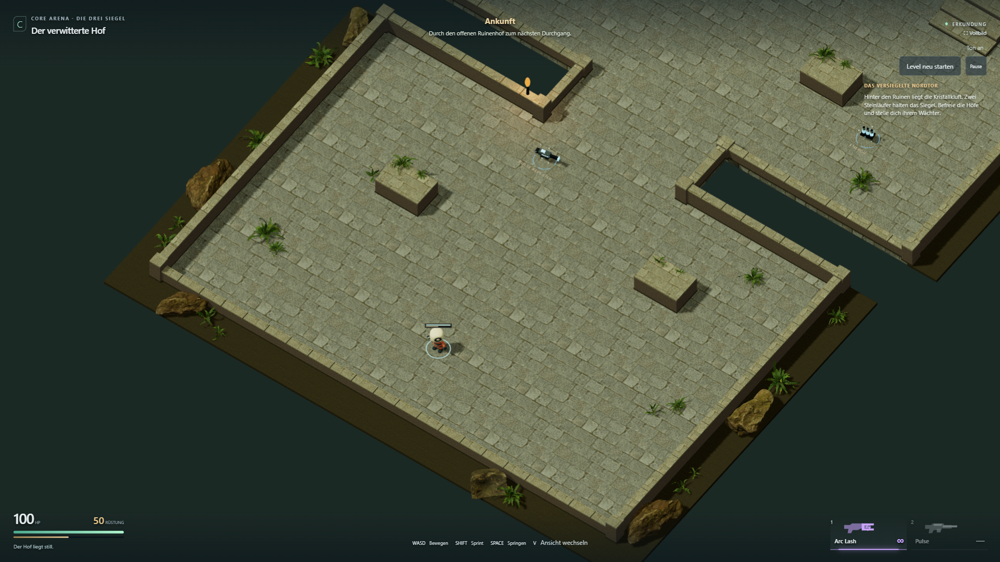
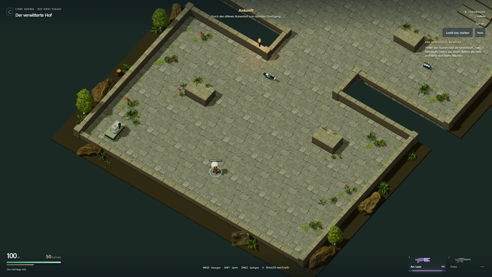
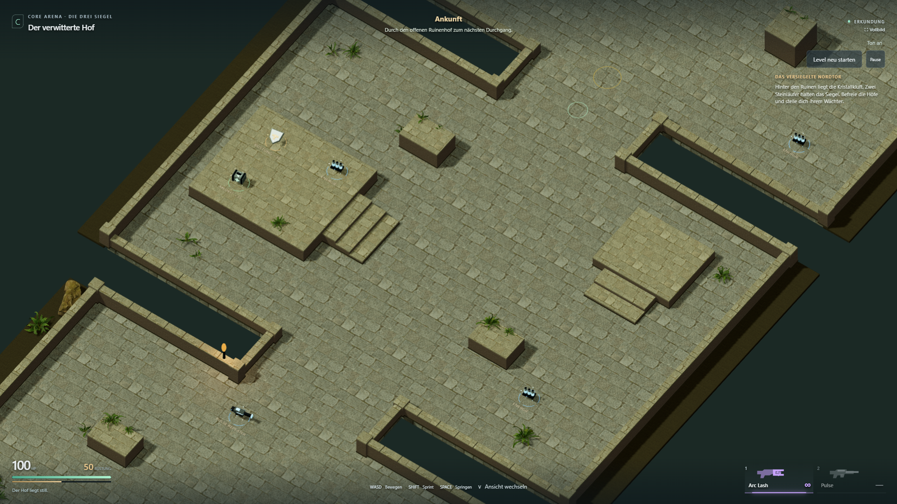
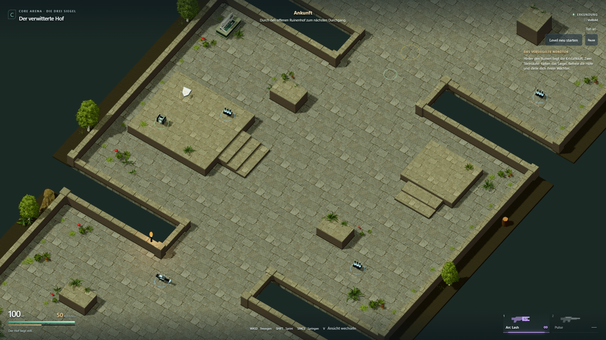
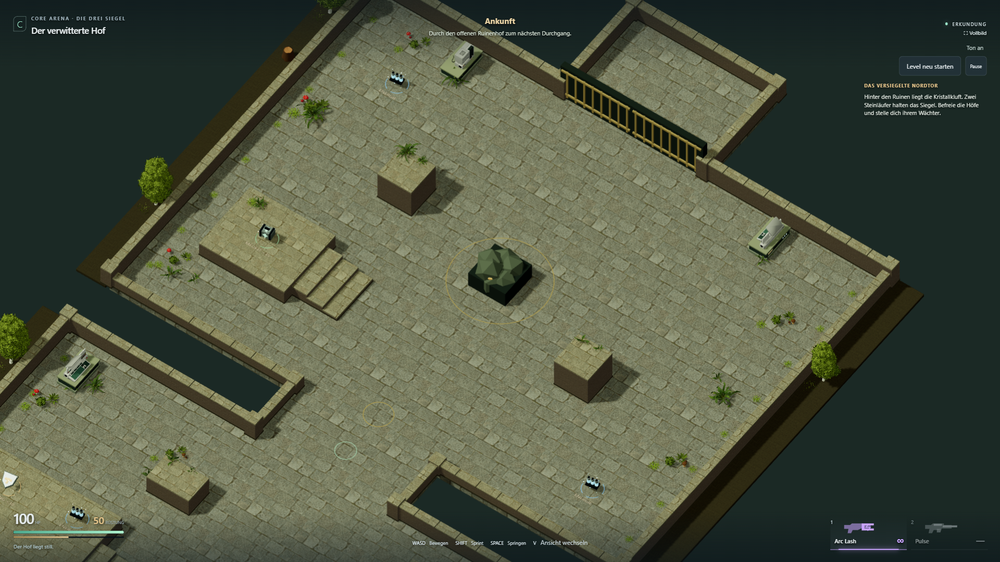

# Kostenlose AssetQuest-/Retro-Tech-Ausstattung

29. Oktober 2026. Die freigegebene kleine Ausstattungsrunde ist umgesetzt und
technisch geprüft. **Keine Käufe.** Verwendet wurden ausschließlich öffentlich
angebotene Downloadbeispiele der beiden ausgewählten Anbieter.

[Spielen](https://emfau88.github.io/CoreArena-3D/?mode=pve&level=stone&adventure=1)
· [Ruhig erkunden](https://emfau88.github.io/CoreArena-3D/?mode=pve&level=stone&adventure=1&explore=1)
· [Roadmap](../planning/LEVEL_1_STONE_ADVENTURE.md)

## Änderungen

- Acht Modelle aus der AssetQuest-Demo: Birke, Brombeerbusch, Farn, Gras,
  Waldmeister, zwei Pilzgruppen und Baumstumpf. Kleine Pflanzengruppen stehen
  innerhalb aller drei Höfe und entlang der Mauersockel. Baumstämme stehen auf
  den vorhandenen äußeren Erdstreifen. Treppen, Pickups und Kampfmitten bleiben frei.
- Zwei Retro-Tech-Konsolentypen auf vier Stationen: Ankunftshof, innerer Hof,
  links und rechts vor dem Nordtor. Die niedrigen Podeste haben Kollision;
  ruhige Statuslichter beleben die Ausstattung. Die Geräte sind zunächst Kulisse,
  keine zusätzlichen Aufgaben oder vermeintlich notwendige Interaktionsschalter.
- Blattmasken mit echter Tiefenprüfung statt transparenter Bodenplatten.
  Pflanzen werden pro Modellteil instanziert. Zusätzliche GLB-Dateien insgesamt
  rund 1,85 MiB, nur beim Laden des Adventure-Levels; kein neuer Laufzeitdienst.
- Gegnerzahl, Waffen, Kamera, Kampfwerte, Checkpoint und Levelabschluss bleiben
  unverändert. Alte Arena und separate Kampagnenkarten sind nicht umgebaut.

Quellen und beigefügte Lizenzen:
[AssetQuest](../../public/assets/assetquest/CREDITS.md) und
[FlakDeau](../../public/assets/retro-tech/CREDITS.md).
AssetQuest-Demo: CC0. Die Retro-Tech-Produktseite nennt CC0, das tatsächlich
gelieferte Demoarchiv enthält jedoch eine eigene Lizenz mit ausdrücklicher
Ausnahme für Weitergabe als Projektinhalt; diese ist unverändert beigefügt.
Die Modelle sind Spielinhalt und kein separat angebotener Assetpack.

## Prüfung

- `npm run build:test` und `npm run build`: erfolgreich, einschließlich TypeScript.
  Die bestehende Größenwarnung zum gemeinsamen Three-/Rapier-Chunk bleibt.
- `npx tsx --test --test-concurrency=1 tests/stone-adventure.test.ts tests/adventure-fight.test.ts`:
  **11/11 bestanden**. Laufwege, Höhen, Pickups, Gate, Gegner, Boss und Checkpoint.
- **5/5 Browserfälle bestanden** in sichtbarem Chromium: Vergleichskameras bei
  1920 × 1080; Desktop-Spielabläufe bei 1366 × 768 sowie Touch-Emulation bei 844 × 390.
  Keine gemeldeten Seitenfehler; Vergleichstest prüft auch fehlgeschlagene Assetanfragen.

```text
npx playwright test tests/e2e/courtyard-look.spec.ts --grep "fixed side" --project chromium-1920 --trace off
npx playwright test tests/e2e/courtyard-look.spec.ts tests/e2e/stone-adventure.spec.ts tests/e2e/adventure-fight.spec.ts --grep "first court|walk every room|touch joystick|menu entry" --project chromium-1366 --trace off
```

1. Drei Höfe jeweils seitlich, gerade und isometrisch aufgenommen; repräsentative
   Ansichten auf Bodenverankerung, Blattmasken, Konsolen und Sichtlinien geprüft.
2. Beide Eingangsdeckungen durch echte Tastatureingaben besprungen, Pulse gesammelt.
3. Alle Räume, Treppen, Terrassen und Vorräte regulär erreicht; Waffen, Ansicht,
   Pause und Neustart geprüft.
4. Vollständiger Desktopablauf: beide Läufer, Checkpoint, Boss-Tod/Retry, Sieg,
   physischer Ausgang und vollständiger Reset.
5. Touch-Joystick, Sprint, Waffenaufnahme, Terrasse, Sprung, Ansicht und Neustart.

[Kamerabericht](free-decoration/camera-report.json) ·
[Spielbericht](free-decoration/gameplay-report.json).
Echte Smartphone-Leistung und persönliche Gestaltungsabnahme bleiben offen.
Die Screenshots verwenden dieselben festen Dokumentationskameras im Test-Build
und den Erkundungsmodus; die Spieltests verwenden echte Eingaben ohne Positions-,
HP- oder Munitionsmanipulation. Der Ortsname im Screenshot-HUD bleibt daher „Ankunft“.

## Vorher / Nachher

### Ankunftshof

Vorher:


Nachher:


### Innerer Hof

Vorher:


Nachher:


### Wächterhof

Vorher:


Nachher:

