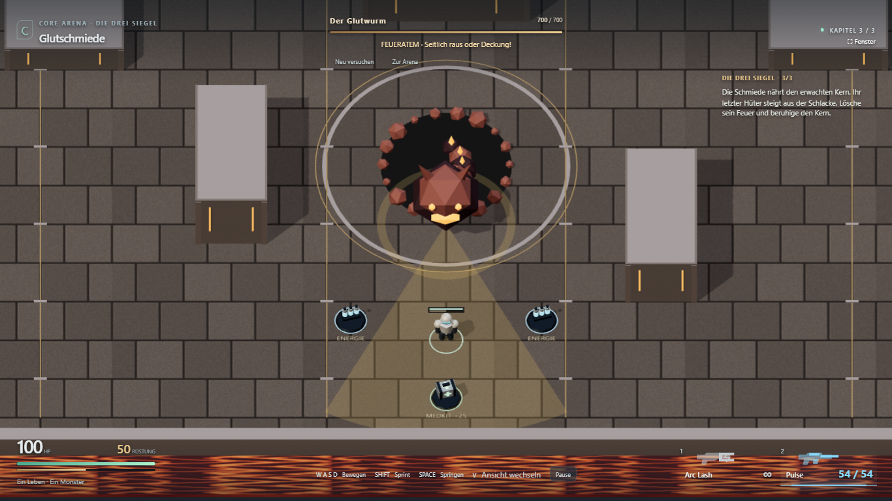
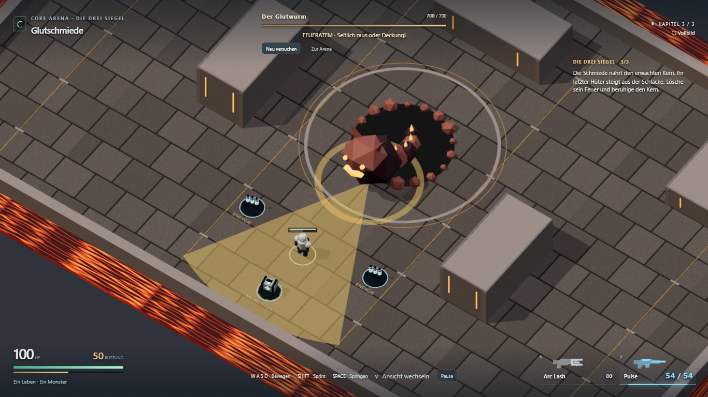
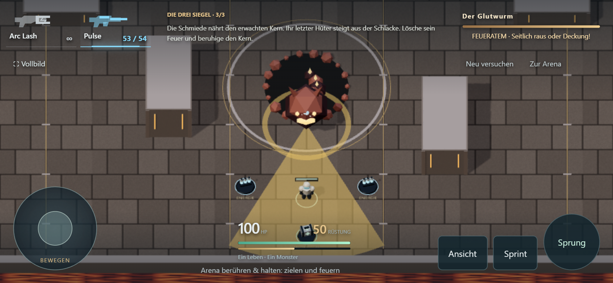

# Vollbild, integriertes HUD und lesbare Glutschmiede

27. Oktober 2026. Umgesetzt und technisch geprüft; persönliche visuelle Abnahme offen.

## Änderung auf Spielrückmeldung

- Nähere, steilere Kamera in beiden Ansichten. Die Arena füllt mehr vom Bildschirm.
- Echtes Browser-Vollbild über „Vollbild“ oder F; erneutes F schaltet zurück.
- Transparente, schlanke HUD-Anzeigen statt großer Kartenflächen. Zahlen für HP,
  Rüstung und Munition bleiben erhalten; zusätzlich HP/Rüstung direkt über der Figur.
- Glutschmiede: hellerer Boden und Deckung, zusätzliches kühles Fülllicht, sichtbare
  Deckungskanten. Lava, Glutwurm und Angriffswarnungen bleiben farblich unterscheidbar.
- Keine Änderung an Kampfwerten oder Trefferregeln; keine neue Meilensteinfreigabe.

## Prüfung

`npm run build` einschließlich TypeScript-Prüfung bestanden. Bestehende Warnung zur
Größe des gebündelten Three.js-/Rapier-Codes bleibt bestehen.

`npx playwright test tests/e2e/immersive.spec.ts tests/e2e/campaign.spec.ts tests/e2e/mobile.spec.ts --project=chromium-1366`

**4/4 Browserfälle im ersten Lauf bestanden:** natives Vollbild per Klick betreten
und per F verlassen, beide Kameras aufgenommen, alle drei Bosse regulär besiegt samt
Kartenwechsel/Kampagnenabschluss, Touch-Treffer in der Glutschmiede und bestehender
Mehrfinger-Steuerungsablauf. Normale Browser-Eingaben; Diagnose nur lesend.
Desktop 1366×768, zusätzlicher Touch-Fall 844×390 bei DPR 2. Keine zusätzlichen
Tests auf echten Smartphones; Browseremulation belegt keine Geräteperformance.

[Laufstatistik](immersive-hud/browser-results.json).

## Sichtprüfung

Vorheriger Stand: [Glutschmiede vor der Nacharbeit](mini-campaign/ember.png).
Die Aufnahmen zeigen unterschiedliche Kampfzeitpunkte, keinen pixelgenauen Vergleich.

