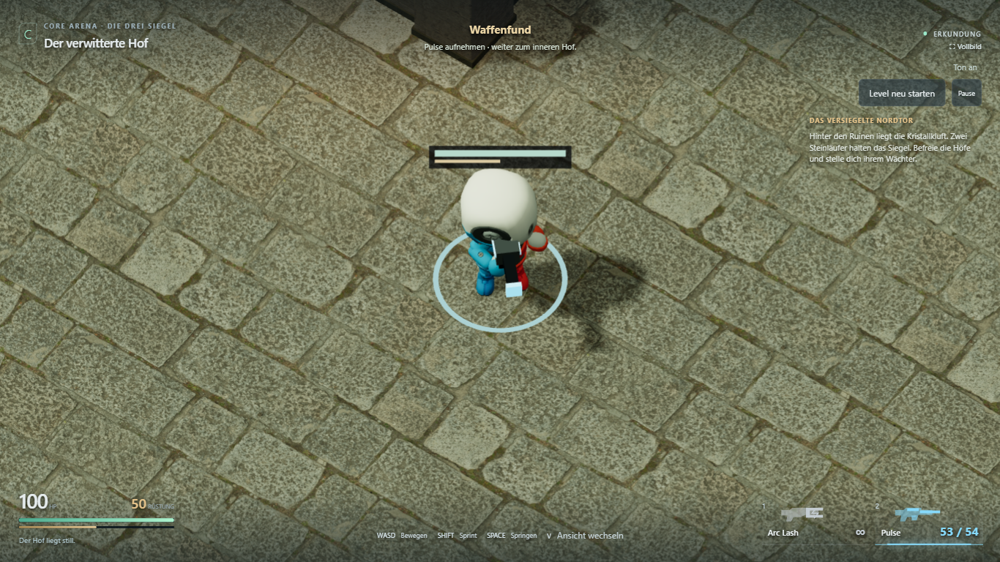
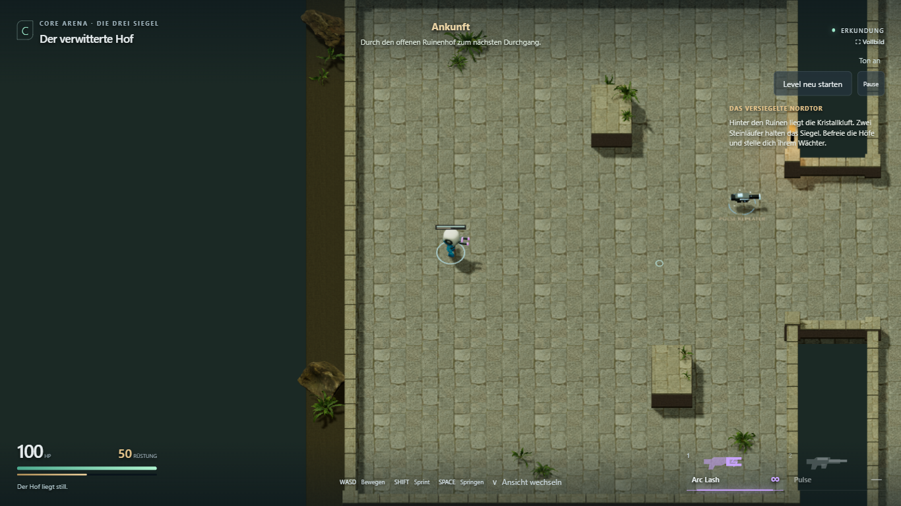
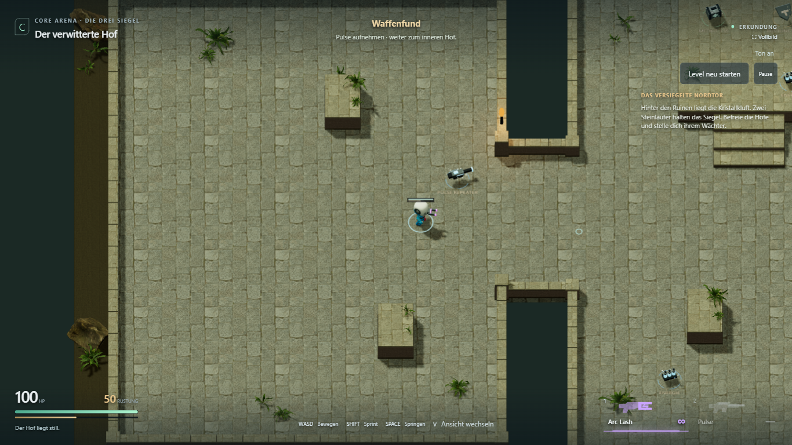
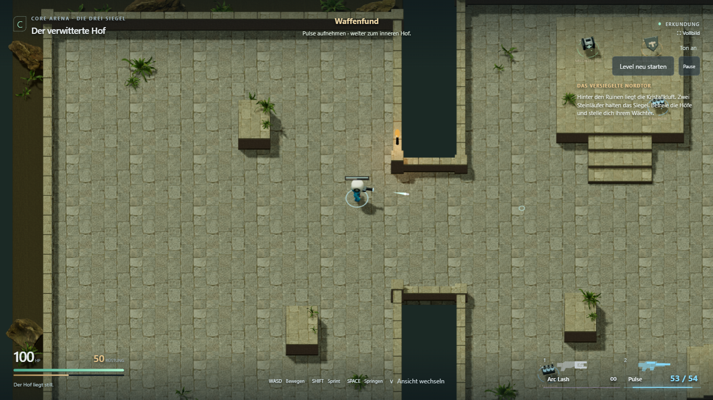
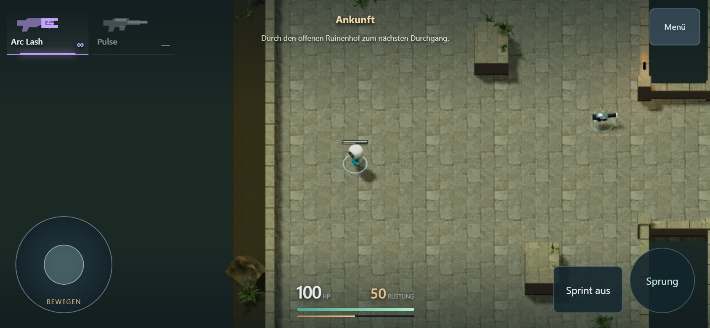
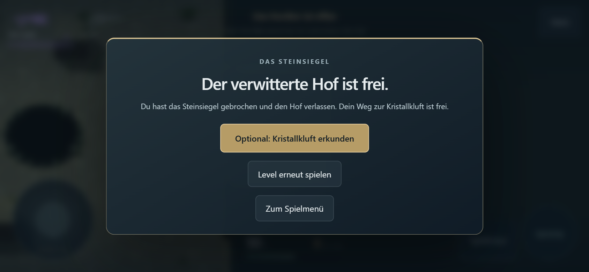

# KayKit-Figur und Energie-Pickups

29. Oktober 2026. **Umgesetzt und technisch geprüft.** Zusätzlicher, vom Nutzer
freigegebener Präsentationsschritt; persönliche Abnahme und L1.5 bleiben offen.

[Spielen](https://emfau88.github.io/CoreArena-3D/?mode=pve&level=stone&adventure=1)
· [Ohne Gegner ansehen](https://emfau88.github.io/CoreArena-3D/?mode=pve&level=stone&adventure=1&explore=1)
· [Roadmap](../planning/LEVEL_1_STONE_ADVENTURE.md)

## Figur

Die Grundform-Figur ist durch **KayKits Mannequin Medium** ersetzt: großer Kopf,
kurzer Körper, farbige Gliedmaßen und ein vorhandenes Skelett mit 21 Knochen.
Das kostenlose offizielle **Character Animations Free 1.1** enthält dieses
Mannequin bereits zusätzlich zu den Animationen. Deshalb war für diese Umsetzung
kein Kauf des separaten Prototype-Bits-Dummys erforderlich.

[Originalquelle, Archivhash und CC0-Lizenz](../../public/assets/kaykit/CREDITS.md).
Vier unveränderte, lokal ausgelieferte GLBs mit eingebetteten Texturen: zusammen
2,82 MiB. Modell, General-, MovementBasic- und CombatRanged-Animationen werden vor
Spielstart geladen. Für Spieler und Arena-Bot werden eigene Skelettinstanzen erstellt.
Materialien wirken matter; die Figur ist auf die bestehende Spielerhöhe abgestimmt.

Der Renderer mischt Idle/Lauf/Sprint/Sprung mit separaten Oberkörperzuständen für
Arc und Pulse. Eine begrenzte Taillendrehung berücksichtigt die Bewegungsrichtung
bei weiter zum Ziel gerichteten Schultern; Rückwärtsgehen verwendet den Laufzyklus
entsprechend rückwärts. Kleine Rückstoßbewegung, kurzer Trefferzustand und eine
Landestauchung ergänzen die Animationen. Bei Tod spielt kurz die Ganzkörperanimation,
Wiederholen/Respawn setzen den Zustand zurück. Bewegung, Sprunghöhe und Trefferregeln
werden weiterhin vom vorhandenen Spielkern bestimmt.

Im ersten Browserlauf wurden fehlende optionale Hand-Slot-Marker in den Animations-
dateien erkannt. Deren Tracks werden nun ausgeschlossen; alle vorhandenen Knochen
werden regulär animiert. Der abschließende neue Präsentationstest meldet keine
PropertyBinding-Warnungen, fehlenden Assets oder JavaScript-Seitenfehler.

## Nachbesserung: ungewolltes Drehen beim Laufen, 29. Oktober

Nutzerrückmeldung bestätigt: Die zusätzliche Hüftdrehung summierte sich pro Bild.
Der Three-Animationsmixer schreibt unveränderte Tracks nicht erneut; gerade die
Hüftrotation von `Walking_A` ist konstant. Deshalb blieb die vorherige manuelle
Drehung erhalten. Hüfte und Brust bekommen jetzt vor dem Animationsschritt ihre
zuletzt gespeicherte, unveränderte Clip-Pose zurück. Erst danach wird die begrenzte
Taillendrehung einmal angewendet. Das gilt auch bei Pause, Tod und Wiederbelebung.

Der neue Browser-Regressionsfall fährt acht Laufrichtungen mit unabhängiger Maus-
Zielrichtung ab und prüft die tatsächlichen Knochenrotationen sowie Stillstand in
Pause. Nach dem Fix bestanden. Vor dem Fix schlug er schon beim ersten Geradeauslaufen fehl (1,90 rad
statt höchstens 0,76 rad). Die bisherigen Prüfungen auf wechselnde Beinknochen
hatten diese unerwünschte Körperrotation nicht erkannt.

Zusätzlich erneut geprüft: Präsentationsablauf mit Sprint/Sprung/Arc/Pulse und
Pickups, vollständiger Desktopkampf einschließlich Tod/Retry/Exit sowie Touch-
Joystick/Sprint/Sprung/Kamera. Test- und Produktionsbuild einschließlich TypeScript
erfolgreich. Keine Änderungen an Steuerung, Kamera, Karte oder Spielbalance.

## Pickup-Darstellung

- Die geschlossenen dunklen Zylindersockel sind entfernt.
- Vier dünne Leuchtsegmente lassen den Boden zwischen sich sichtbar.
- Zwölf kleine instanzierte Lichtpartikel steigen um jeden verfügbaren Pickup auf.
  Blau markiert Waffe/Munition, Grün Heilung und Gold Rüstung. Keine neuen Lichtquellen.
- Beim Aufnehmen breitet sich kurz ein Lichtimpuls aus. Verbraucht und ohne Respawn
  verschwinden Modell, Beschriftung, Ring und Partikel vollständig nach dem Impuls.
- Teilweise verfügbare Vorräte bleiben sichtbar; bei Arena-Respawn bleibt während
  der Wartezeit ein gedimmter Ring. Neustart und Checkpoint-Vorräte stellen die
  zugehörige Darstellung passend zum tatsächlichen Ressourcenstand wieder her.

## Prüfung

`npm run build:test` und `npm run build` erfolgreich, einschließlich TypeScript.
Die bekannte Warnung des gemeinsamen Three/Rapier-Chunks bleibt bestehen.
Der Spielkern wurde nicht geändert; seine Kerntests laufen zusätzlich im Pages-Workflow.

**Vier Browserfälle bestanden** im sichtbaren Chromium. Desktop 1366 × 768,
Touch-Emulation 844 × 390:

```text
npx playwright test tests/e2e/fighter-look.spec.ts tests/e2e/adventure-fight.spec.ts tests/e2e/stone-adventure.spec.ts --grep "KayKit|menu entry|touch full level|touch joystick" --project=chromium-1366 --trace=off
```

1. Neuer Präsentationstest: importiertes Skelett und laufende Beinknochen geprüft;
   echte Eingaben wechseln zwischen Gehen/Sprint/Sprung, danach Landung, Arc-Schuss,
   regulärer Waffenfund und Pulse-Schuss. Der verbrauchte Waffenfund wird nach dem
   Impuls auch visuell unsichtbar. Nahaufnahme nur durch Dokumentationskamera.
2. Desktop-Komplettlauf: beide Läufer, Waffenfund/Vorräte, Checkpoint, tatsächlicher
   Boss-Tod/Retry, Sieg, physischer Ausgang und vollständiger Reset.
3. Derselbe vollständige Levelabschluss per Touch, inklusive Checkpoint-Retry und
   Rückkehr ins Spielmenü.
4. Touch-Joystick, Sprint während Bewegung, Waffenfund, Feuer, Terrasse, Sprung,
   Kameras, Menü und Neustart.

[Browserbericht](kaykit-presentation/browser-result.json). Reguläre Spieltests
benutzen keine Teleports oder HP-/Munitionsinjektionen. Diagnose und Nahaufnahmekamera
existieren nur im Test-Build. Eine persönliche Sichtung des Stils und ein echter
Smartphone-Leistungstest stehen weiterhin aus.

## Aufnahmen aus dem Spiel

**Detail aus der Spielperspektive, per Testkamera herangezoomt:**



**Normaler Spieleinstieg:**



**Waffenfund mit Leuchtring und aufsteigenden Partikeln:**



**Nach regulärer Aufnahme und Pulse-Schuss:**



**Touch:**




