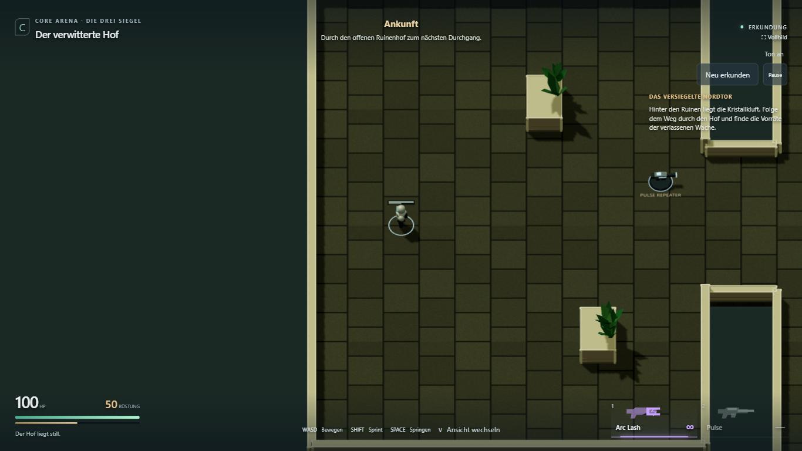
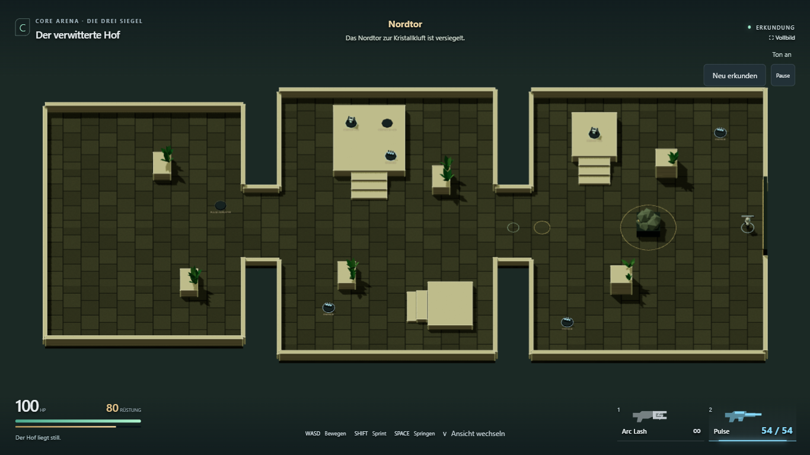
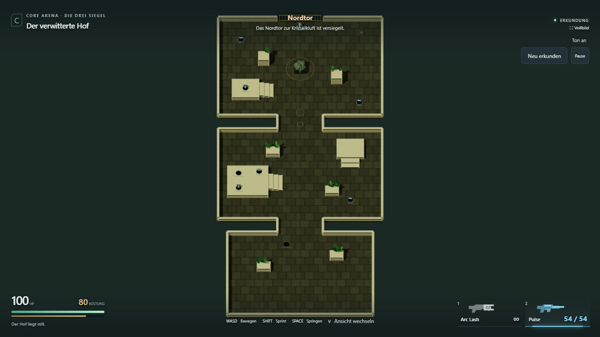
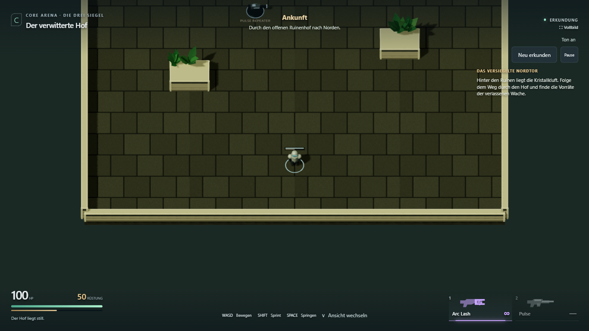
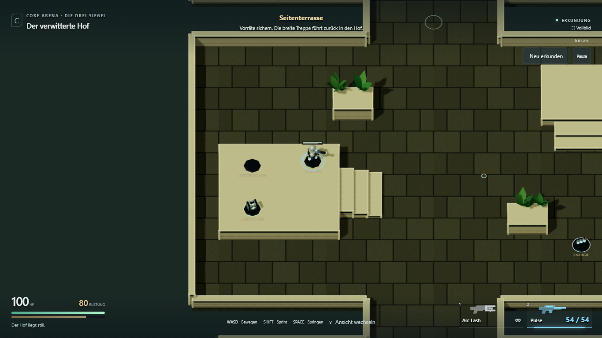
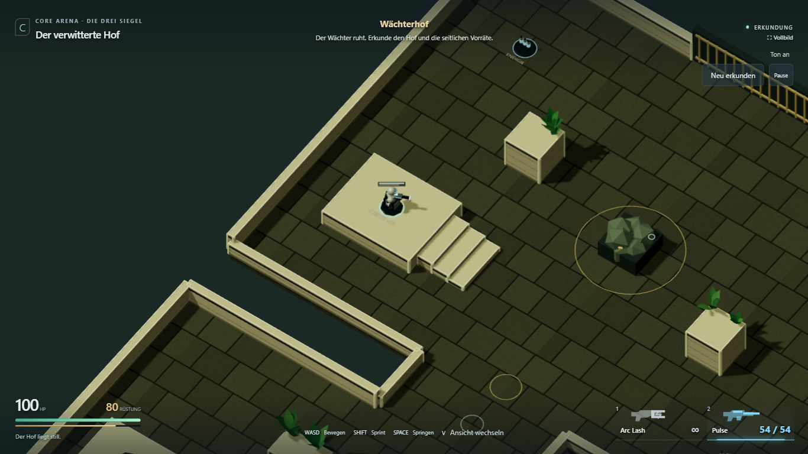
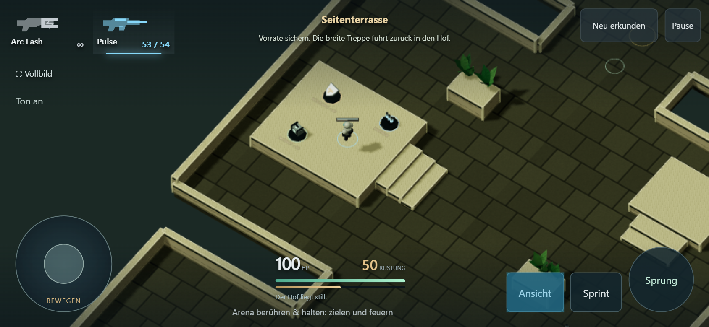

# L1.1 — Drei große Höfe erkunden

27. Oktober 2026. **Umgesetzt und technisch geprüft; persönliche Abnahme offen.**
[Ruhigen Erkundungsstand öffnen](https://emfau88.github.io/CoreArena-3D/?mode=pve&level=stone&adventure=1&explore=1).

Der normale Adventure-Link enthält inzwischen [L1.2 mit zwei Nahkämpfern und dem
vorhandenen Boss](L1_2_RESULT.md). Dieser Bericht dokumentiert den früheren Grundrissstand.

Anschließend umgesetzt: [Mobile-Zoom, Sprint während Bewegung, kompakteres HUD und
kürzere Adventure-Sprünge](MOBILE_POLISH_RESULT.md). Die Aufnahmen unten zeigen die
vorherigen L1.1-Zwischenstände; aktuelle Touch-Aufnahmen stehen im verlinkten Bericht.

## Ergebnis

Der erste, verwinkelte Grundriss wurde auf direkte Nutzerrückmeldung während der
Umsetzung ersetzt. Jetzt gibt es **drei große offene Höfe**: Ankunft/Ruinenhof
32 × 22 m, innerer Hof 36 × 24 m, Wächterhof 36 × 26 m. Die Verbindungen sind
10 m breit und nur 4 m lang. Die gesamte Karte misst ungefähr 36 × 80 m.
A–H sind benannte Orte innerhalb dieser Höfe, keine acht ummauerten Räume.

- Freier Hauptweg, wenige seitliche Deckungen und niedrige Umfassungsmauern.
- Kamera folgt dem Spieler durch das ganze Level, zeigt 20 % mehr Umgebung;
  beide Ansichten und direkter Kamerasprung zum Start beim Neustart.
- Drei erhöhte Flächen: optionale Terrasse, späterer Werfersockel, Boss-Heilplateau.
  Breite Treppen mit Stufen unter 0,32 m sind ohne Sprung begehbar. Dieser kleine
  Schrittmodus gilt nur hier; die bisherigen Arenen behalten ihren Höhenmotor.
- Arc zum Start, Pulse mit 54 Schuss am Norddurchgang des ersten Hofs. Seitliche
  Rüstung, Medkits und Munitionslager an den dokumentierten festen Orten.
- Einmalige Vorräte mit Restmengen; kompletter Neustart setzt sie zurück.
- Ruhender Wächter, Siegelmarkierung und physisch geschlossenes Nordtor.
- Gemeinsame Bodenmaterialien mit konsistenten Fugen; Mauerteile werden gemeinsam
  gezeichnet, um die Zahl separater Zeichenaufrufe zu begrenzen.

Die bisherigen Kampagnenkarten und der Arena-Einstieg bleiben separat aufrufbar.
L1.1 ist bewusst Erkundung: **noch keine kleinen Gegner, Bossaktivierung, Checkpoint-
Auffüllung oder Levelabschluss**. Dafür gelten L1.2/L1.3 und ihre nächsten Freigaben.

## Prüfung

### Kameranacharbeit: Standard von links nach rechts

Auf anschließenden Nutzerwunsch startet Adventure nun mit seitlichem Blick. Der
Weg zum Nordtor verläuft auf dem Bildschirm nach rechts; D/rechter Joystick bewegt
entsprechend vorwärts durch die Höfe. V/Ansicht wechselt seitlich → bisher gerade →
isometrisch → seitlich. Ein Neustart behält die selbst gewählte Perspektive bei.
Pickup-Beschriftungen werden in der seitlichen Ansicht mitgedreht, damit sie lesbar
bleiben. Geometrie und Vorratspositionen sind unverändert.

Sechs gezielte Kern-/Kameratests bestanden (`tests/core.test.ts` und
`tests/stone-adventure.test.ts`). Der bestehende Desktop-/Touch-Durchlauf wurde auf
die seitliche Startkamera angepasst; beim Desktop-Feuern wird auch die tatsächliche
Projektilrichtung nach rechts geprüft. **2/2 Browserfälle ohne Retry bestanden**,
Test- und Produktionsbuild grün. [Laufstatistik](stone-adventure/horizontal-browser-results.json).
Die nachfolgende ursprüngliche L1.1-Prüfung bleibt als historischer Nachweis erhalten.





### Ursprüngliche L1.1-Übergabe

`npm run build`: TypeScript und Produktionsbuild bestanden. Bestehende Warnung zum
großen Three-/Rapier-Hauptbundle bleibt; keine neue Optimierungsbaustelle eröffnet.

`npx tsx --test --test-concurrency=1 tests/*.test.ts`: **44/44 bestanden**.
Die drei neuen Fälle prüfen den gesamten Weg mit echtem Rapier-Motor einschließlich
aller Treppen/Standflächen und Torblockade, Einmal-/Teil-Pickups sowie Kamerafolge/Reset.
Bestehende Kampf-, Bot-, Sprung-, Kollisions- und Bossprüfungen bleiben grün.

Browserlauf gegen den gebauten Test-Preview, sichtbares Chromium unter Windows:

```text
npx playwright test tests/e2e/stone-adventure.spec.ts tests/e2e/scenery.spec.ts --project=chromium-1366 --trace=off
```

**3/3 bestanden, keine Retries und keine JavaScript-Fehler in den beiden Adventure-Fällen.**
[Laufstatistik](stone-adventure/browser-results.json),
[gelesener Endzustand des Durchlaufs](stone-adventure/walkthrough.json).

1. Desktop 1366 × 768: normaler Spawn → Pulse aufnehmen/auswählen/feuern → Terrasse
   über Treppe → Rüstung und Munition aufnehmen → Kamerawandel und Bewegung →
   Werfersockel → Wächterhof/Heilplateau → Nordtor → Pause/Weiter → Neustart.
   Alle Wege mit Tastatur, Maus und UI; keine Teleports für den Durchlauf. Verbraucht
   gebliebene Pulse, zurückbehaltene Munitionsreste und vollständiger Reset geprüft.
2. Touch-Emulation 844 × 390, Geräte-DPR 2, Render-DPR 1: Joystick vom Start zur Pulse,
   Waffenbutton/Feuern, Terrasse über Treppe, Sprung, Kamerawechsel und Neustart.
3. Bestehende Kampagne: echter Plattformsprung im alten Steinhof und Darstellung
   von Stein/Frost/Glut in beiden Kameraperspektiven als Regression.

Die Testhilfe liest Zustand. Nur für Übersichtsaufnahmen kann sie die Kamera
vergrößern und pausieren; sie setzt keine Spielerposition, Vorräte oder Ergebnisse.
Sie ist im Produktionsbuild entfernt. Nach dem Browserlauf wurden lediglich zwei
Hinweistexte auf „Siegelplatz“/„Norddurchgang“ vereinheitlicht und erneut gebaut.

Während der Entwicklung: lange Tastendrücke konnten durch Eingabe-/Prozessverzögerung
an Zielpunkten vorbeilaufen; der Desktop-Test korrigiert jetzt mit echten kurzen
Tastendrücken. Der finale Lauf ist ohne Wiederholung grün. Wegen sehr wenig freiem
lokalem Speicher lief er ohne Traces; der parallele Node-Lauf hatte lokale
Speicherallokationsfehler, deshalb der vollständige serielle Kernlauf oben.

## Grenzen und nächste Freigabe

Medkits sind erreichbar und bleiben bei vollen HP liegen; ohne Gegner gibt es hier
noch keinen regulären Schaden/Heilungszyklus. Teilverbrauch ist im Kerntest geprüft.
Die niedrige Außenmauer kann übersprungen werden; ein Sturz außerhalb setzt die
Figur zum Start zurück, ohne Inventarverlust. Fortschrittssperren folgen erst in L1.3.
Touch wurde im Browser emuliert, nicht auf einem echten Smartphone abgenommen.
Kein FPS-/Geräteleistungsversprechen; Lesbarkeit und Spielgefühl brauchen Nutzerurteil.

Nächster begrenzter Auftrag nach Freigabe: **L1.2**, fünf Pflichtgegner und zwei
optionale Gegner mit zwei unterschiedlichen Verhaltensweisen. Der Aufbau bleibt
groß und offen; Aktivierung der Gruppen D/E muss die maximal drei gleichzeitigen
Angreifer berücksichtigen. [Aktualisierter Plan](../planning/LEVEL_1_STONE_ADVENTURE.md).

## Echte Aufnahmen des neuen Aufbaus

Übersicht nach dem Durchlauf; bereits eingesammelte Gegenstände fehlen entsprechend.
Die normale Kamera folgt dem Spieler und zeigt nur den jeweiligen Bereich.










