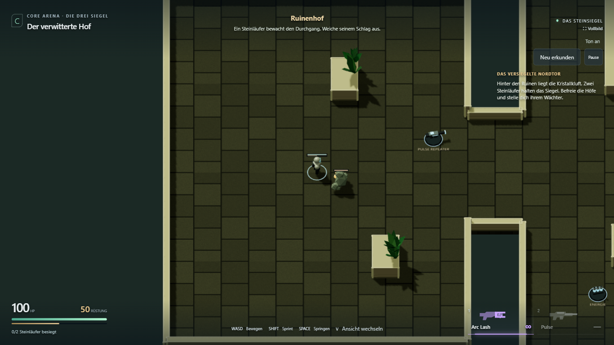
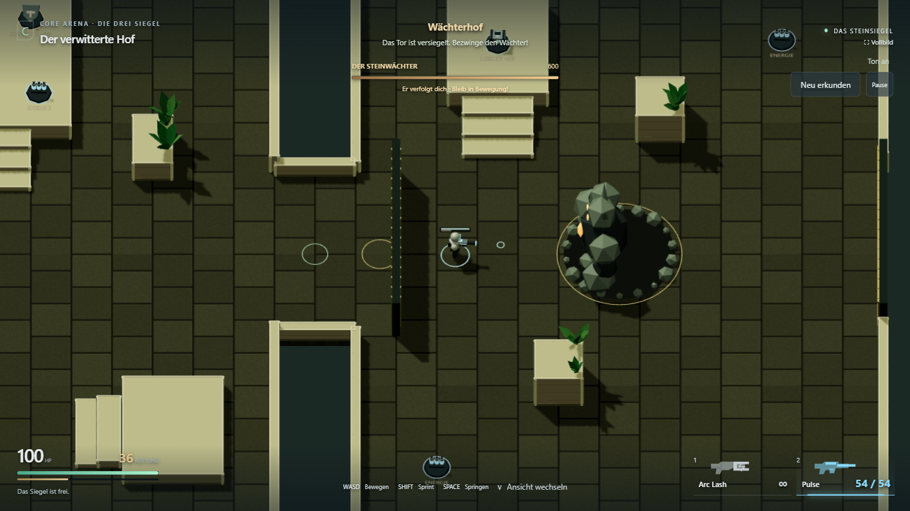
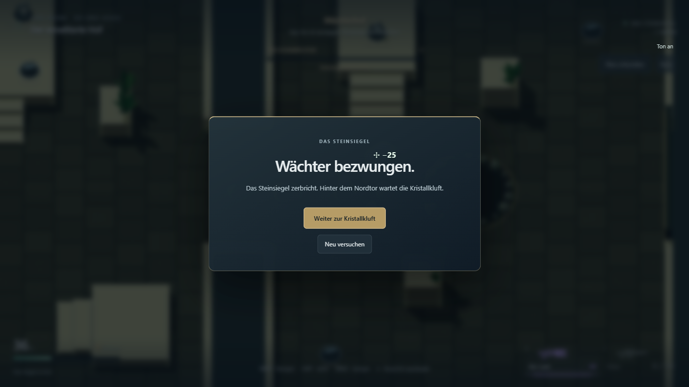
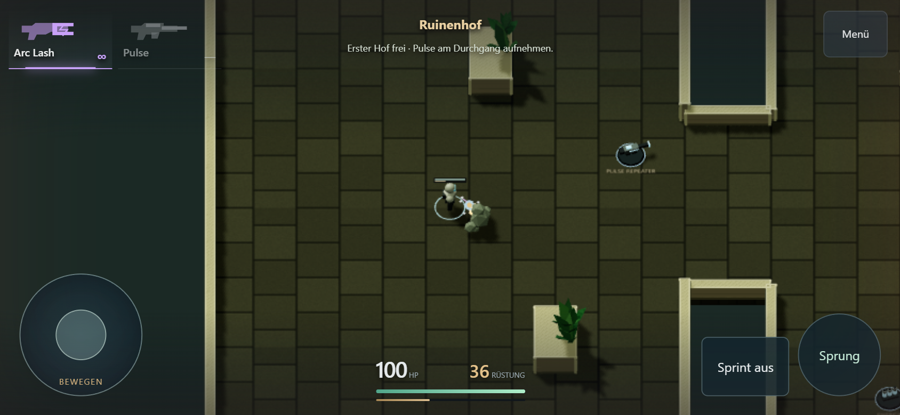

# L1.2 — Zwei Steinläufer und der vorhandene Wächter

Historischer Kampfstand: [L1.3](L1_3_RESULT.md) ergänzt inzwischen Checkpoint,
Spielmenü-Einstieg und den tatsächlich begehbaren Ausgang. Der Ablauf unten dokumentiert L1.2.

27. Oktober 2026. **Umgesetzt und technisch geprüft.** Persönliches Urteil zum
Spielgefühl und ein echter Smartphone-Test stehen aus.

[Adventure spielen](https://emfau88.github.io/CoreArena-3D/?mode=pve&level=stone&adventure=1)
· [Überarbeiteter Plan](../planning/LEVEL_1_STONE_ADVENTURE.md)

## Ergebnis

Auf Nutzerwunsch reduziert: **ein kleiner Nahkämpfer im Ruinenhof, ein weiterer im
inneren Hof und der bekannte Steinwächter im dritten Hof**. Keine Zusatzgruppen,
Werfer, Wellen oder neuen Bossphasen. Die Seitenterrasse bleibt ein Vorratsabstecher.

Die Steinläufer verfolgen mit echter Kollision und schlagen nach 0,4 Sekunden
sichtbarem Ausholen zu: 70 HP, 14 Schaden, 1,8 m Reichweite, 0,7 Sekunden Erholung.
Sie bleiben in ihrem Hof; Schaden bleibt bei Rückzug erhalten. Abstand, Höhe und
Deckung verhindern Treffer. Die kleinen Figuren haben Arme, Beine, einen hellen
Steinkern, HP-Balken, Aushol-/Schlagbewegung und eine kurze Todesanimation.

Nach beiden Läufern weckt das Betreten des letzten Hofs den Steinwächter. Sein
vorhandenes Auftauchen, Verfolgen, Faustschlag, Schockwelle und Bodenausbruch werden
wiederverwendet. Der Eingang schließt während des Kampfes mit echter Kollision.
Ein gemeinsamer Lebenszustand gilt für die Anreise und den Boss; Pickups helfen
weiter. Sieg/Niederlage bieten Neustart, nach Sieg führt ein Button zur bestehenden
Kristallkluft. Kein Checkpoint oder physisch begehbarer Levelausgang in diesem Paket.

Der alte ruhige Grundriss ist zum Vergleich mit zusätzlichem `&explore=1` aufrufbar.
CTF-3.0 wurde nicht verändert. Mobile-Feinschliff wurde zuvor separat als `cb5753f`
committet und veröffentlicht.

## Prüfung

- `npm run build`: TypeScript und Produktionsbuild erfolgreich. Bekannte Größenwarnung
  für den gemeinsamen Three/Rapier-Chunk bleibt bestehen.
- `npx tsx --test --test-concurrency=1 tests/*.test.ts`: **47/47 bestanden**.
  Neue Kernfälle prüfen Schlagvorbereitung, einmaligen Schaden, Ausweichen, Höhe,
  Deckung, Tod, gemeinsamen Lebenszustand, ruhenden Boss, Aktivierung und Reset.
  Bestehende Waffen-, Boss-, Höhen-/Kollisions- und Kamera-Prüfungen ebenfalls bestanden.
- `npx playwright test tests/e2e/adventure-fight.spec.ts tests/e2e/stone-adventure.spec.ts --project=chromium-1366 --trace=off`:
  **4/4 bestanden**, sichtbarer Chromium, Desktop 1366 × 768 und Touch 844 × 390.
  Gesamtlauf ca. 106 Sekunden; keine gemeldeten Seitenfehler.
- Desktopkampf: vom normalen Spawn mit WASD zum ersten Läufer, per Maus besiegt,
  Pulse aufgenommen/gewählt, zweiten Läufer besiegt, regulär Munition aufgenommen,
  zum Boss gelaufen, Auftauchen abgewartet, mit echten Schüssen gewonnen, neu gestartet.
  Endstand: **36 HP, 0 Rüstung, 0 Boss-HP, beide Läufer besiegt**, vier erhaltene
  Treffer über den gesamten Versuch. Neustart stellt Gegner, HP und Waffenbesitz zurück.
- Touchkampf: per Joystick angenähert, durch Halten/Nachführen des Fingers den ersten
  Läufer besiegt; über Menü neu gestartet; ohne Gegenwehr tatsächlich gestorben;
  „Neu versuchen“ stellt 100 HP, 50 Rüstung und lebenden Läufer wieder her.
- Grundrissvergleich ohne Gegner: sämtliche Höfe, Treppen, Terrasse und Bossplateau
  begehbar; Touch-Sprint während gehaltenem Joystick, Menü, Kamera und Neustart bleiben
  funktionsfähig. Diese beiden Fälle laufen ausdrücklich mit `explore=1`.

Der Browser liest den Zustand über die Testbuild-Diagnose, setzt aber weder Position,
HP, Munition noch Schaden. Der erste Desktop-Testversuch hielt den Mauszeiger noch
über dem Waffenbutton und löste deshalb kein Feuer aus; der Test bewegt ihn jetzt
vor dem Drücken zur Figur. Bei der visuellen Prüfung sichtbare zusätzliche
Trainings-Zielkugeln wurden aus dem Adventure-Rendering entfernt; die unsichtbaren
Trefferkörper bleiben für die Physik erhalten. Der anschließende Vier-Fälle-Lauf bestand.

**Grenze der Abnahme:** Stehendes, präzises Dauerfeuer konnte den vorhandenen Boss
noch besiegen. Dies ist eine funktionierende kleine Erstfassung, keine fertige
Schwierigkeitsabstimmung. Der kurze Lauf misst auch keine Erstbesucher-Spielzeit.
Touch-Emulation belegt Bedienbarkeit im Browser, keine Leistung auf einem echten Handy.

## Echte Spielaufnahmen

Erster Steinläufer im Ruinenhof:

Der wiederverwendete Steinwächter nach dem Auftauchen im letzten Hof:

Regulärer Sieg nach beiden kleinen Gegnern und Boss:

Touch nach dem ersten besiegten Läufer:

[Kompakter Laufnachweis](adventure-fight/browser-result.json).
