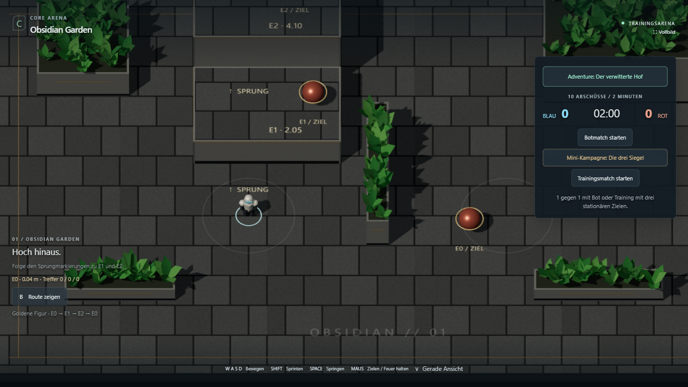
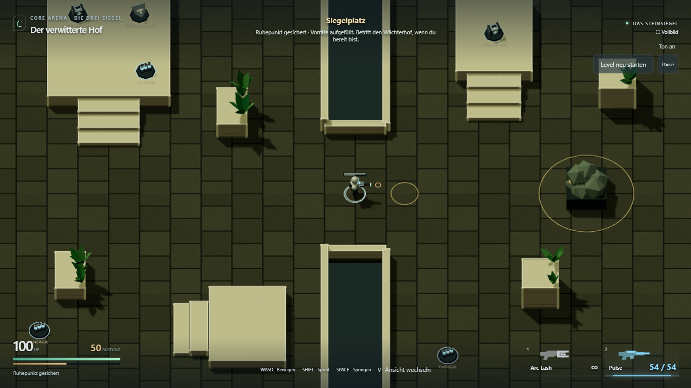
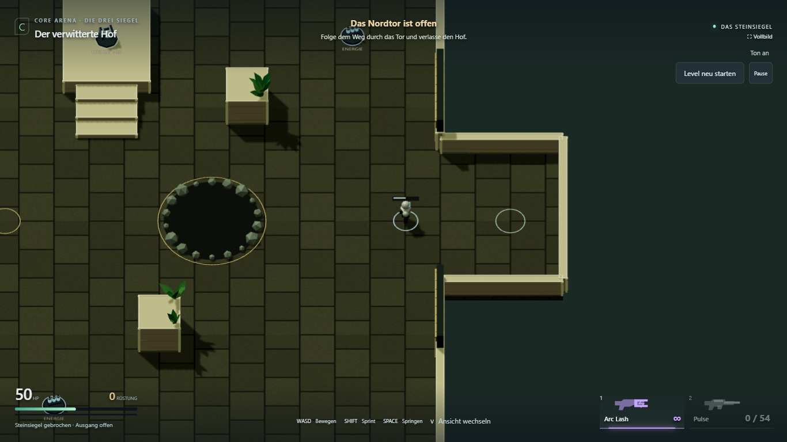
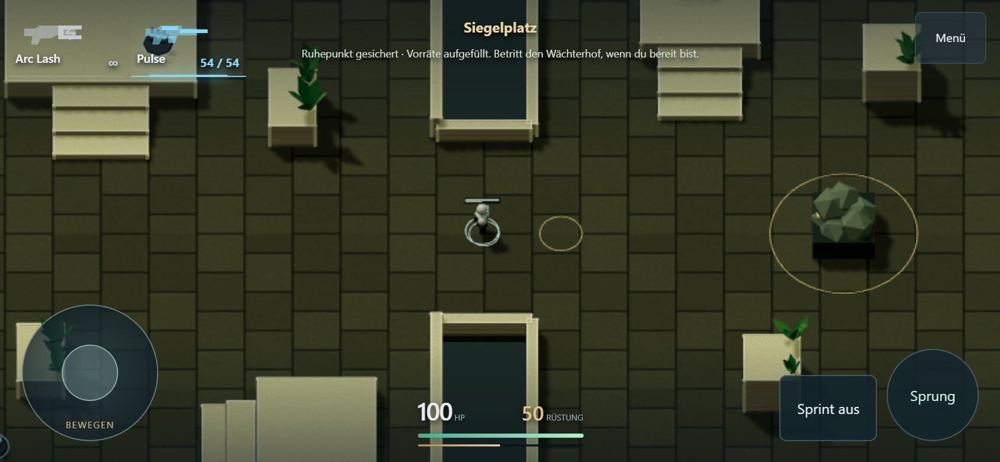
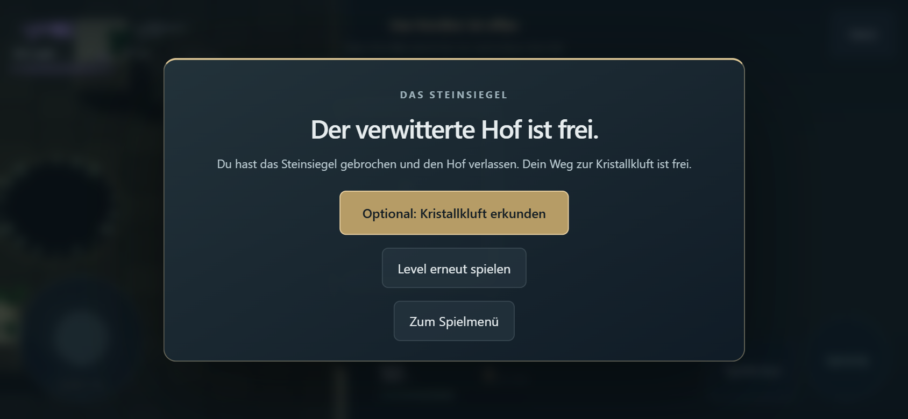

# L1.3 — Ein vollständiger Levelablauf

28. Oktober 2026. **Umgesetzt und technisch geprüft.** Gestaltung und abschließende
Schwierigkeitsabstimmung bleiben L1.4a/b bzw. L1.5; persönliche Abnahme steht aus.

[Direkt spielen](https://emfau88.github.io/CoreArena-3D/?mode=pve&level=stone&adventure=1)
· [Spielmenü](https://emfau88.github.io/CoreArena-3D/)
· [Roadmap](../planning/LEVEL_1_STONE_ADVENTURE.md)

## Ergebnis

- Im bestehenden Spielmenü führt „Adventure: Der verwitterte Hof“ zum Testlevel.
  Bei Ankunft erklärt ein kurzer Auftrag den Weg: Höfe befreien, Wächter bezwingen,
  Zugang zur Kristallkluft öffnen. Keine zusätzliche Startbestätigung.
- Nach beiden kleinen Gegnern sichert das Erreichen des Siegelplatzes einen Ruhepunkt.
  Einmalig 100 HP, mindestens 50 Rüstung und Pulse mit 54 Schuss; bereits gesammelte
  höhere Rüstung bleibt erhalten. Zurücklaufen erzeugt keine weitere Auffüllung.
- Nach Boss-Tod startet „Am Ruhepunkt versuchen“ bei (0; -14), mit 100 HP, 50 Rüstung
  und 54 Pulse-Schuss. Beide Läufer bleiben besiegt, verbrauchte Vorräte der Anreise
  bleiben verbraucht. Boss, seine drei Vorräte, Angriffsphasen und Projektile werden
  zurückgesetzt. Vor dem Checkpoint beginnt Wiederholen am Levelanfang.
- „Level neu starten“ setzt immer das gesamte Level zurück. Der Checkpoint gilt nur
  für die laufende Sitzung, ohne Speicherung nach Reload oder Rückkehr zum Spielmenü.
- Nach Boss-Sieg öffnen sich die zwei Nordtorhälften sichtbar, der zugehörige Collider
  wird abgeschaltet. Spieler und Kamera bleiben steuerbar. Ein kurzer begehbarer
  Ausgang hinter dem Tor ergänzt den vorhandenen Grundriss.
- Erst tatsächliches Durchgehen bis hinter Z = -45 schließt den Level ab. Der Abschluss
  bietet Wiederholen, Spielmenü und optional die bestehende Kristallkluft. Keine
  automatische Weiterleitung mitten im Sieg; der Bosskampf bleibt unverändert.

## Technische Prüfung

`npm run build:test` und `npm run build` erfolgreich. Die bekannte Größenwarnung
für den gemeinsamen Three/Rapier-Chunk bleibt bestehen.

`npx tsx --test --test-concurrency=1 tests/*.test.ts`: **48/48 bestanden**.
Der neue Fall prüft die einmalige Auffüllung, gemeinsamen Ressourcenstand, erhaltene
Anreise-Vorräte, gezieltes Zurücksetzen der Bossvorräte, Checkpoint-/Gesamtneustart und
Levelabschluss erst hinter dem Tor auf Bodenhöhe. Bestehende Kampf-, Bewegungs-,
Kollisions- und Kamerafälle bleiben grün.

**Fünf Browserfälle bestanden**, sichtbarer Chromium, Desktop 1366 × 768 und
Touch-Emulation 844 × 390. Ausgeführt in zwei Läufen:

1. `npx playwright test tests/e2e/adventure-fight.spec.ts --project=chromium-1366 --trace=off`
   mit den zunächst zwei vorhandenen, erweiterten Fällen: Desktopkomplettlauf sowie
   Touch-Kampf/Tod vor dem Checkpoint. Beide bestanden.
2. Nach Ergänzung des vollständigen Touch-Abschlussfalls:
   `npx playwright test tests/e2e/adventure-fight.spec.ts tests/e2e/stone-adventure.spec.ts --grep "touch full level|walk every room|touch joystick" --project=chromium-1366 --trace=off`.
   Neuer Touchkomplettlauf und beide Grundriss-/Eingaberegressionen bestanden.

Desktop: aus dem Spielmenü starten, beide Läufer regulär besiegen, Waffen/Vorräte
aufnehmen, Checkpoint erreichen, durch echte Bossangriffe sterben, am Ruhepunkt
erneut versuchen, regulär gewinnen, durch das physische Tor laufen, vollständigen
Neustart und Rückkehr ins Menü bedienen. Boss-Sieg mit 50 HP/0 Rüstung im dokumentierten
Durchlauf; beim Sieg ist der Abschluss noch verborgen, erst hinter dem Tor sichtbar.

Touch: derselbe vollständige Kampf-/Checkpoint-/Ausgangsablauf mit Joystick,
Finger-Aim und Tap-Buttons. Zusätzlich vorheriger Fall: im ersten Hof ohne Gegenwehr
tatsächlich sterben und am Anfang neu versuchen. Abschluss und Retry passen ins
Querformat. Das Spielmenü ist per Touch erreichbar.

Grundrissregressionen im ruhigen `explore=1`-Vergleich: alle Höfe, Treppen, Terrassen,
Waffenaufnahme, Kamera, Pause und Neustart; Sprint während gehaltenem Joystick.
Keine gemeldeten Seitenfehler. Keine Teleports, HP-/Munitionsinjektionen oder
künstlicher Schaden in den Browserdurchläufen; Diagnosezugriff nur lesend. Die
Übersichtsfunktion wird nur für die separate Layout-Aufnahme genutzt.

Touch-Emulation ersetzt keinen echten Smartphone-Leistungs-/Bedienungstest. Keine
neue Aussage zu FPS oder fertiger Schwierigkeit; L1.5 bleibt offen. Keine Änderung
an CTF-3.0 und keine vorgezogene Material-/Dekorationsarbeit.

## Spielaufnahmen

[Desktop/erster Touch-Lauf](adventure-completion/combat-result.json)
· [Touch-Abschluss und Grundrissregressionen](adventure-completion/touch-layout-result.json).
