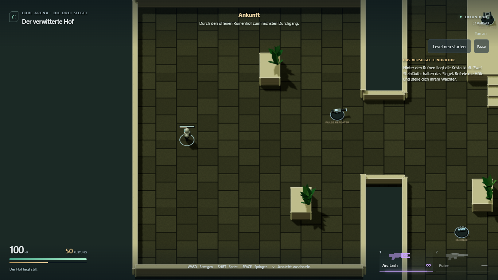
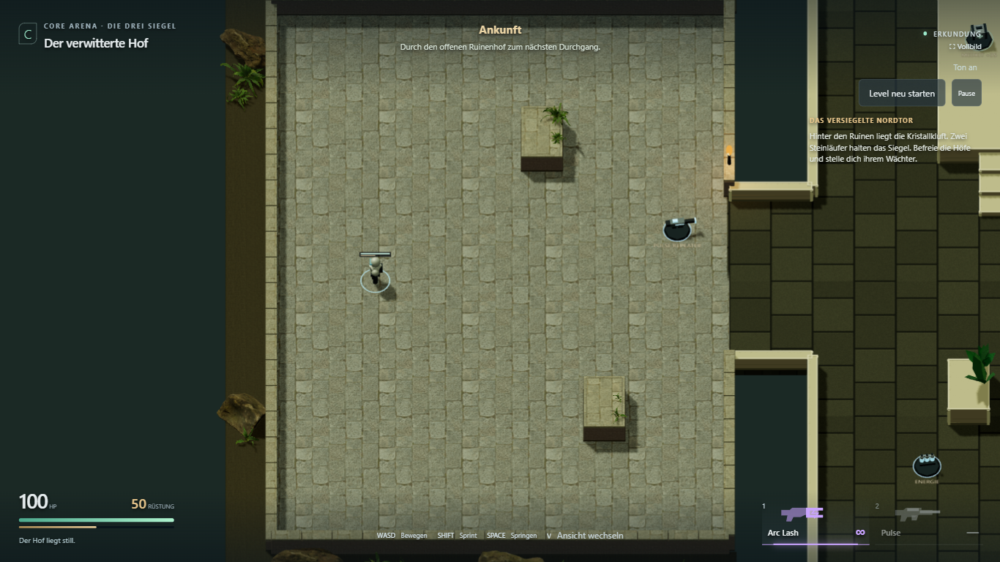
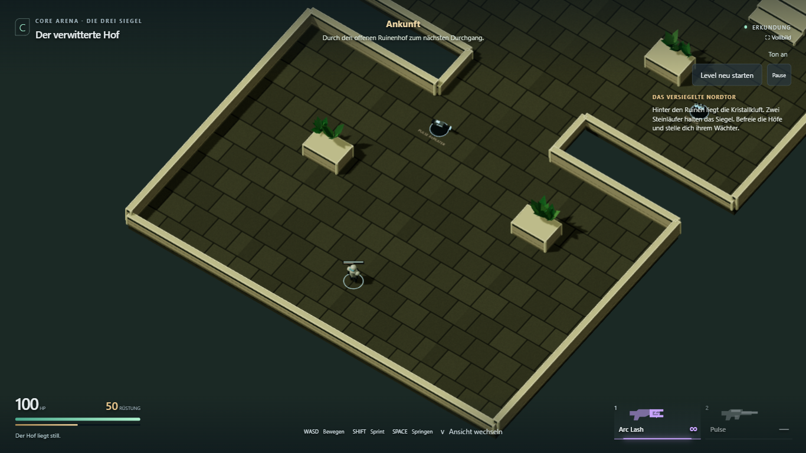
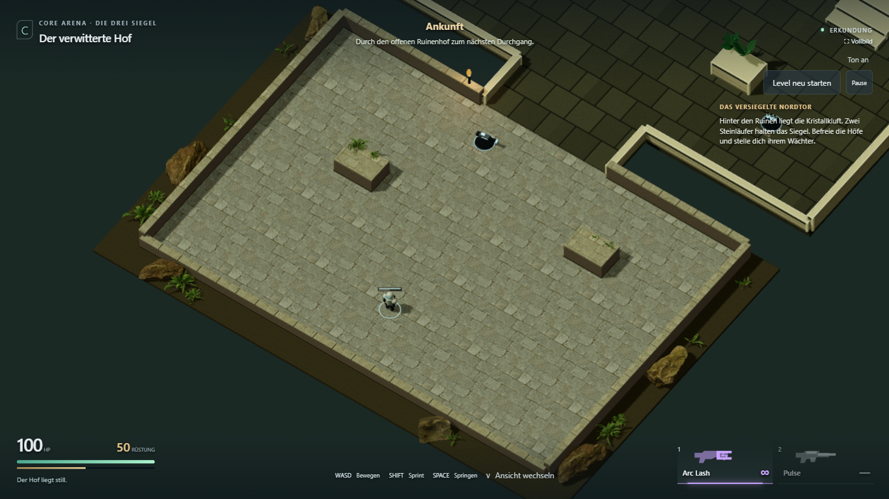
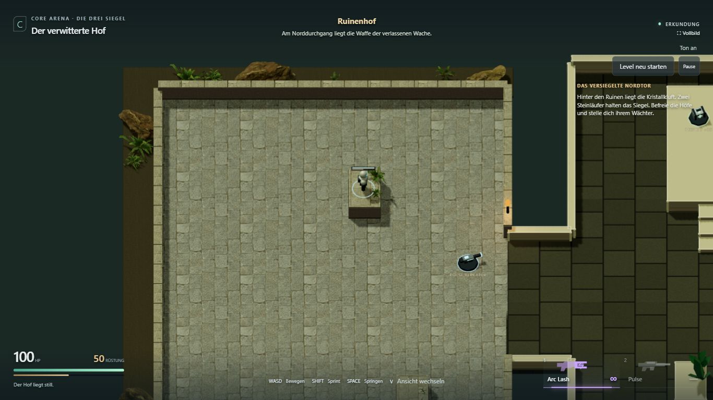
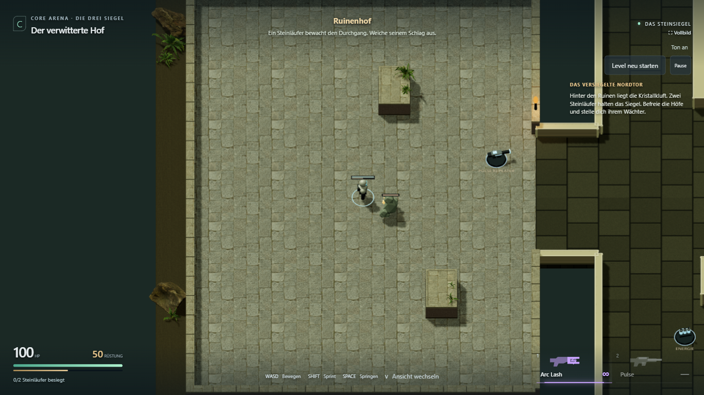
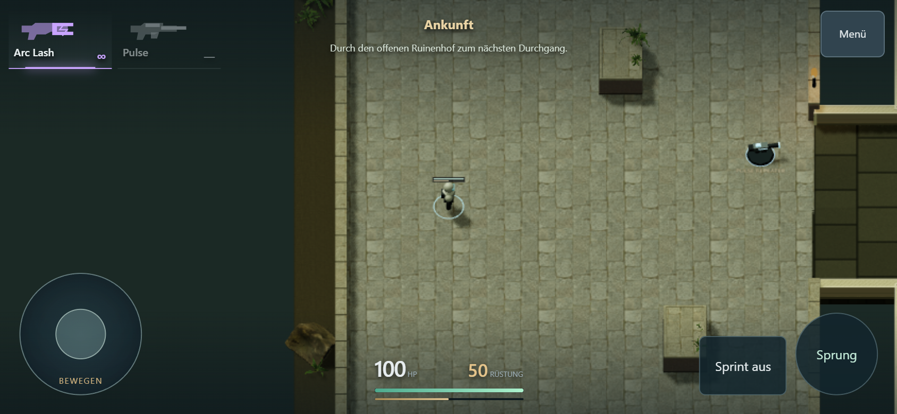

# L1.4a — Gestaltungsprobe im ersten Hof

28. Oktober 2026. **Umgesetzt und technisch geprüft.** Persönliche Sichtung steht
aus; die Übertragung auf den inneren Hof und Wächterhof ist L1.4b und nicht begonnen.

[Spielen](https://emfau88.github.io/CoreArena-3D/?mode=pve&level=stone&adventure=1)
· [Ohne Gegner ansehen](https://emfau88.github.io/CoreArena-3D/?mode=pve&level=stone&adventure=1&explore=1)
· [Roadmap](../planning/LEVEL_1_STONE_ADVENTURE.md)

## Sichtbares Ergebnis

- Verwittertes, helleres Steinpflaster mit zurückhaltenderen Fugen als das bisherige
  dunkle Raster. Farb-, Normalen- und Rauheitskarten sitzen direkt auf der Geometrie.
- Maßstäbliche Steinstruktur auf den senkrechten Wänden, kleine Fasen und einzelne
  helle Kappensteine. Beide Deckungen behalten eine freie, helle Landefläche und
  dunklere, bis zum Boden reichende Seiten. Keine schwebenden Moosflächen.
- Vier detaillierte Farnvarianten mit ausgeschnittenen Blättern ersetzen im ersten
  Hof die bisherigen groben Pflanzen. Sie sitzen an hinteren Deckungskanten oder
  im Außenstreifen. Drei bemooste Felsvarianten stehen außerhalb der Umfassung.
- Eine kleine eiserne Fackel am ersten Durchgang mit bewegter Flamme und lokalem
  warmem Licht. Keine zusätzliche Schattenmap für die Fackel.

Grundriss, Collider, Sprungkurve, Gegner und Kampfwerte bleiben unverändert. Die
anderen beiden Höfe sowie die bisherigen Arena-/Kampagnenkarten bleiben beim
bisherigen Materialset. Der Materialwechsel am ersten Durchgang ist in dieser
begrenzten Stilprobe daher sichtbar.

Die [vier CC0-Assetpakete und Quellen](../../public/assets/courtyard/CREDITS.md)
liegen vollständig im Repository: rund 7,5 MiB, 1K-Texturen, keine externen
Ladeadressen zur Laufzeit. Die Adventure-Ansicht wartet auf die geladenen Modelle
und Texturen. Statische Mauern/Kappen werden pro Material zu gemeinsamen Meshes
zusammengeführt; Modelle und Texturen werden innerhalb der Szene geteilt.

## Vorher / Nachher

Echte Chromium-Aufnahmen mit identischer Auflösung **1366 × 768**, identischem
Spielerstart und identischer Kamera. Vorher: `5b48877` plus ausschließlich dem
Testkamera-Hook, vor Einbau der neuen Materialien. Nachher: der L1.4a-Stand.
`explore=1` hält den Vergleich frei von angreifenden Gegnern. Die Ansicht wurde
jeweils für die Aufnahme angehalten; Gegner/HP/Positionen wurden nicht manipuliert.

Die Vergleichskamera ist auf den ersten Hof bei (0; 27) zentriert, mit fester
halber Bildhöhe 13,5 seitlich bzw. 16 isometrisch. Das sind Dokumentationsansichten;
der eigentliche Spielbetrieb behält seine bisherige mitgeführte Kamera.

**Seitlich — vorher**



**Seitlich — nachher**



**Isometrisch — vorher**



**Isometrisch — nachher**



## Prüfung

`npm run build:test` und `npm run build` erfolgreich, einschließlich TypeScript.
Die bestehende Größenwarnung des gemeinsamen Three/Rapier-Chunks bleibt bestehen.

Vier Fälle im sichtbaren Chromium bestanden:

```text
npx playwright test tests/e2e/courtyard-look.spec.ts tests/e2e/adventure-fight.spec.ts tests/e2e/stone-adventure.spec.ts --grep "first court|menu entry|touch joystick" --project=chromium-1366 --trace=off
```

1. Identische seitliche/isometrische Vergleichsansichten; keine Seitenfehler oder
   HTTP-Fehler bei Modellen, Texturen und Blattmaske.
2. Echte Tastatureingaben vom Spawn, Sprung und bestätigte Landung auf
   `entry-cover-west` und `entry-cover-east`, danach Pulse-Aufnahme.
3. Desktop-Komplettlauf aus dem Spielmenü: beide Läufer besiegen, Checkpoint,
   tatsächlicher Boss-Tod, Retry, Sieg, physischer Ausgang und vollständiger Reset.
4. Touch-Emulation 844 × 390: Joystick, Sprint während Bewegung an/aus, Waffenfund,
   Feuer, Seitenterrasse, Sprung, Kamera, Pause und Neustart. Mobile Render-DPR bleibt 1.

[Browserbericht](courtyard-look/browser-result.json). Alle vier Fälle ohne gemeldete
JavaScript-Seitenfehler. Kampf- und Wegtests benutzen echte Eingaben ohne Teleports,
HP-/Munitionsinjektionen oder künstlichen Schaden. Der neue Kamera-Hook existiert
ausschließlich im Test-Build. Der Spielkern wurde nicht geändert; die vorhandenen
Kerntests werden zusätzlich vom Pages-Workflow ausgeführt.

Die Aufnahmen wurden visuell gesichtet. In einer ersten Zwischenfassung waren die
Wände zu dunkel und Deckungsoberseiten überlagert; beides wurde vor dem abschließenden
Browserlauf korrigiert. Reale Smartphone-FPS, Wärmeverhalten und persönliche
Gestaltungs-/Schwierigkeitsabnahme bleiben offen. Keine 60-FPS-Garantie aus diesen Tests.

**Regulär auf die westliche Deckung gesprungen:**



**Gegner in der normalen Spielansicht:**



**Mobile Ansicht:**


