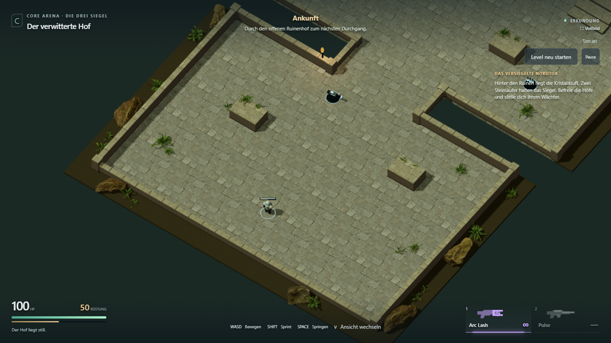
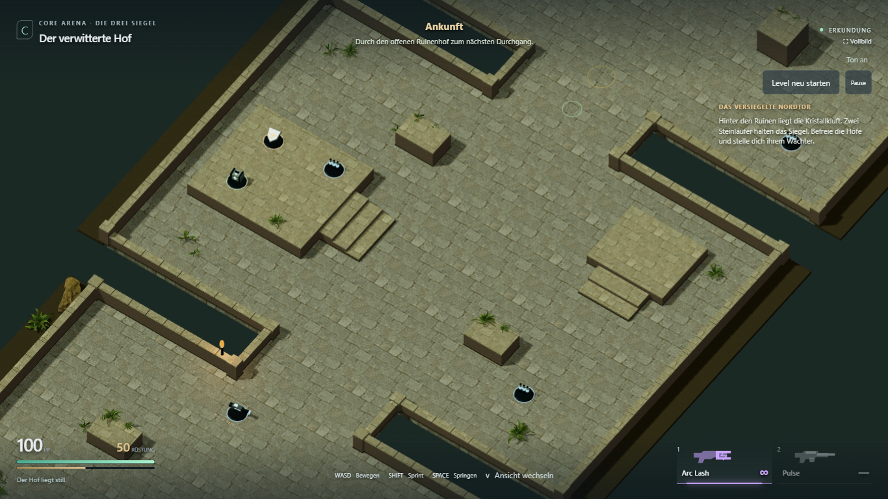
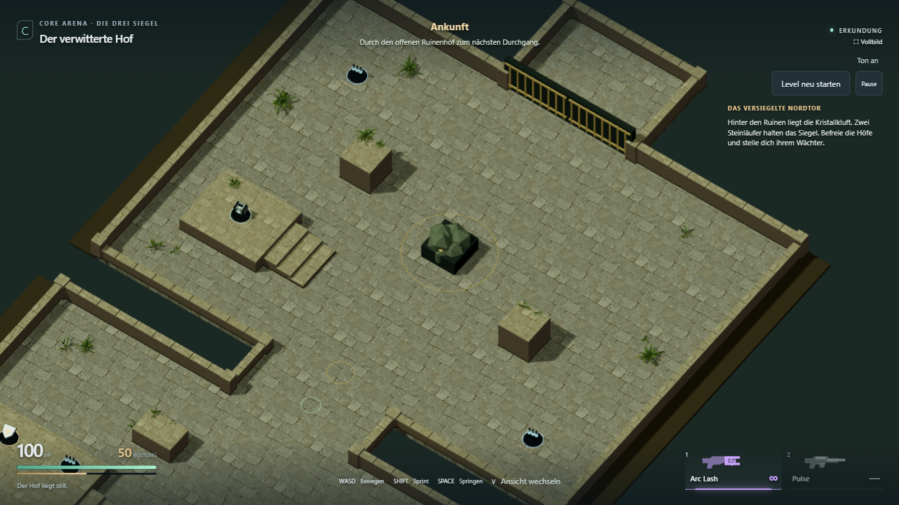
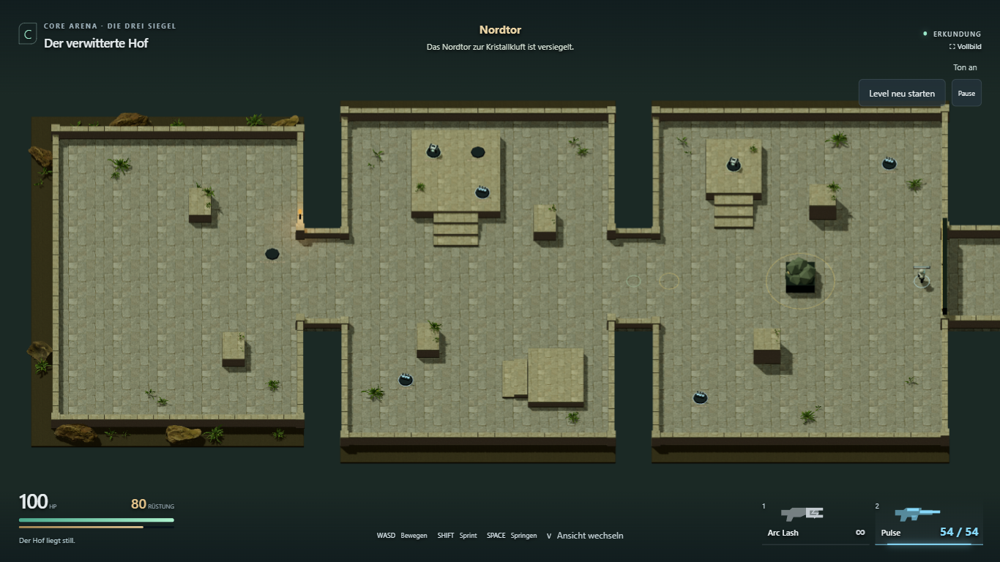

# L1.4b — Boden auf der ganzen Map, Innenpflanzen und saubere Ecken

28. Oktober 2026. **Der konkret freigegebene Material-/Ecken-/Pflanzenschritt ist
umgesetzt und technisch geprüft.** Weitere hofeigene Blickfänge/Lichtgestaltung
aus dem ursprünglichen L1.4b-Plan und die Kampf-/Leistungsabnahme L1.5 bleiben offen.

[Spielen](https://emfau88.github.io/CoreArena-3D/?mode=pve&level=stone&adventure=1)
· [Ohne Gegner erkunden](https://emfau88.github.io/CoreArena-3D/?mode=pve&level=stone&adventure=1&explore=1)
· [Roadmap](../planning/LEVEL_1_STONE_ADVENTURE.md)

## Änderungen auf die Rückmeldung

- Der Steinboden liegt in allen drei Höfen, beiden Verbindungen und am Ausgang.
  Texturmaßstab und Fugen laufen über die Raumgrenzen weiter. Die für die Physik
  überlappenden Bodenstücke werden visuell bündig abgeschnitten.
- Alle statischen Mauern, Deckungen, Treppen und Terrassen verwenden dasselbe
  Materialset. Plattformen erhalten eine durchgehende Abdeckplatte statt vier
  überkreuzter Randstücke; helle Oberseiten und dunklere Seiten zeigen die Höhe.
- Kleine massive Eckpfeiler schließen alle Mauerenden und -anschlüsse. Ihre
  durchgehenden Körper überdecken auch die Übergänge unterschiedlich hoher Mauern.
  Die Pfeiler sind 0,78 m breit, jeweils 0,14 m höher als die höchste anschließende
  Mauer und haben passende Kollision aus derselben Mapdefinition.
- Zusätzliche Farngruppen stehen innerhalb jedes Hofs, neben Deckungen und an
  Terrassenrändern. Es sind kleine durchgehbare Pflanzen, keine neuen Hindernisse.
  Waffen, Vorräte, Treppen, Landeflächen und der Siegelkreis bleiben frei.
- Große Felsen bleiben vorerst im Außenstreifen. Die bestehende Fackel bleibt am
  ersten Durchgang. Es wurden keine neuen Assetpakete heruntergeladen.

Die vier Farnvarianten werden als Instanzen dargestellt, die Mauer-/Bodengeometrie
weiterhin pro Material zusammengeführt. Die zusätzliche Bepflanzung erzeugt damit
nicht je Pflanze einen eigenen Modelldurchlauf. Kampflogik und Gegneranzahl bleiben
unverändert. CTF-3.0 und die separaten alten Kampagnenkarten wurden nicht verändert.

## Technische Prüfung

- `npm run build:test` und `npm run build`: erfolgreich, einschließlich TypeScript.
  Die bekannte Größenwarnung des gemeinsamen Three/Rapier-Chunks bleibt bestehen.
- `npx tsx --test --test-concurrency=1 tests/stone-adventure.test.ts tests/adventure-fight.test.ts`:
  **7/7 bestanden**. Reale Physikroute, Treppen/Landungen, Sprungkurve, Ressourcen,
  Nahkampf, Bossaktivierung, Checkpoint und Retry.
- **5/5 Browserfälle bestanden** im sichtbaren Chromium, Desktop 1366 × 768 und
  Touch-Emulation 844 × 390:

```text
npx playwright test tests/e2e/courtyard-look.spec.ts tests/e2e/adventure-fight.spec.ts tests/e2e/stone-adventure.spec.ts --grep "all courts|first court|menu entry|walk every room|touch joystick" --project=chromium-1366 --trace=off
```

1. Drei Höfe jeweils seitlich, gerade und isometrisch aufgenommen; keine fehlenden
   Assets/HTTP-Fehler. Repräsentative Aufnahmen visuell auf Anschlüsse und Lesbarkeit geprüft.
2. Durch echte Tastatureingaben auf beide Eingangsdeckungen gesprungen und Pulse aufgenommen.
3. Vollständiger Desktopkampf vom Menü über beide Läufer, Checkpoint, Boss-Tod/Retry,
   Sieg und physischen Ausgang bis zum vollständigen Reset.
4. Alle Höfe, Treppen und erhöhten Landeflächen regulär begangen; Vorräte aufgenommen,
   Kamerawechsel, Schießen, Pause und Neustart geprüft.
5. Touch-Joystick, Sprint während Bewegung, Waffenfund, Feuer, Terrasse, Sprung,
   Kamera und Menü geprüft.

[Browserbericht](adventure-map-look/browser-result.json). Keine gemeldeten
JavaScript-Seitenfehler. Keine Teleports oder HP-/Munitionsinjektionen im Spieltest.
Nur die separate Dokumentationskamera wird im Test-Build versetzt; deshalb bleibt
in diesen Ansichten das Start-HUD sichtbar. Die normale Kamera folgt weiterhin
dem Spieler. Echte Smartphone-Leistung und persönliche Spielabnahme sind offen.

## Aktuelle Aufnahmen

**Erster Hof: Pflanzen innen und geschlossene Eckanschlüsse**



**Innerer Hof: einheitlicher Boden, Treppen und freie Vorratsterrasse**



**Wächterhof und Ausgang**



**Gesamte Map**



Weitere Blickwinkel: [Einstieg seitlich](adventure-map-look/entry-side.png),
[Einstieg gerade](adventure-map-look/entry-straight.png),
[Mitte seitlich](adventure-map-look/middle-side.png),
[Mitte gerade](adventure-map-look/middle-straight.png),
[Boss seitlich](adventure-map-look/boss-side.png),
[Boss gerade](adventure-map-look/boss-straight.png),
[Mobile](adventure-map-look/mobile-start.png).
