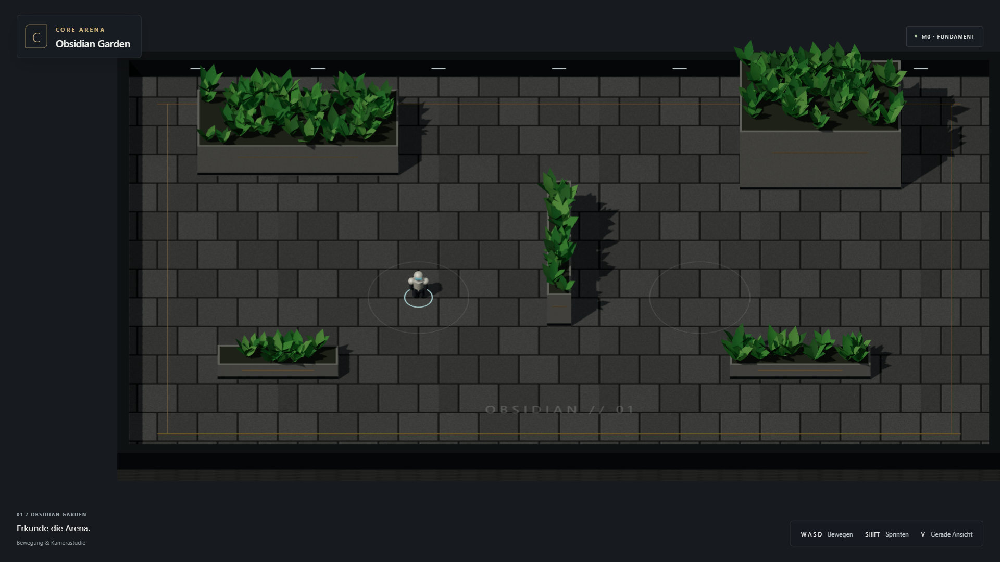
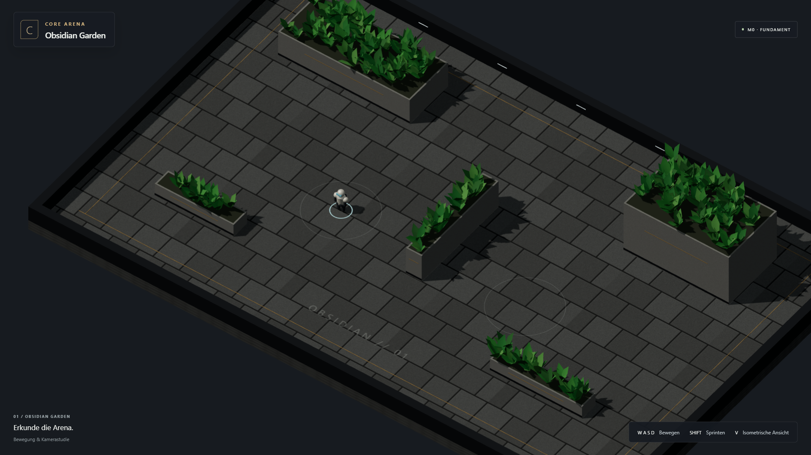

# M0 — Ergebnis und Übergabe

20. Oktober 2026. **M0.1–M0.3 umgesetzt und technisch geprüft. Persönliches Spielurteil offen. M1 nicht begonnen.**

## Ausprobieren

Lokaler Produktionsbuild: http://127.0.0.1:8743/CoreArena-3D/

Falls der Server beendet wurde: `npm run build`, danach `npm run preview`.
WASD bewegt bildschirmbezogen, Shift sprintet, V schaltet gerade/isometrisch.
F3 zeigt ausschließlich im Entwicklungs-/Testbuild die tatsächlichen Collider.

M0 enthält E0-Bewegung, Wandkollision, Begrenzungen, beide V5-Kameras und eine
prozedurale Material-/Vegetationsprobe. Die erhöhten Pflanzkörper sind Hindernisse.
Sprünge, Schüsse, Bots und Matches sind noch nicht enthalten.

Vite 8.3.4, TypeScript 5.9.3, Three.js 0.186.1 und Rapier 0.21.0 sind exakt
festgeschrieben. Der Kern importiert weder Three noch DOM. Sichtbare Körper
und Collider verwenden dieselben Arenadaten. V5 liefert die gestalterische
Richtung sowie die Vergleichstempi 7,2/10,8 m/s.

## Ausgeführte Prüfungen

| Prüfung | Ergebnis |
| --- | --- |
| Installation, Typecheck, Produktionsbuild | Bestanden; npm meldete keine bekannten Vulnerabilities |
| `npm test` | 6/6 bestanden, einschließlich echter Rapier-Integration |
| Gebauter Browser-Teststand | 24/24 bestanden, keine Retries oder übersprungenen Fälle |
| Browser | Chromium 156.0.8078.4, Chrome 155.0.8059.85, Edge 155.0.4283.62 |
| Größen | 1366×768 angefordert (Windows meldete 1367 CSS-Pixel Breite), 1920×1080 exakt; zusätzlich Resize auf 1200×800 |
| Bewegung/Kamera | Echte Tastatureingaben bewegen Simulation und sichtbare Figur in beiden Ansichten |
| Kollision | 10 Annäherungen je Wandseite im Physiktest; Browser prüft Anlaufen und Abgleiten |
| Zeit | Gleiche Strecke bei 30/60/144-Hz-Renderplänen; Diagonale und Sprint im Physiktest |
| Fokus | Echter Tabwechsel pausiert, löscht gehaltene Tasten und verhindert Nachholen |
| Darstellung | Bilder beider Kameras und tatsächlicher Collider geprüft |
| Runtime | Keine Konsolenfehler, fehlgeschlagenen Requests oder externen Runtime-Requests in den Browserfällen |
| V5 | SHA-256 unverändert: `74786c9b7a0ac1e228a6d4a9f126d0787f45a7a97046f02bb27a8243e7f84642` |

Der Fokusfall deaktiviert Playwrights künstliche Fokusemulation. Die Suite nutzt
isolierte, sichtbare Browserfenster und normale Eingaben. Diagnose ist ausschließlich
lesend und nur im Testbuild verfügbar. CTF-3.0 und das Starterpaket blieben unverändert.

Frühe Tests deckten Boden-Kontaktstocken und die Fokusemulation des Testwerkzeugs auf.
Beides wurde korrigiert. Rapier verwendet für M0 kleinen Bodendruck, 2 cm
Kontaktabstand und 1 cm normale Kontaktkorrektur. Ground-Snap ist für die ebene
M0-Fläche deaktiviert; die Höhenmechanik wird damit nicht vorweggenommen.

## Bilder

[Collideransicht](m0/colliders.png) · [Browser-Messwerte](m0/browser-results.json)

## Messumgebung und Grenzen

Windows 11 Home 10.0.26200, Ryzen 7 6800H, 15,3 GiB RAM. Die Browser meldeten
ANGLE/D3D11 auf der integrierten AMD Radeon; die ebenfalls vorhandene RTX 3060
war nicht der verwendete Renderer.

Letzte 120 Frames/Schritte der kurzen Browserfälle: Bildzeit p95 5,5–8,5 ms,
Simulationsschritt p95 0,8–1,1 ms, 133 Drawcalls und 15.966 Dreiecke laut Renderer.
Dies ist kein Langzeit- oder späterer Matchbenchmark. JavaScript-Build ungefähr
4,89 MB, gzip 1,81 MB, wesentlich durch eingebettetes Rapier-WASM. Vite meldet
die erwartete Chunkgrößenwarnung.

Nach Nutzerfeedback keine zusätzlichen Langzeit-, Geräte- oder Randfallrunden.
Eine Neuinstallation aus einem frischen Checkout wurde nicht zusätzlich ausgeführt;
der installierte Arbeitsstand wurde gebaut und geprüft.

## Übergabestatus

Die Umsetzung ist in drei Commits im Branch `main` gesichert. Kein Deployment.
Zuerst M0 selbst bewegen und die Richtung beurteilen. **Vor M1 auf ausdrückliche
Freigabe warten.** Danach früh einen spielbaren Höhen-/Aim-Zwischenstand liefern
und relevante Kernfälle prüfen; breitere Absicherung folgt nach Bewährung.
Mobile bleibt optional.
