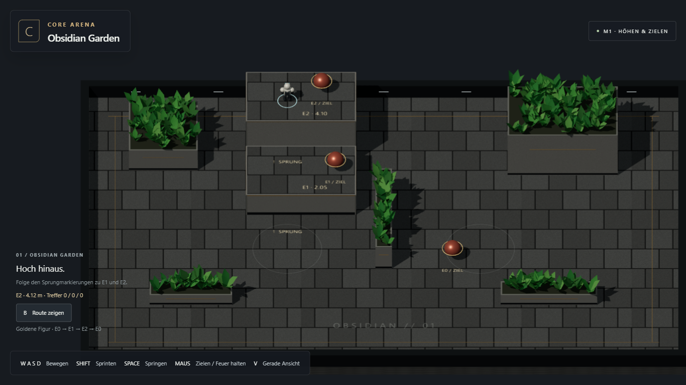
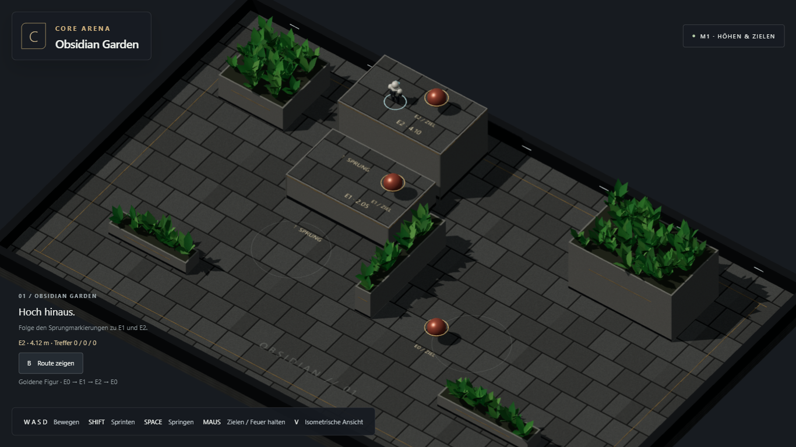

# M1 — Höhen, Aim und Navigationsprobe

20. Oktober 2026. **M1.1–M1.4 umgesetzt und technisch geprüft; erste persönliche Rückmeldung nachgearbeitet. Bestätigung der Nacharbeit offen. M2 nicht begonnen und nicht freigegeben.**

## Ausprobieren

Produktionsbuild: http://127.0.0.1:8743/CoreArena-3D/

Falls nötig `npm run build` und `npm run preview` starten. Eine bereits offene
M0-Seite neu laden. WASD bewegt bildschirmbezogen, Shift sprintet, Space springt,
V wechselt die Kamera. Links im Garten den Sprungmarkierungen über E1 (2,05 m)
und E2 (4,10 m) folgen. Maus zielt, linke Maustaste tippen/halten feuert.
Mintfarbener Ring: freie Schusslinie; orange: Deckung zwischen Mündung und Ziel.
Die drei Zahlen zählen Treffer an E0/E1/E2. B oder „Route zeigen“ startet die
goldene Testfigur. Neuladen setzt Zähler und Probe zurück.

## Geliefert

| Paket | Ergebnis |
| --- | --- |
| M1.1 | Echter Sprung/Fall mit V5-Werten (10,8 m/s Impuls, 22,6 m/s² Schwerkraft), massive E0/E1/E2-Plateaus, Standflächen-IDs; Kopfkontakt in einer separaten Überhang-Testszene. Rückkehr zum Spawn nach Fall über den Außenrand. |
| M1.2 | Kamera-Ray auf erste physische Oberfläche oder Dummy; keine Bodenebenen-Annahme, kein automatisches Zentrieren. Schulter→Mündung→Ziel prüft die erste Kollision. Diagnosefeuer, Einschlag/Strahl, drei Trefferzähler. |
| M1.3 | Gerichtete Sprung-/Fallverbindungen in der Arena-Beschreibung. Goldene Figur läuft E0→E1→E2→E0 über dieselben Bewegungsbefehle und denselben Motor. |
| M1.4 | Integrierter Browser-Spielablauf, gezielte Regression, Screenshots, README und Roadmap aktualisiert. |

Die Probe verwendet eine zweite identische Rapier-Welt und kollidiert daher nicht
mit dem Spieler. Sie zeigt Wegmachbarkeit; sie wählt noch keine Kampfziele oder
alternative Routen. Dummies sind feste Treffervolumen ohne HP/Tod. Waffeninventar,
Kampf-KI und Matchsystem gehören zu M2. Mobile ist unverändert optional.

## Prüfungen

- `npm test`: nach Nacharbeit **11/11** bestanden, einschließlich des neuen Kantensprung-Regressionstests (Erststand: 10/10).
- `npm run build`: Typecheck und Produktionsbuild bestanden.
- `npm run build:test`, `npx playwright test --project=chromium-1366`: **5/5** bestanden,
  keine Retries, keine Flakes, ca. 36 Sekunden. Vier vorhandene Regressionen plus
  ein integrierter M1-Spielablauf.
- Echte Eingaben: vom regulären Spawn laufen und auf E1/E2 springen, freie Ziele
  auf allen drei Höhen treffen, Dauerfeuer, Kamerawechsel, verdeckten Schuss an
  der Wand stoppen und die goldene Figur bis zurück auf E0 beobachten.
- Testzustand ausschließlich gelesen; keine Teleports, gesetzten Treffer oder
  künstlich abgeschlossenen Routen im Browsernachweis.
- Keine Browserfehler, fehlgeschlagenen Requests oder externen Laufzeitrequests
  in diesen Fällen. Produktionsbuild zusätzlich im In-App-Browser geöffnet,
  Tastaturbewegung/Sprung, Kamerawechsel und sichtbare Navigationsprobe bedient.
- Nach dem Browserlauf ergänzte Rückkehr zum Spawn nochmals im echten Rapier-
  Kerntest geprüft; kleine HUD-Korrekturen im Produktionsbrowser gesichtet.
- Abschließende Sichtkorrektur: unterschiedliche Auftreffpunkte von Kamera und
  Mündung auf derselben Kugel gelten nicht als Deckung. Kernprüfung und integrierter
  M1-Browserablauf danach erneut bestanden (1/1, ca. 23 Sekunden inklusive Start).
  Die Bilder zeigen diesen finalen Stand; beide Läufe sind im JSON dokumentiert.

## Nacharbeit auf die erste persönliche Spielrückmeldung

Der Nutzer meldete langsames Hochziehen an Plateau-Kanten beim Absprung aus
Wandnähe und eine schlecht lesbare, scheinbar schwebende E2-Platte.

- **Ursache und Korrektur:** Rapier konnte die aufsteigende Kapsel am Rand bereits
  als „grounded“ melden. Dadurch wurde ihre vertikale Geschwindigkeit zu früh
  auf null gesetzt; Vorwärtsbewegung schob sie anschließend langsam hoch.
  Solange die gewünschte Bewegung aufwärts führt, gilt Kantenkontakt nicht als
  Landung. Sprungimpuls und Schwerkraft bleiben unverändert.
- **Gezielter Nachweis:** Der Kerntest springt aus Wandnähe und von der Markierung
  auf E1 und E2. Er verlangt erhaltene Aufwärtsgeschwindigkeit und Landung innerhalb
  von 60 Ticks. Der neue Browserfall läuft vom regulären Spawn direkt gegen beide
  Wände und springt mit echten Tasten hinauf; auch dort ist die Dauer begrenzt.
  Die frühere reine Prüfung „landet irgendwann“ erkannte dieses Problem nicht.
- **Lesbarkeit:** E2 ist jetzt ein 4,10 m hoher massiver Körper bis zum Boden;
  sichtbare Seitenkanten, umlaufender oberer Abschluss und Sockel verdeutlichen
  seine Höhe. Sichtbare Geometrie und Collider verwenden dieselben Maße.
  Die alte Platte samt Stützen entfällt. Überhang-/Deckenfreiheit bleibt im
  separaten Physik-Testlabor geprüft.
- **Ergebnis:** elf Kernfälle, Typecheck/Build und **2/2 gezielte Browserabläufe**
  bestanden (ca. 25 Sekunden, Chromium 1366×768, keine Retries). Der zweite
  Browserablauf prüft weiterhin die komplette Höhen-, Treffer- und Navigationsroute.
  Der Produktionsbuild wurde außerdem im offenen In-App-Browser neu geladen und
  mit Tastatur direkt an den Plateauwänden gespielt.
  [Nacharbeitsbericht als JSON](m1/feedback/browser-results.json).

Umgebung: Windows, Chromium **156.0.8078.4**, **1366×768**, ANGLE/D3D11 auf AMD
Radeon Graphics. Kein neuer Benchmark und keine erneute vollständige Chrome-/Edge-
oder Auflösungsmatrix. [Maschinenlesbare Ergebnisse](m1/browser-results.json).

Behobener Befund: Rapier meldet bei manchen ruhenden Kontakten „grounded“, aber
keine neue Bewegungskollision. Eine kurze physische Stützabfrage ergänzt dann
die Flächen-ID. Kopfkontakt setzt die Aufwärtsgeschwindigkeit zurück. Die
bereits in M0 bewährte Bewegung ohne Ground-Snap bleibt erhalten.

## Sichtnachweise

Aktueller Stand nach Rückmeldung:

Historische Nachweise der ersten Übergabe: [E1-Treffer](m1/e1-hit.png),
[E2-Treffer](m1/e2-hit.png), [verdeckter Schuss](m1/e0-cover.png),
[vollständige Navigationsroute mit Diagnose](m1/route-complete.png).

## Offene Grenzen und nächster Schritt

Die Arena ist eine kompakte Höhen-/Aim-Übung. E2 besitzt nach Rückmeldung keine
begehbare Unterseite mehr. Automatische Sichtfreistellung hinter hohen Baukörpern
ist noch nicht Teil dieser Probe. Weitere Formen, sämtliche Sicht-/Höhenkombinationen,
Langzeittests und die breite Browsermatrix folgen gezielt nach Spielbewährung.
Der Rapier-/Three-Build erzeugt weiterhin die bekannte Vite-Warnung zur
Chunkgröße (ca. 4,9 MB JS / 1,8 MB gzip), ohne Buildfehler.

Bitte 5–10 Minuten Landungen, Zielring und Kameras ausprobieren. Die technische
Prüfung ersetzt dieses persönliche Spielurteil nicht. **Vor M2 auf Freigabe warten.**

Aufwände neu kalibriert: M0 und M1 jeweils ca. 30 Minuten bis zur ersten technischen
Übergabe laut Nutzer. Diese Nacharbeit ist separat vom gemeldeten Erstaufwand.
M2 vorläufig 1,5–3 Stunden Agent-Zeit, M3/M4 je 1–2 Stunden einschließlich Reserve
für kleinere Korrekturen. Persönliche Tests und Freigabewartezeit stehen separat.
Siehe [Roadmap](../planning/MILESTONES_AND_QA.md).
