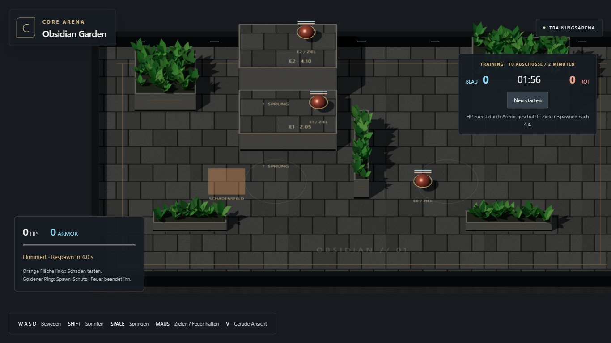
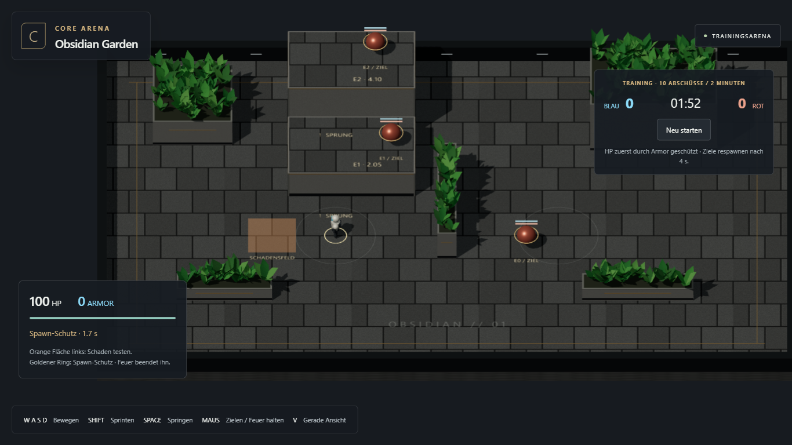
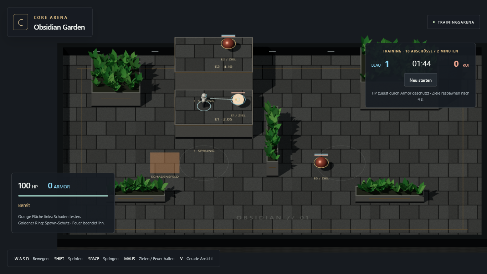
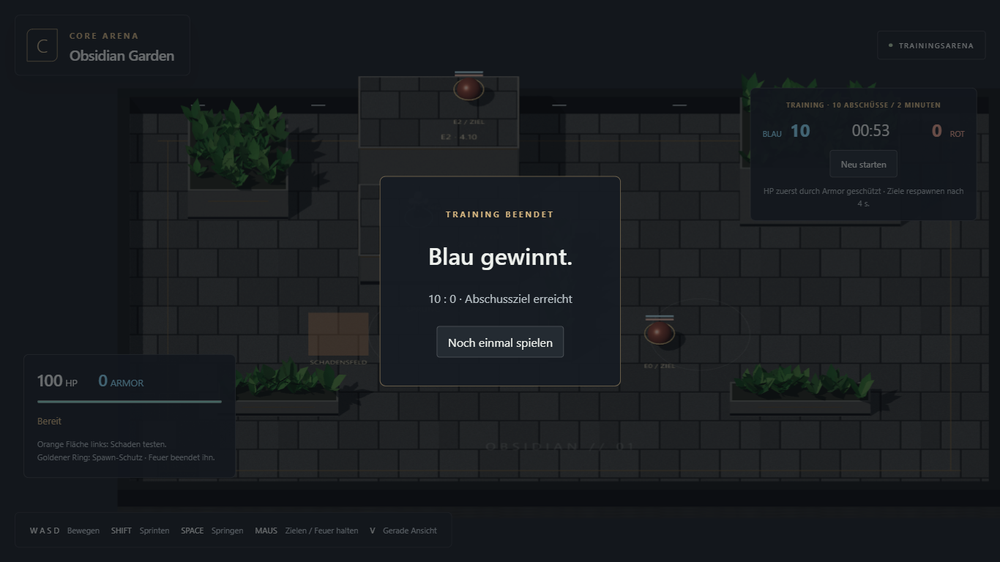
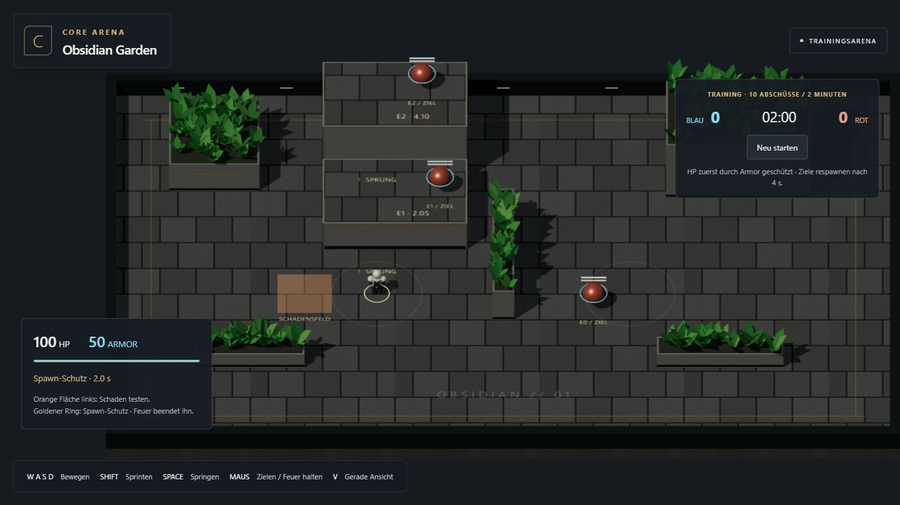

# M2.1 — Lebenszyklus und Trainingsmatch

Stand: 20. Oktober 2026. **Umgesetzt und technisch geprüft; persönliches Spielurteil offen.** Branch `main`. Ausschließlich M2.1 war freigegeben; M2.2 wurde nicht begonnen.

## Spielen

Produktionsbuild: http://127.0.0.1:8743/CoreArena-3D/ — „Trainingsmatch starten“ anklicken. Bei geschlossenem Server: `npm run build`, danach `npm run preview`.

Die bestehende Höhenarena, Bewegung und Diagnosewaffe bleiben erhalten. Drei stationäre rote Ziele besitzen nun HP/Armor und einen Lebenszyklus. Runde: 120 Sekunden oder 10 Abschüsse, danach Ergebnis und Neustart. Ein orange markiertes Schadensfeld links vom Spawn ermöglicht den eigenen Tod/Respawn ohne vorgezogene Kampf-KI. Es wirkt nur bodennah, nicht durch obere Etagen. Freies Höhentraining ist vor Matchstart weiterhin verfügbar.

- 100 HP und 50 Armor beim Rundenstart; Armor absorbiert vor HP.
- 35 Schaden pro Diagnosetreffer; Deckung bleibt die echte 3D-Mündungsprüfung.
- Tod entfernt Zielkörper und Treffer-Collider. Jedes Opferleben kann genau einen Punkt geben.
- Respawn nach 4 Sekunden mit 100 HP, 0 Armor und 2 Sekunden Schutz. Schießen beendet den eigenen Schutz.
- Freundbeschuss ist aus; Umwelttod vergibt keine Teampunkte.
- Scorelimit und Zeitende werden nach allen Treffern desselben Ticks ausgewertet; Gleichstand ist möglich.
- Neustart setzt Lebenszustände, Score, Timer, Motorposition, Eingaben, Diagnosewaffe und Routenprobe zurück. Die gewählte Kamera bleibt erhalten.

## Architektur und Herkunft

Der neue numerische Kern `src/core/match.ts` ist unabhängig von Three, Rapier und DOM. Rendering, Treffer-Collider und Spieler-Motor werden in der App an dessen Zustand angebunden. Angepasste Regeln aus CTF-3.0, am Auditcommit `9794575fa6241f47845fb85352316564789e8d1c` erneut über die GitHub-API gelesen: `src/core/actors/actorLifecycle.ts`, `ActorLifecycleConfig.ts`, `src/core/modes/TeamDeathmatchMode.ts`. Das frühere Übernahmeaudit dokumentiert auch das Scoreboard-Prinzip. Statt einer separaten Award-Key-Infrastruktur verhindert hier der unmittelbare Alive→Dead-Übergang die Doppelwertung; es gibt noch keine verzögerte Ereigniswarteschlange.

CTF-3.0 wurde nicht verändert. V5 bleibt unverändert. Start-Armor und das Schadensfeld sind ausdrücklich Trainingsentscheidungen; kein endgültiges Waffen- oder Arena-Balancing.

## Tatsächlich ausgeführte Prüfungen

| Prüfung | Ergebnis |
| --- | --- |
| `npm test` | 16/16 bestanden: bisherige Bewegung/Physik/Höhen/Aim plus fünf Matchtests |
| `npm run build:test` und `npm run build` | TypeScript und beide Builds bestanden |
| `npx playwright test --project=chromium-1366` | Sechs M0/M1-Regressionsfälle bestanden, einschließlich direkter Kantensprünge, Höhenroute, Deckung, Kamera und Fokus |
| Gezielter Wiederholungslauf `npx playwright test tests/e2e/m2-1.spec.ts --project=chromium-1366` | Neuer vollständiger Matchtest bestanden: 70,439 Sekunden Testdauer, Chromium 156.0.8078.4, 1366×768 |
| Produktionsbuild im bestehenden In-App-Browser | Neu geladen, Trainingsmatch gestartet und HUD visuell geprüft, auch im schmalen Browserpanel |

Der neue Matchtest läuft mit sichtbarem Browser, echten Maus-/Tastatureingaben und ausschließlich lesender Testdiagnose. Er läuft ins Schadensfeld, beobachtet Armor-Verbrauch und Tod, hält während des Wartens Eingaben und bestätigt deren Löschung beim Respawn. Anschließend springt er regulär auf E1, prüft das Verschwinden des getöteten Zielcolliders, feuert während des gegnerischen Spawn-Schutzes ohne HP-Verlust, erspielt zehn Abschüsse und startet über die Ergebnisansicht neu. Ergebnis: **10:0 nach 4062 Matchticks**, keine Browserfehler. [Kompakter Messnachweis](m2-1/browser-results.json).

Zwei anfängliche Fehlläufe waren Testbedienungsfehler: zu grobes Positions-Polling führte über das Schadensfeld hinaus; die am Startbutton verbliebene Maus löste beim Loslassen einen Neustart aus. Der Test wartet nun bildweise auf die tatsächliche Position und setzt die Maus vor dem Halten auf das Spielfeld. Keine Spielregeln oder Testresultate wurden dafür manipuliert.

Zeitende, letzter-Tick-Treffer, Gleichstand und gleichzeitige Scorelimit-Kills sind im Kern getestet; der vollständige Browsermatch endete am Scorelimit. Keine erneute Chrome-/Edge-/Auflösungs-Vollmatrix, kein Mobile-Test und keine Performanceabnahme für spätere Kampf-Bots. Bekannte Buildmeldung bleibt das große Rapier-/Three-Bundle; keine neuen Laufzeitfehler festgestellt.

## Aufnahmen

## Nächste Grenze

M2.1 ist die Lebenszyklus-/Matchbasis und enthält noch keine kämpfenden Gegner, kein Waffeninventar, keine Pickups und kein 2v2. Nächster vorgesehener Auftrag: M2.2 „Waffen und Ressourcen“. **Vorher auf Nutzerfreigabe warten.**
