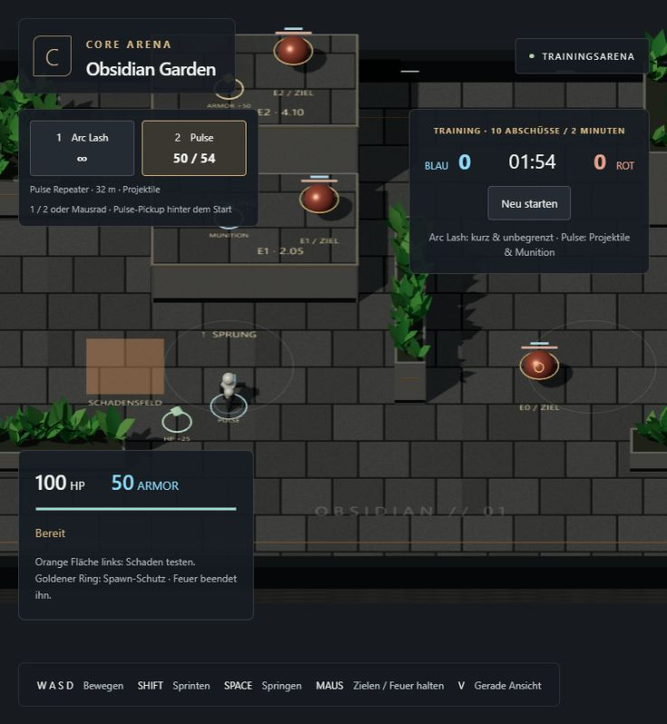
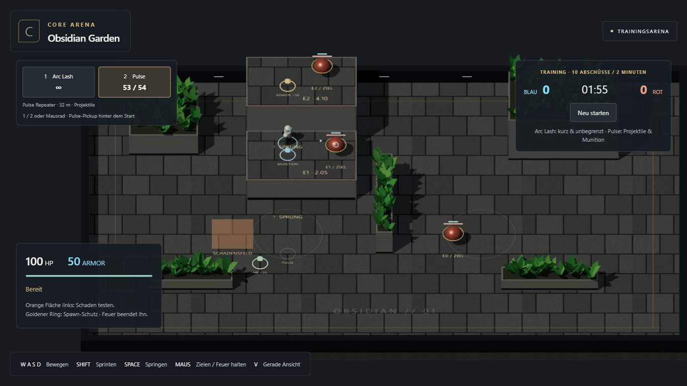
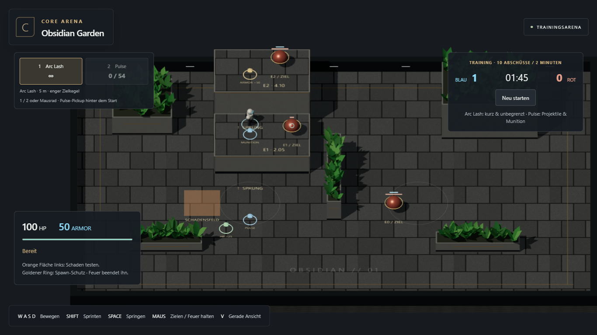
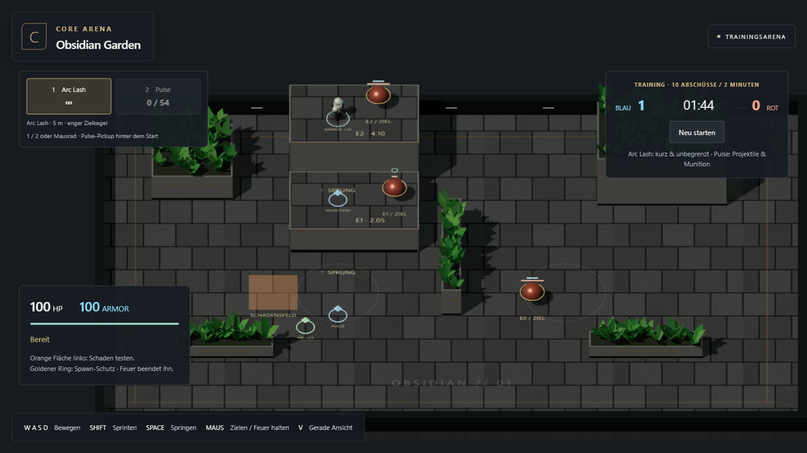

# M2.2 — Waffen, Ressourcen und GitHub-Playlink

Stand: 20. Oktober 2026. **Umgesetzt, technisch geprüft und auf GitHub Pages veröffentlicht; persönliches Spielurteil offen.** Branch `main`, Spielcommit `1dbff990e2c475c339b2731c913bb564aea11efa`. M2.3 nicht begonnen.

## Spielbarer Umfang

Trainingsmatch starten. **1** wählt Arc Lash, **2** die aufgenommene Pulse, Mausrad über der Arena wechselt verfügbare Waffen. Arc ist unbegrenzt: 35 Schaden, 5 m Reichweite, 0,8 Sekunden Cooldown, 10° Zielkegel mit Berücksichtigung der Zielkugel und echter Kamera-/Mündungssicht. Pulse: 10 Schaden, 10 Ticks Cooldown, 30 m/s, 32 m Reichweite, maximal 54 Schuss. Sichtbare Projektile treffen erst nach tatsächlicher Flugzeit; Rapier prüft den ganzen Flugweg jedes Ticks als Kugel-Sweep mit 8 cm Radius. Die Auswahl hält unabhängige Waffencooldowns ein.

Pulse-Pickup liegt hinter dem Startpunkt auf E0. Munition liegt auf E1, Armor auf E2, Heilung auf E0 links hinten. Abholung braucht dieselbe Standfläche, passende Höhe, Nähe und eine freie Verbindung. Nicht benötigte Ressourcen bleiben liegen; Teilaufnahme lässt den Rest zurück. Vollständig entleerte Pickups respawnen nach 10 Sekunden. HP/Armor sind bei 100 gedeckelt. Leere Pulse fällt auf Arc zurück; Aufnahme erzwingt keinen Wechsel. Beim Tod verschwinden eigene Projektile, Respawn setzt das Inventar zurück, Matchneustart zusätzlich alle Pickups und Effekte.

Freies Höhentraining vor Matchstart behält die M1-Diagnosewaffe. Kampfbots, Teamspiel und finale Balance bleiben spätere Pakete. Die neuen Waffen ersetzen die Diagnosewaffe ausschließlich im Match. V5 und CTF-3.0 wurden nicht verändert.

## Referenz und Entscheidung

CTF-Waffenkatalog `src/core/weapons/ArenaWeaponCatalog.ts` am bereits auditierten Commit `9794575fa6241f47845fb85352316564789e8d1c` erneut über die GitHub-API gelesen. Namen, Schadenswerte, Arc-Cooldown und Pulse-Munitionsmaximum übernommen; räumliche Werte und Projektilprüfung für 3D neu entwickelt. 160 ms Pulse-Cooldown wird auf 10 feste 60-Hz-Ticks aufgerundet. [Architekturentscheidung einschließlich genauer Arc-Regel](../planning/ARCHITECTURE_DECISION.md).

## Ausgeführte Prüfungen

- `npm test`: **21/21 bestanden**, davon fünf neue Combat-/Pickup-Tests mit echter Rapier-Welt. Arc-Reichweite, Kegel/Randtreffer, Deckung, Pulse-Flugzeit und dünne Wand, Munitionsmaximum/Fallback/Reset, Pickup-Etagen/Deckung/Teilmengen/Respawn, HP-/Armor-Maxima.
- `npm run build:test` und `npm run build`: TypeScript und beide Builds bestanden. Bestehende Warnung zum großen Rapier-/Three-Bundle bleibt.
- Sieben bestehende Browserfälle in sichtbarem Chromium 1366×768 bestanden: Movement, Wandkontakt, Fokus, Kamera, Kantensprung/Höhenroute und kompletter Match mit zehn echten Arc-Abschüssen plus Restart. [Regressionsprotokoll](m2-2/regressions.json).
- Neuer M2.2-Browserablauf bestanden: Pulse wirklich aufnehmen, ohne erzwungenen Wechsel; Tasten-/Mausradwahl; verdeckter Schuss verursacht keinen Zielschaden; auf E1 springen, Munition ergänzen, sichtbare Projektile feuern und einen Kill erzielen; alle Schüsse verbrauchen, automatischer Arc-Fallback; E2 erreichen und Armor auf 100 auffüllen; Neustart räumt Inventar, Projektile und Pickups auf. Ausschließlich echte Eingaben und lesende Diagnose, keine Ergebnisinjektion. [Messnachweis](m2-2/browser-results.json).
- Ein anfänglicher Kernfehler bei Arc-Randtreffern wurde durch Kegel-/Kugelschnitt korrigiert. Ein Browser-Fehllauf hatte das Mausrad über dem Startbutton statt über der Arena bedient; der Test setzt die Maus nun aufs Spielfeld und wartet auf die tatsächlich eingetroffene Auswahl.

Keine neue Browser-/Geräte-Vollmatrix, keine Kampf-Bot-Performanceabnahme, kein Mobile-Test. Der reguläre Browsermatch prüft das Scorelimit, Zeitende bleibt durch den bestehenden Kerncheck abgedeckt.

## GitHub Pages

Vom Nutzer zusätzlich freigegeben. [Playlink](https://emfau88.github.io/CoreArena-3D/) steht prominent in der README. GitHub Pages war bereits als öffentliches Workflow-Deployment aktiviert. Der neue [Actions-Workflow](https://github.com/emfau88/CoreArena-3D/actions/workflows/pages.yml) installiert gepinnte Abhängigkeiten, führt Kerntests/Typecheck aus, baut und veröffentlicht ausschließlich `dist`. Reine Dokumentationsänderungen lösen keinen neuen Build aus; manueller Start bleibt verfügbar. Konfiguration anhand der [offiziellen GitHub-Pages-Dokumentation](https://docs.github.com/en/pages/getting-started-with-github-pages/using-custom-workflows-with-github-pages).

**Veröffentlicht und live geprüft:** [Actions-Lauf 39490912559](https://github.com/emfau88/CoreArena-3D/actions/runs/39490912559) erfolgreich, Build in 24 Sekunden, Deployment in 26 Sekunden. Frische Linux-Installation, alle 21 Kerntests und Produktionsbuild auf dem GitHub-Runner bestanden. [Deployment-Metadaten](m2-2/deployment.json).

Die öffentliche Seite wurde anschließend im In-App-Browser geöffnet. Über normale Eingaben: Trainingsmatch gestartet, mit S zum tatsächlichen Pulse-Pickup gelaufen, mit 2 Pulse gewählt (54/54), auf das Spielfeld gefeuert (50/54), laufenden Timer und HUD beobachtet. Danach neu geladen und startbereit offengelassen. Dies ist ein zusätzlicher Produktions-Smoke, keine zweite vollständige Matchabnahme. Die später ergänzten Dokumentationsnachweise verändern den veröffentlichten Spielbuild nicht.

## Bilder

**Nächster Auftrag: M2.3 Botwahrnehmung und Kampf, erst nach Nutzerfreigabe.**
