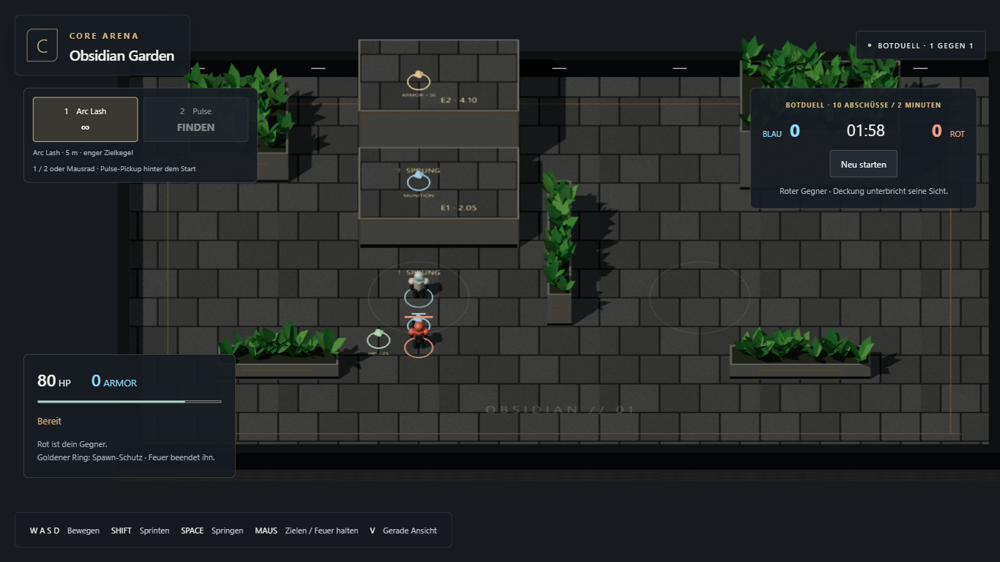
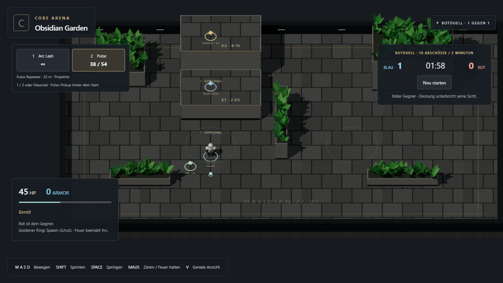

# M2.3 – Botwahrnehmung und Kampf

Stand: 21. Oktober 2026. Nutzerfreigabe: „go nächster punkt“. Umgesetzt und technisch geprüft; persönliches Spielurteil offen. M2.4 nicht begonnen.

## Spielbarer Umfang

„Botmatch starten“ startet ein 1v1 gegen einen roten Gegner. Die vorhandene Trainingsrunde bleibt separat verfügbar. Gleiche Matchregeln, HP/Armor, Bewegung, Waffenwerte, Munition, Schutz, Tod/Respawn und Punkte für beide Seiten. Der Bot startet ebenfalls mit Arc Lash, kann räumlich berührte Pickups aufnehmen und wählt verfügbare Pulse für größere Distanz. Keine geschenkte Munition, keine direkten Schadensaufrufe als Ersatz für Schüsse.

Wahrnehmung: 18 m, 140°-Sichtfeld und echte Rapier-Sichtstrahlen über alle drei Koordinaten. Nur sichtbare Gegnerdaten verlassen den Sensor. Die Entscheidungslogik bekommt keinen vollständigen Weltzustand. Sie kopiert den zuletzt gesehenen Punkt, verfolgt ihn höchstens 120 Ticks (2 s) und feuert bei Sichtverlust nicht weiter. Bereits fliegende Projektile bleiben physikalische Schüsse.

Reaktion: 24 Ticks (0,4 s) vor dem ersten Feuer, erneut nach jeder Sichtunterbrechung. Zielpunkt alle sechs Ticks, begrenzte Drehgeschwindigkeit und deterministische Winkelabweichung bis 0,06 rad. Waffenbedienung läuft durch dieselbe `Combat`-Klasse wie beim Menschen, ergänzt um die Schützen-ID. Trefferkörper im Duell sind für beide gleich große Sensor-Kugeln mit Radius 0,6 m; Bewegung nutzt den bisherigen Kapselmotor.

Darstellung: rote Figur mit Waffe, Lebens-/Armor-Balken, Schutzring und sichtbaren Schüssen. Dummies und Schadensfeld sind im Duell ausgeblendet und inaktiv. Neustart und Respawn räumen Botgedächtnis, Waffen und Effekte auf.

## Prüfung

- `npm test`: **25/25 bestanden**. Vier neue Botfälle: echte 3D-Deckung/Distanz/Sichtkegel und bewegte Sensoren; Reaktionssperre/erneute Sicht/kopierte und ablaufende Erinnerung; gemeinsame Arc-/Pulse-Regeln samt Flugzeit und Schützen-ID; echter Motor mit regulärem Botkill.
- `npm run build:test` und `npm run build`: Typecheck und beide Builds bestanden. Bestehende große Bundle-Warnung unverändert.
- Sichtbares Chromium, 1366×768: **drei Browserabläufe bestanden** – neues Botduell, vorhandener M2.2-Waffen-/Höhen-/Pickup-Ablauf, Touch-Regression im emulierten Querformat.
- Botduell: starten, Gegnerbewegung und tatsächlichen Schaden beobachten, Spieler-Tod und geschützten Respawn abwarten; neu starten, Pulse durch Bewegung aufnehmen, beweglichen Gegner mit echten Mausereignissen verfolgen und abschießen; Gegner-Respawn und sauberer Restart. Kein Setzen von HP, Position, Treffern oder Ergebnissen; nur lesende Testdiagnose. Keine Seitenfehler.
- Nach kleiner Abschlusskorrektur an Modusbeschriftung und Botwaffe den Botablauf auf dem finalen Build erneut geprüft. Kein Retry eines fehlgeschlagenen Spieltests. Ein erster Sandbox-Teststart blieb vor der Testausführung hängen und wurde abgebrochen; der reguläre sichtbare Browserlauf außerhalb der Sandbox funktionierte.

[Browsernachweis](m2-3/browser-results.json)

## Bewusste Grenze zum nächsten Paket

Einfache Patrouille und lokale Verfolgung auf E0. Der Gegner plant noch keine Höhenroute, keinen Umweg um eine blockierte direkte Strecke und keinen Weg zu Ressourcen. Er kann dort stehen bleiben; die bestehende M1-Höhenprobe bleibt separat erhalten. Genau diese Routen-/Ressourcenentscheidungen sowie 2v2 und Easy/Normal/Hard gehören zu M2.4. Keine zusätzliche Arena, keine Langzeit-/Balance-Matrix und keine vollständige 2v2-Abnahme vorgezogen. Echte Smartphone-Tests bleiben offen.

CTF-3.0 wurde nur gelesen: `BotTargetSelector.ts`, `BotCombatConfig.ts` und Wahrnehmungs-/Reaktionsfälle in `bot-ai-v2.test.ts`. Übernommen sind die fachlichen Ideen Sicht, Erinnerung, Reaktionsverzug und begrenzte Zielabweichung. 2D-Abfragen und Zugriffe auf aktuelle verdeckte Positionen wurden nicht übertragen. Die Referenz bleibt unverändert.

Der bestehende Pages-Workflow veröffentlicht diesen Stand nach dem Push über den [Playlink](https://emfau88.github.io/CoreArena-3D/).
