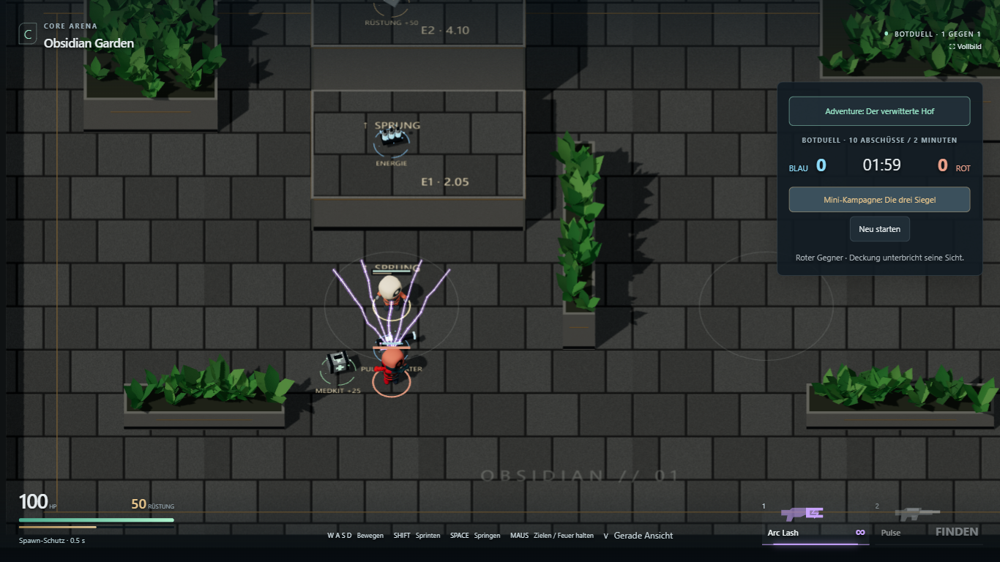
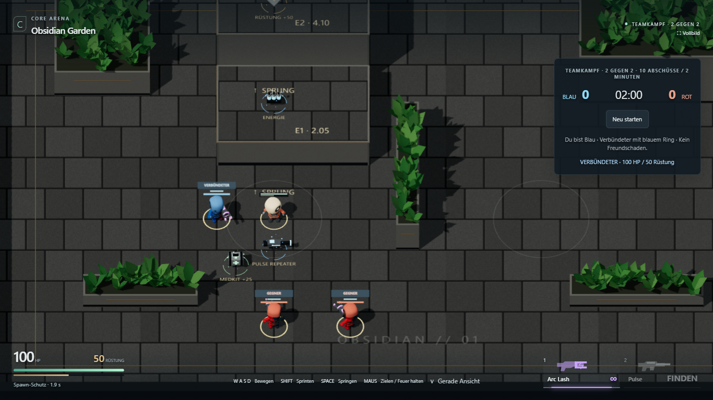
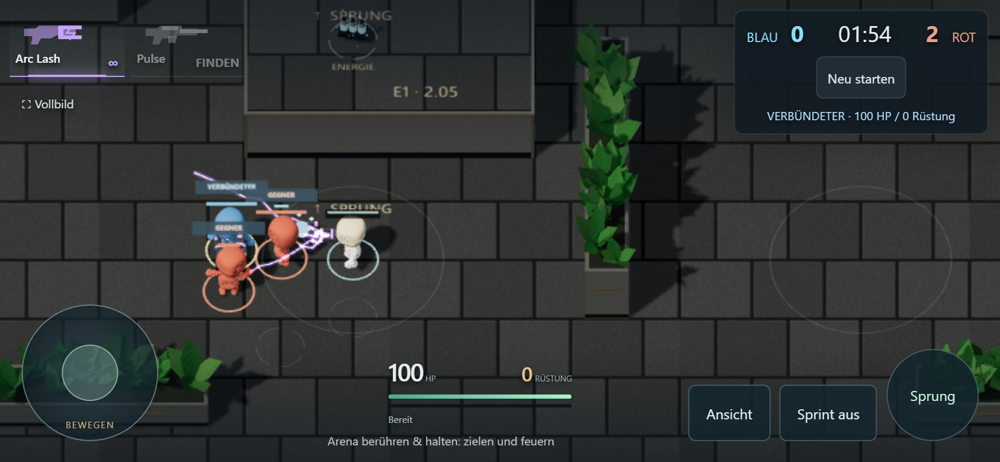

# M2.4a — begrenztes Arena-Teamspiel

Stand: 31. Oktober 2026. Branch `main`, Ausgangsstand lokal/Remote `59d352c`.
Umsetzung und dieser Bericht werden gemeinsam committed.

**Umgesetzt und technisch geprüft, persönliche Spielabnahme offen.** Der freigegebene
Zuschnitt ist das zuvor vorgeschlagene kleine 2v2-Paket. Das größere ursprüngliche
M2.4 ist damit ausdrücklich **nicht vollständig erledigt**: Bot-Wege, Ressourcenplanung
und Easy/Normal/Hard bleiben M2.4b. Adventure L1.5b bleibt separat offen.

## Spielergebnis

[Arena spielen](https://emfau88.github.io/CoreArena-3D/) → **„2v2-Teamspiel starten“**.
Du und ein blauer Bot gegen zwei rote Bots; 10 Teamabschüsse oder zwei Minuten.
Training und das bisherige 1v1 bleiben auswählbar. Jeder Bot hat eigene Waffen,
HP/Rüstung, Sicht/Gedächtnis und Respawn. Gegnerwahl berücksichtigt Team, Leben,
Sichtkegel, Reichweite und echte Deckung; ein sichtbares Ziel bleibt stabil,
Zielwechsel startet die Reaktionszeit erneut. Eine lokale Abstandsregel vermindert
Überlagerungen nach Respawns, ohne die künftige Wegeplanung vorwegzunehmen.

Blaue/rote KayKit-Figuren, Ringe und Beschriftungen zeigen die Zugehörigkeit;
das HUD zeigt Zustand/Respawn des Verbündeten. Auto-Arc wählt keine Verbündeten.
Freundbeschuss verursacht keinen Schaden und keine Punkte. Figuren können
Schusslinien blockieren; Pulse wird an ihrem Trefferkörper verbraucht.
Waffenwerte, Ressourcenwerte, Basisstats und Matchregeln bleiben erhalten.

## Abgrenzung

Code nur im Arena-Einstieg, Arena-Bots und deren Darstellung sowie neuen
Arena-Roster-/HUD-Dateien. Keine Änderung an Adventure-/PvE-Gameplay, gemeinsamer
Waffenlogik, Physik, Kamera, Karten oder Assets. Das neue CSS verlangt ausdrücklich
`#app[data-arena]`; Adventure setzt dieses Attribut nicht. CTF-3.0 und Hexwars bleiben
unverändert. Dokumentation unterscheidet aktives Arena-M2.4a und pausiertes Adventure.

## Prüfung

- `npm test`: **61/61 bestanden**, einschließlich neuem Vier-Akteur-Match mit realen
  Botwaffen, Punkten beider Teams, unabhängigen Respawns und Restart. Nach der
  Abstandsregel nochmals **11/11 relevante Bot-/Matchprüfungen** bestanden.
- Typecheck, Testbuild und Produktionsbuild bestanden. Bestehende Warnung über
  die Größe des Hauptbundles bleibt; kein neuer Performance-Nachweis für Handys.
- Sichtbares Chromium, Desktop **1366×768**: realer kompletter Teamkampf bis
  **10:9 nach 41,62 Spielsekunden**, anschließend Ergebnisstabilität und Restart.
- Touch-Emulation **844×390**, DPR 2 bei reduziertem Render-DPR: Joystick,
  Schussfinger, Pulse-Fund und Waffenwahl; kompletter Teamkampf bis **7:10 nach
  41,30 Spielsekunden**, Ergebnis und Restart. **Kein tatsächlicher Handytest.**
- Beide Teamläufe nutzen Pulse und Auto-Arc, beobachten echte Todes-/Respawnzyklen
  und prüfen gegnerbezogene Botziele. Keine HP-, Munitions-, Positions- oder
  Zeitinjektion. Beobachtung ausschließlich über lesende Testdiagnose.
- Vorhandener 1v1-Browserfall bestanden: Spieler-/Bot-Tod, Respawn, Pulse-Treffer
  und Restart. Adventure mit `adventure=1` startet weiter mit eigener Missions-HUD
  und ohne Arena-Teamsteuerung. Kein erneuter Adventure-Gesamtdurchlauf behauptet.
- Keine Seitenfehler in den bestandenen Teamläufen. Die Ergebnisse sind keine
  Aussage über endgültige Schwierigkeit oder langfristige Matchbalance.

Die ersten Touch-Versuche deckten zwei Testprobleme auf: ein zusätzliches TouchEnd
ohne aktiven Finger und einen beschädigten Chromium-Trace-Export. Ereigniszustand
korrigiert; finale Läufe nutzen explizite Screenshots und Zustandsprotokolle ohne
Trace-Aufzeichnung. Nach Bildprüfung wurde außerdem die Bot-Abstandsregel ergänzt
und **Desktop plus Touch auf diesem Spielstand erneut erfolgreich geprüft**.

[Finaler Browserbericht](m2-4/browser-report.json) ·
[Desktop-Matchdaten](m2-4/desktop-match.json) · [Touch-Matchdaten](m2-4/touch-match.json).
Frühere Testversuche bleiben in `m2-4/initial-browser-report.json` und
`m2-4/touch-initial-report.json` nachvollziehbar.

## Bilder

Vorher: veröffentlichtes 1v1 auf Stand `59d352c` (Spielbuild aus `38bcf49`):

Nachher: neuer Teamkampf auf Desktop und in Touch-Emulation:

## Nächster offener Schritt

M2.4b klein zuschneiden: zuerst verlässliche Arena-Wege über die vorhandenen
Höhen und um Hindernisse, daran anschließend Ressourcenwahl und faire Schwierigkeit.
Aktuell bleiben lokale Verfolgung, einfache Patrouillen, fehlende Höhennavigation
und eine noch nicht auf 2v2 ausbalancierte Pickup-Verteilung erkennbare Grenzen.
M2.5 (Arena-Gestaltung/Feedback), M2.6 (Gesamtabnahme), CTF und Liga bleiben offen.
Keine separat gemessene Agent-Istzeit wird nachträglich erfunden.
