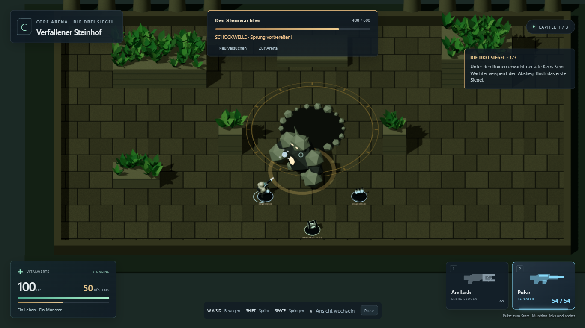
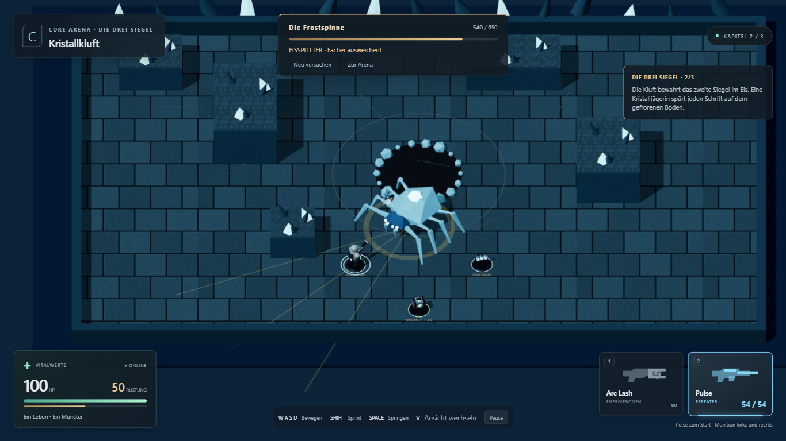
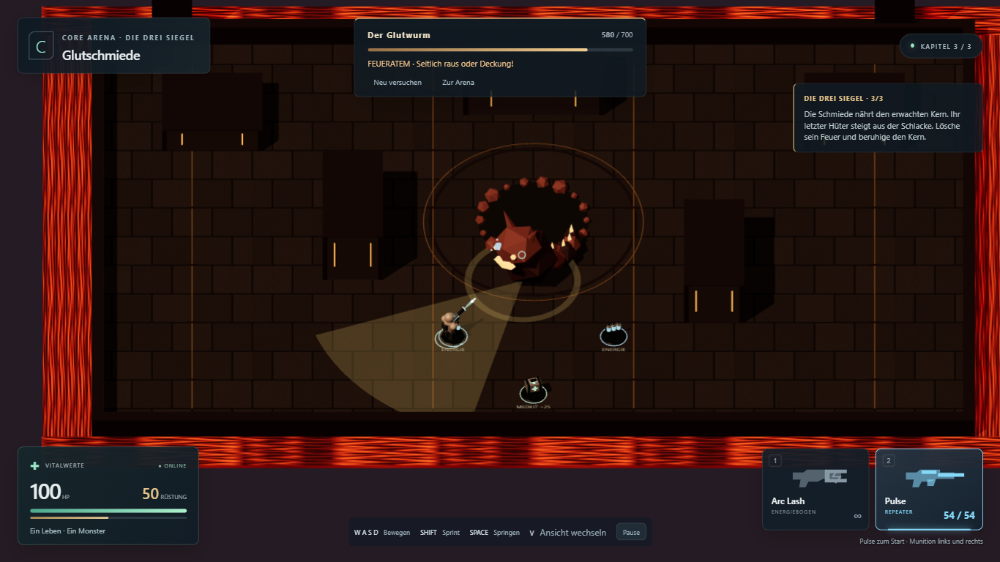
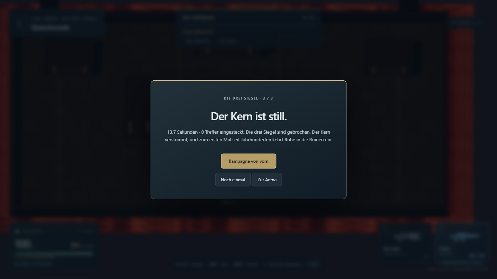
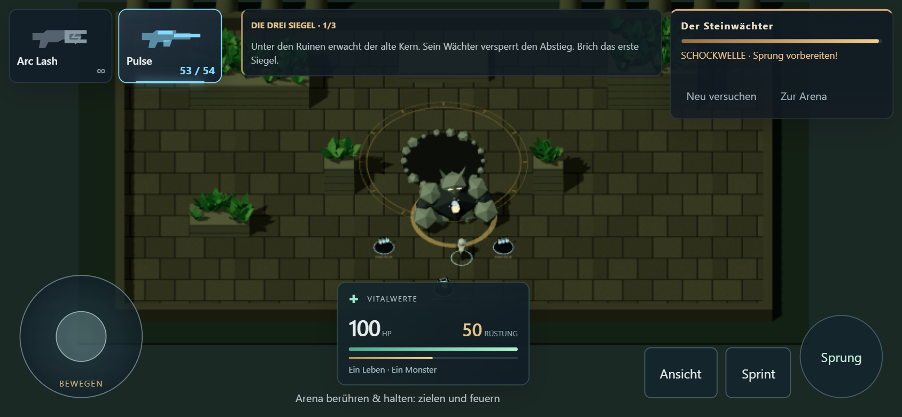

# Die drei Siegel – Mini-Kampagne und Darstellung

27. Oktober 2026. Separat freigegebene Erweiterungen nach dem positiven
Steinwächter-Spielurteil. Verfolgung zuvor als `95cb572` committed und gepusht.

## Spielbarer Umfang

1. **Verfallener Steinhof:** überwachsene Steinruinen, Säulen und Siegelkreis;
   schwerer Steinwächter, springbare Schockwelle und Bodenausbruch.
2. **Kristallkluft:** kalter Stein, Eiskristalle, versetzte Deckungen;
   achtbeinige Frostspinne, drei gerichtete Eissplitter und Kristallausbruch.
3. **Glutschmiede:** dunkle Metallstreben, glühende Randgräben und Schmiedeanlage;
   gehörnter Glutwurm mit segmentiertem Schwanz, Feueratem und größerem Glutausbruch.

Alle Gegner verfolgen lokal, halten für ihre Warnungen und greifen erst danach
an. Deckung blockiert Angriffe physisch. Eis lässt sich überspringen; Feueratem
erfordert seitliches Ausweichen oder Deckung. Bodenziele bleiben nach ihrer Warnung
fest. Warnzeiten und Trefferregeln gehören zur jeweiligen Begegnung.

Eine kurze Geschichte verbindet die Karten: Steinsiegel öffnen, Eissiegel brechen,
Schmiedekern beruhigen. „Weiter“ wird nach einem tatsächlichen Sieg verfügbar;
nach Karte drei folgt ein Abschluss mit Neustart der Kampagne. Jede Karte beginnt
mit frischen Ressourcen. Direkte Kartenlinks in der README helfen beim Testen.
Keine Speicherung, Freischaltungen oder große Kampagnenarchitektur.

## Darstellung

- Eigene geometrische Waffenmodelle für Arc Lash und Pulse, auch beim Arena-Bot.
- Violetter elektrischer Arc; längliche Pulse-Geschosse mit weißem Kern, blauer
  Leuchtspur und Treffern mit Funken. Eis und Feuer haben eigene Angriffseffekte.
- Medkit mit Kreuz/Griff, Energiezellen, Rüstungsschild und schwebendes Pulse-Gewehr;
  Sockel, Farbcodierung und kurzes Aufleuchten bei Aufnahme.
- Gemeinsames Kampf-HUD: klare Waffen-Silhouetten/Auswahl/Munition, separate HP-
  und Armor-Balken, niedrige HP farblich hervorgehoben. Bossanzeige oben mittig,
  Lebenswerte und Waffen unten; kompakte Touch-Variante und neue Ergebnisansicht.
- Waffenwerte, Pickupregeln und das normale ArenaMatch wurden dafür nicht geändert.

## Nachweise und Grenzen

37 Kern-/Physiktests bestanden. Neue Fälle unterscheiden Eis-/Feuerabwehr,
physische Deckung, Gegneridentitäten und die endliche Kartenfolge.

**Sieben Browserabläufe erfolgreich geprüft** in sichtbarem Chromium:
vollständige Kampagne mit drei regulären Boss-Siegen und Rückkehr zu Kapitel eins;
Verfolgung/bewegter Treffer; Steinwächter-Sieg mit Ausweichen; Niederlage/Pause/Retry;
PvE-Touch-Einstieg; vollständige Mehrfinger-Touch-Regression; Waffen-/Pickup-/Höhenroute
einschließlich leerer Pulse, Arc-Fallback, Rüstung und Restart. Desktop 1366×768,
Touch 844×390. Testbuild, Typecheck und Produktionsbuild bestanden.

Alle drei Kapitel wurden durch echte Schüsse, Bewegung und Ausweichen gewonnen;
Fortschritt über die sichtbaren Weiter-Buttons, keine Test-Abkürzung. Karten,
Gegnersilhouetten, neues HUD und Touch-Aufnahmen wurden visuell geprüft.

Der erste Kampagnen-Browsertest besiegte den Steinwächter, wartete aber weiter auf
die gerade begonnene Ausweichbewegung, obwohl der Sieg Bewegung korrekt stoppt.
Der Test beendet diese Wartebedingung nun auch bei einem regulären Kampfergebnis.
Ein weiterer Lauf gewann bereits alle drei Kapitel, las nach dem abschließenden
Reload aber zu früh die Diagnose. Der Test wartet jetzt auf URL und Startbereitschaft.
Der abschließende vollständige Lauf bestand in 42,7 Sekunden. Die sechs anderen
Browserfälle waren bereits grün; ihr Ergebnis und der vorherige Fehler bleiben
im Bericht erhalten.
Keine injizierten Treffer, Ergebnisse oder Spielzustände.

[Browsernachweise](mini-campaign/browser-results.json)

Prozedurale Modelle und einfache lokale Verfolgung bleiben der kleine Versuchsrahmen;
keine vollständige Wegplanung, Soundproduktion oder umfangreiche Balanceabnahme.
Touch wird in Chromium emuliert geprüft; echte Smartphone-Leistung bleibt offen.
CTF-3.0 bleibt unverändert, M2.4 bleibt ungeöffnet. Persönliches Spielurteil offen.
