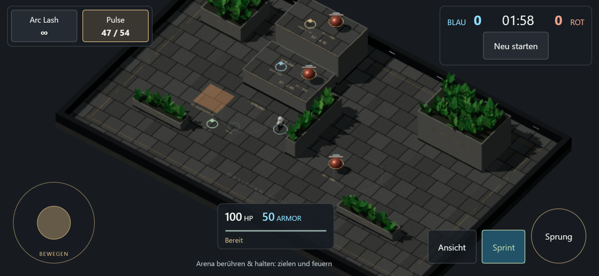
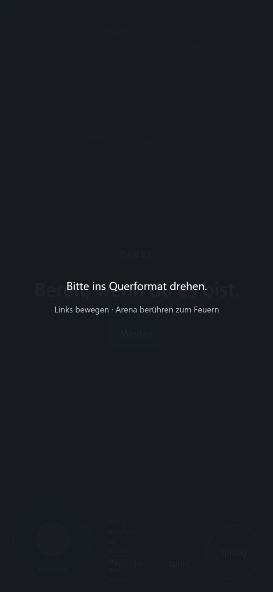

# Einfacher mobiler Basiszugang

20. Oktober 2026. Separat freigegeben: „so simpel wie möglich ohne Mammutprojekt auf mobile spielbar“. Desktop-first bleibt erhalten, M2.3 bleibt offen.

## Bedienung

- Querformat. Joystick links unten: analog bewegen, gleiche Kameraausrichtung wie WASD.
- Arena berühren: direkt auf den Bildschirmpunkt zielen. Halten feuert, Ziehen führt nach, kurzes Tippen feuert einmal bei bereiter Waffe. Keine Beschränkung auf die rechte Bildschirmhälfte, damit auch Ziele links erreichbar sind.
- Bewegungs- und Zielfinger sind unabhängig. Sprungtaste, Sprint-Umschalter und Kamera rechts unten. Bestehende Waffenbuttons oben links sind antippbar.
- Kompaktes HUD mit Platz für die Arena. Hochformat zeigt einen Drehhinweis und pausiert einen laufenden Match. Fokusverlust, Pointer-Abbruch, Drehung, Tod/Respawn und Neustart räumen Eingaben auf.
- Gleicher Spielkern, keine mobilen Sonderwerte für Bewegung oder Waffen. Bei grobem Zeiger Render-DPR maximal 1 und Schattenmap 1024 statt 2048.

## Prüfung

`npm test`: 21 Kern-/Physiktests bestanden. `npm run build:test` und `npm run build`: Typecheck und Builds bestanden. Vier bestehende Desktop-Browserfälle für Eingabe/Kamera/Wandkontakt/Fokus/Resize bestanden.

Neuer Browserablauf in sichtbarem Chromium mit 844×390 CSS-Pixeln, Touch und Geräteskalierung 2: echten Pulse-Pickup mit Joystick erreichen; Waffe antippen; gleichzeitig bewegen und schießen; jeden Finger einzeln lösen und Fortsetzung des anderen prüfen; Pointer-Abbruch; einzelner Tap-Schuss; Sprung, Kamerawahl und Sprint; Wechsel zu 390×844 mit Pause und zurück ohne klemmende Eingaben; Neustart. Browser-Eingaben über Chromiums Touch-Protokoll, ausschließlich lesende Spielzustandsdiagnose. Keine Ergebnisinjektion. Bestanden ohne Seitenfehler. Ein erster Testfehler betraf die Angabe des losgelassenen Fingers an CDP und wurde im Test korrigiert.

[Kompakter Testnachweis](mobile-basic/browser-results.json).

## Veröffentlichung

Commit `8e6a3c1` ist auf `main` veröffentlicht. [GitHub Actions: Build und Deployment erfolgreich](https://github.com/emfau88/CoreArena-3D/actions/runs/39493314926). Der [öffentliche Playlink](https://emfau88.github.io/CoreArena-3D/) liefert die neuen Produktionsdateien; die Asset-Hashes stimmen mit dem lokalen Build überein.

## Grenze

Dies ist eine einfache spielbare Touch-Basis. Echte Android-/iPhone-Hardware, Safari, Bedienkomfort mit Daumen und dauerhafte Leistung/Wärme sind noch nicht geprüft. Kein natives App-Projekt, keine Touch-Aim-Varianten und keine zusätzlichen Spielsysteme wurden begonnen. Der bestehende GitHub-Pages-Workflow veröffentlicht diesen Zusatz über denselben Playlink.
