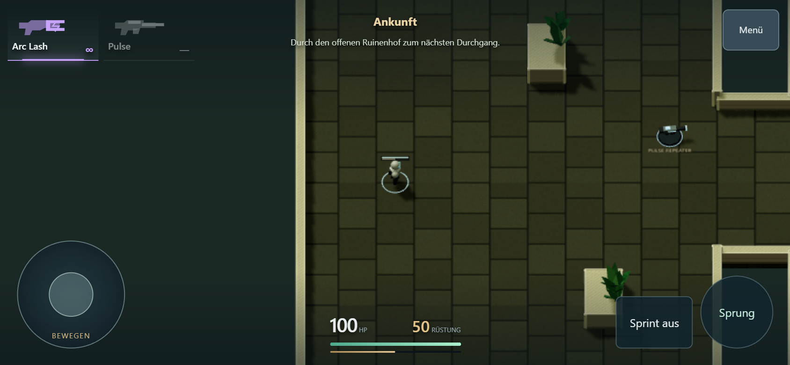
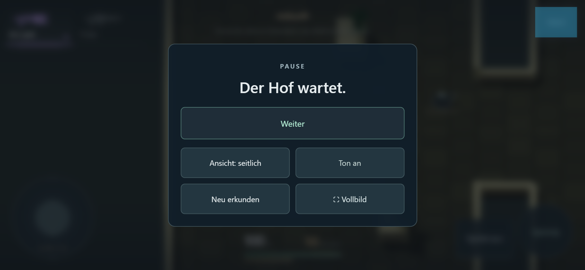
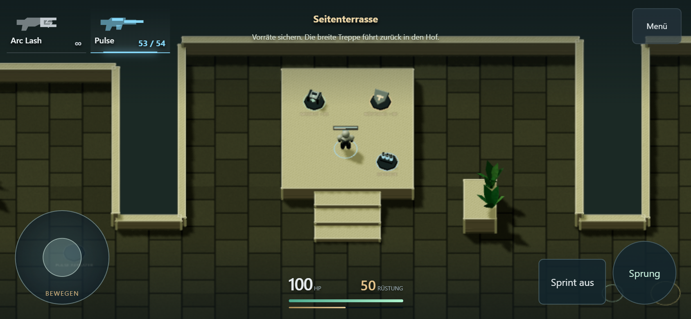

# Mobile-Feinschliff: Zoom, Sprint, HUD und Adventure-Sprünge

27. Oktober 2026. **Umgesetzt und technisch geprüft. Persönlicher Handytest offen.**
[Adventure spielen](https://emfau88.github.io/CoreArena-3D/?mode=pve&level=stone&adventure=1).

## Änderungen

- Mobile-Kamera: Weltobjekte 15 % größer, Sichtbereich entsprechend durch 1,15 geteilt.
  Die Desktop-Vergrößerung bleibt gleich. Adventure zeigt auf Mobile leicht voraus
  in die aktuelle Laufrichtung; Stillstand und Neustart zentrieren die Figur wieder.
- Sprint reagiert direkt auf `pointerdown`, auch vom zweiten Finger bei weiter
  gehaltenem Joystick. Kein Warten auf einen synthetischen Klick. Sichtbar „Sprint
  an/aus“ und aktive Farbfläche; Tastaturaktivierung des Buttons bleibt möglich.
- Adventure-HUD: Kamera, Ton, Vollbild und Neustart im Pausenmenü. Auf dem Spielfeld
  bleiben Waffen, HP/Rüstung, Ort/Ziel, Menü, Joystick, Sprint und Sprung.
  Bedienelemente werden versetzt; bestehende Zustände und Listener bleiben erhalten.
- Adventure verwendet auf Desktop und Touch dasselbe Sprungprofil: Schwerkraft
  34 statt 22,6 und Absprunggeschwindigkeit 11,8 statt 10,8. Der stärkere Absprung
  erhält sinnvolle Plateauhöhe bei deutlich schnellerem Aufstieg und Fall.
  Alte Arena-/Bossmodi behalten ihr bisheriges Profil und ihre Höhenrouten.

## Tatsächlich gemessener Sprung

Echte Rapier-Kollision und Simulation mit 60 Ticks/s, Start/Landung auf gleicher
Ebene. Höhe relativ zur Standposition:

| Zustand | Flugzeit | Höchster Punkt |
| --- | --- | --- |
| Vorher | 0,983 s | 2,671 m |
| Adventure jetzt | 0,717 s | 2,147 m |

Etwa 27 % kürzer und 20 % niedriger. Direkter Sprung auf die 1,1-m-Seitenterrasse
bestanden. Der normale Weg mit allen drei Treppen/erhöhten Flächen bleibt erreichbar.

## Nachweise

- `npm run build`: TypeScript und Produktionsbuild bestanden; bekannte Bundlewarnung.
- `npx tsx --test --test-concurrency=1 tests/*.test.ts`: **45/45 bestanden**.
  Sprungzeit/-höhe und echte Plateaulandung neu geprüft; Kamera-Zoomverhältnis und
  Vorlauf erweitert. Bestehende Arena-, Treffer-, Bot- und Bossregeln weiterhin grün.
- Browser: `npx playwright test tests/e2e/stone-adventure.spec.ts tests/e2e/mobile.spec.ts --project=chromium-1366 --trace=off`:
  **3/3 ohne Retry bestanden**, keine JavaScript-Fehler in den geprüften Abläufen.
  [Laufstatistik](mobile-polish/browser-results.json).

Der Adventure-Touch-Test hält den Joystick physisch per CDP-Touch-Eingabe und setzt
den zweiten Finger auf Sprint: tatsächliche Geschwindigkeit 7,2 → 10,8 → 7,2,
ohne den Bewegungsfinger zu lösen. Loslassen des Sprintfingers toggelt nicht erneut.
Danach Waffenaufnahme, Touch-Feuer, Treppe/Terrasse, Sprung, Menükamera, Ton und
Neustart über normale Eingaben. Zoom wird am tatsächlichen Kamerasichtbereich geprüft.

Desktop: vollständiger Weg vom Spawn bis Nordtor, Waffen/Versorgung, Treppen, Kameras,
Pause und Neustart. Arena-Touch-Regression: unabhängiges Bewegen/Feuern, Sprint,
Sprung, Portraitpause/Querformat-Rückkehr und Reset. Testkamera-Übersicht nur für
Dokumentationsaufnahmen; kein Teleport oder künstlicher Erfolg im Durchlauf.

Chromium unter Windows, Desktop 1366×768 und Touch-Emulation 844×390 mit Geräte-DPR 2
und Render-DPR 1. Kein Test auf einem echten Android-/iPhone-Gerät, keine FPS-Zusage.
Vor weiterem Mobile-Ausbau zuerst persönliches Urteil zum neuen Spielgefühl.
Beweglicher Joystick, zusätzlicher Zielring und Sprungpuffer wurden in diesem kleinen
Paket nicht vorgezogen. Keine Implementierung von L1.2.

## Aufnahmen

