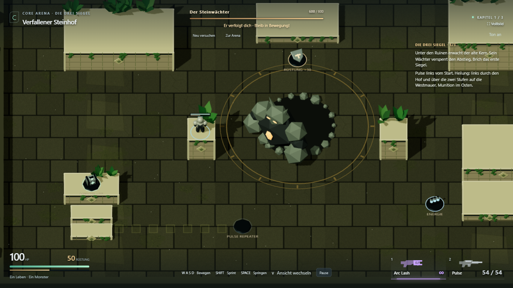
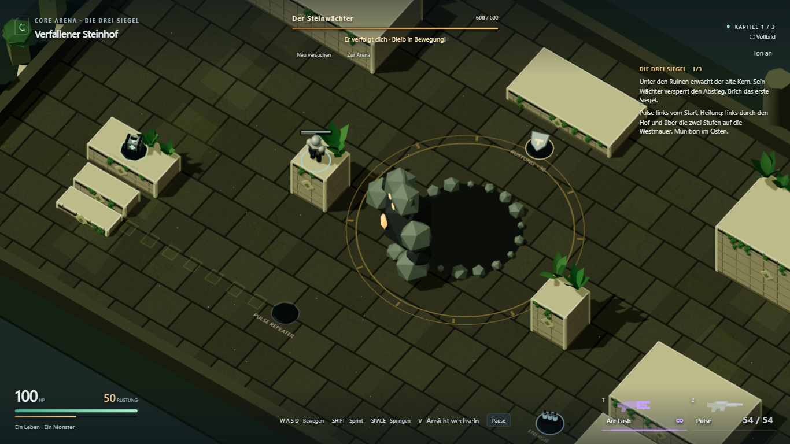
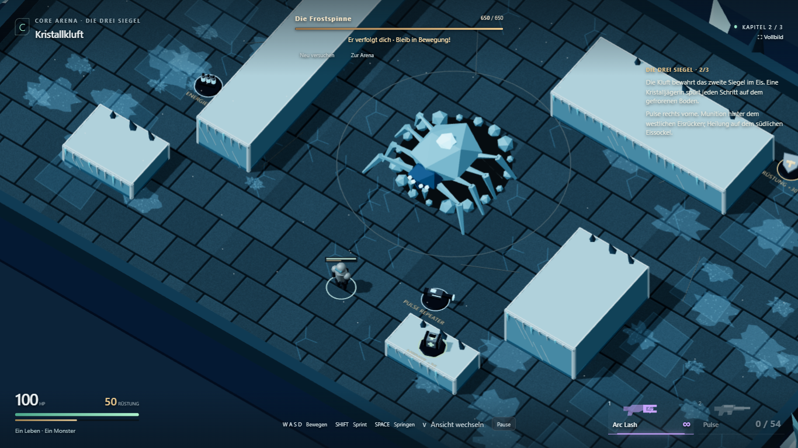
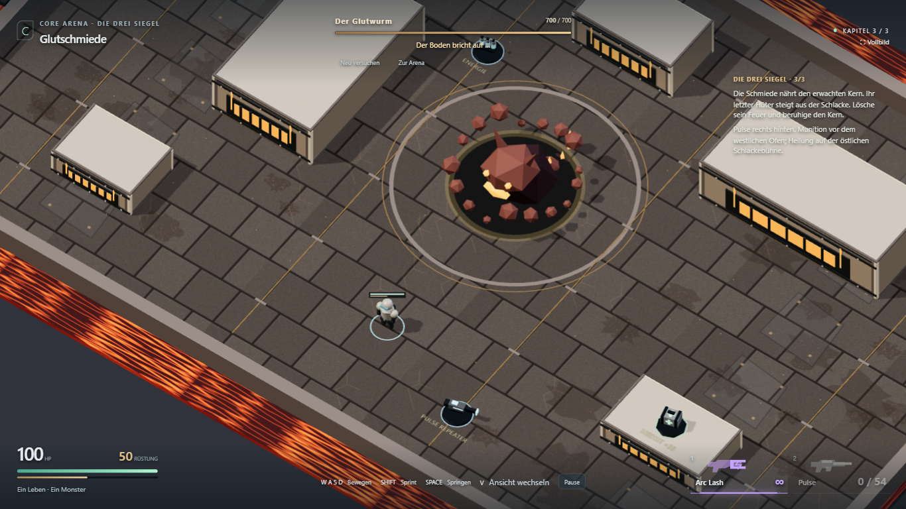

# Lesbare Plateauwände

27. Oktober 2026. Visuelle Nacharbeit auf konkrete Spielrückmeldung.

Die bisherige dunkle Körnung der Wandmaterialien ließ die Seitenflächen im Boden
verschwinden. Jetzt bekommen die vertikalen Flächen eigene hellere Materialien:
Front und Seiten sind unterschiedlich getönt, Ecken verlaufen durchgehend bis zum
Boden, umlaufende Sockel zeigen den Fußpunkt. Mauerfugen laufen auch auf Seitenflächen.
Obere Flächen und tatsächliche Collider behalten ihre Form und Höhe; keine Änderung
an Kamera, Bewegung oder Kampfregeln.

`npm run build` einschließlich TypeScript-Prüfung bestanden. Bestehende Bundlewarnung bleibt.
`npx playwright test tests/e2e/scenery.spec.ts tests/e2e/stone-quality.spec.ts --project=chromium-1366`:
**3/3 ohne Retry bestanden**. Echter Plattformsprung, Heilungsaufnahme, Verfolgung um
Deckung und Feedback-Regressionsprüfung. Beide Kameraansichten aller drei Karten
aufgenommen und gesichtet; Chromium 1366×768. Keine erneute mobile Vollprüfung für
diese Materialänderung. Persönliche visuelle Bestätigung offen.

[Laufstatistik](plateau-walls/browser-results.json).
Vorher: [Steinhof](stone-quality/healing-route.png).

