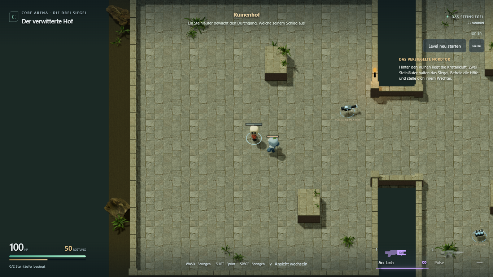
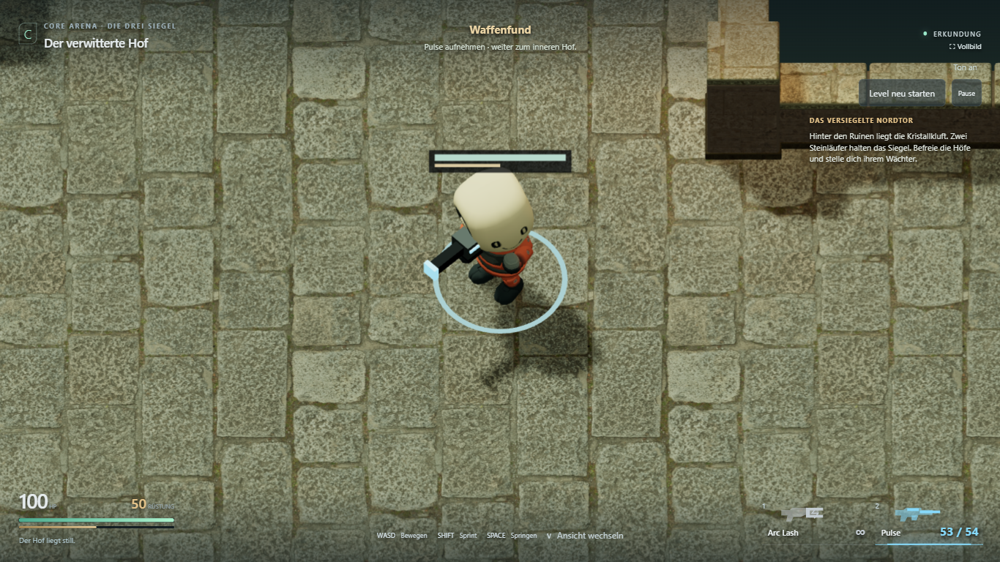
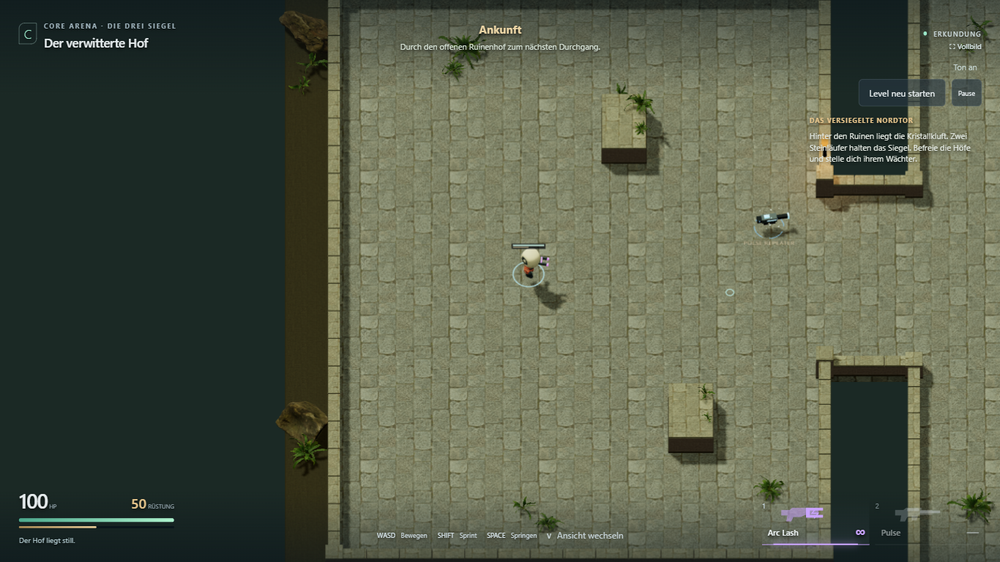
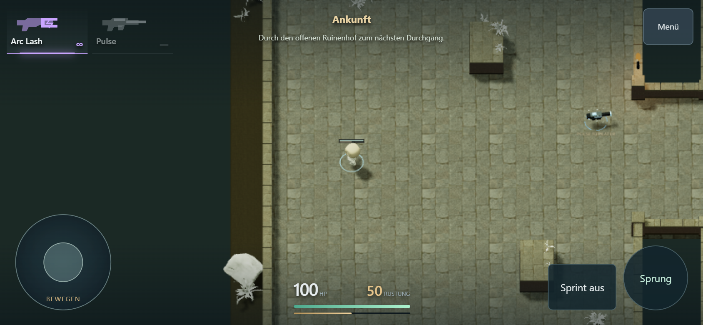

# Ruinenkurier: erste Form- und Farbvariante

29. Oktober 2026. Freigegebener Spieler-Look umgesetzt und technisch geprüft.
[Spielen](https://emfau88.github.io/CoreArena-3D/?mode=pve&level=stone&adventure=1)
· [Roadmap](../planning/LEVEL_1_STONE_ADVENTURE.md)

## Umsetzung

- Kopf 10 % flacher und 5 % breiter; warme Elfenbeinfarbe.
- Unterer Körper bis zu 10 % breiter und 7 % tiefer, weich zu den Schultern auslaufend.
- Stiefel bis zu 18 % breiter und 20 % länger, weich zum ursprünglichen Bein übergehend.
- Korallorange für den Anzug, Graphit für Stiefel und Handschuhe. Die dunklen
  Gesichtselemente, Nähte und Knöpfe des vorhandenen Modells bleiben erkennbar.
- Formänderungen an den eigenen Mesh-Kopien in der Ausgangspose, bevor die Animation
  sie verformt. Kein Skalieren animierter Knochen und keine neue Bewegungslogik.
- Farbzuordnung im Material-Shader, keine zusätzlichen Texturen oder Downloads.
  KayKit-Quelldatei und separate Wächter-/Bot-Darstellungen bleiben unabhängig.

Dies ist die freigegebene erste Form-/Farbpassage. Gesichtsgestaltung, Rucksack und
weitere Ausrüstung sind spätere mögliche Schritte, noch nicht Teil dieser Fassung.

## Prüfung

Test- und Produktionsbuild einschließlich TypeScript erfolgreich. Vier sichtbare
Chromium-Browserfälle bestanden:

1. Desktop-Komplettlauf: beide Gegner, Waffenfund, Checkpoint, Boss-Tod/Retry,
   aktiver Kampf, Sieg, physischer Ausgang und vollständiger Neustart.
2. Gehen in acht Richtungen bei unabhängiger Mauszielrichtung; keine aufaddierte
   Körperdrehung, stabile Pause.
3. Neue Spieleroptik geladen, laufende Beinknochen, Gehen/Sprint/Sprung/Landung,
   Arc-/Pulse-Schuss, Waffenfund; keine Shader-, PropertyBinding-, HTTP- oder Seitenfehler.
4. Touch 844 × 390: Joystick, Sprint-Umschaltung, Waffenfund, Schuss, Terrasse,
   Sprung, Kameras, Menü und Neustart.

[Browserbericht](player-courier/browser-report.json). Keine Teleports oder Lebens-/
Munitionsinjektionen für die Spielabläufe. Persönliches Urteil zu Form und Farbgebung
bleibt offen; Touch-Emulation ersetzt keine Prüfung auf einem echten Handy.

## Spielaufnahmen

Normale seitliche Adventure-Ansicht mit Spieler und Wächter:

Detail derselben seitlichen Ansicht, nur mit näherer Dokumentationskamera:

