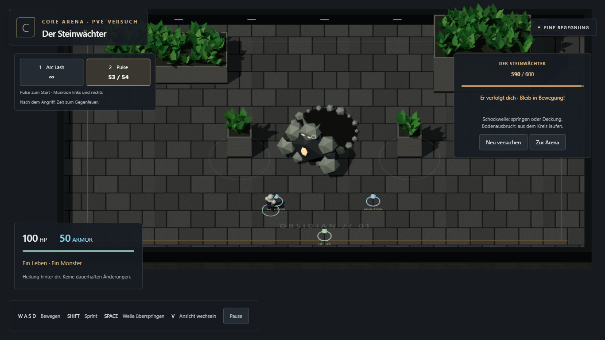
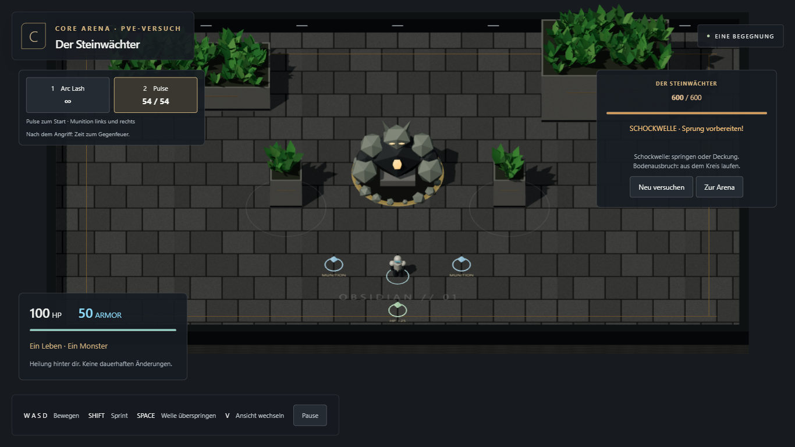
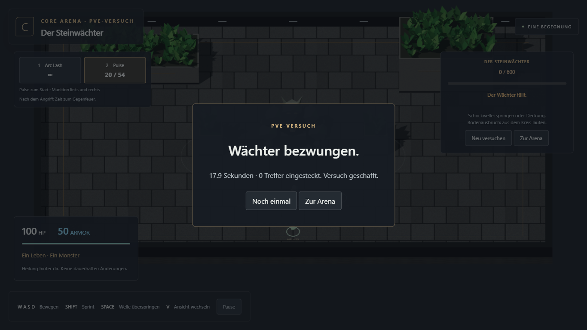
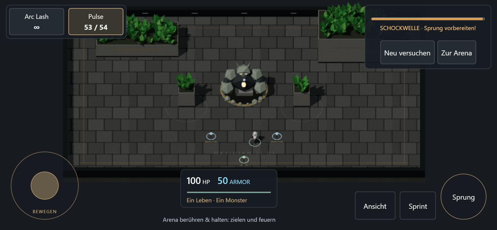

# Kleiner PvE-Versuch: Der Steinwächter

26. Oktober 2026. Separat beauftragter, reversibler Spielversuch. **Umgesetzt und
technisch geprüft.** Positive Nutzerrückmeldung zu Auftauchen und Steinmonster
am 27. Oktober; anschließend Verfolgung beauftragt.

[Direkt spielen](https://emfau88.github.io/CoreArena-3D/?mode=pve).

Dieser Bericht dokumentiert den ursprünglichen Einzelversuch und die Verfolgung.
Der anschließend am 27. Oktober beauftragte Ausbau auf drei Karten und das neue HUD
sind im [Kampagnenbericht](MINI_CAMPAIGN_RESULT.md) dokumentiert.

## Spielbarer Umfang

Eine Begegnung auf einer kleinen Variante der bestehenden Arena. Ein großer
prozeduraler Steinwächter taucht aus einem Krater mit hochfliegenden Steinen auf.
Er hebt vor dem Schlag die Arme. Zwei Angriffe wechseln sich ab:

- Schockwelle: sichtbarer Ring breitet sich aus, Springen oder echte Deckung schützt.
- Bodenausbruch: Warnkreis markiert einmal den Standort; er verfolgt den Spieler
  nicht. Rechtzeitig hinauslaufen, Springen allein genügt nicht.

600 Monster-HP, Spieler mit 100 HP/50 Armor, Pulse mit 54 Schuss, zwei Munitions-
und ein Heilpickup. Treffer verwenden den vorhandenen Combat-/Rapier-Pfad.
Sieg und Niederlage beenden die Begegnung; Neustart setzt sämtliche Ressourcen
und Projektile zurück. „Zur Arena“ öffnet den normalen Modus. Touch bleibt nutzbar.

## Abgrenzung und Rücknahme

Der vorherige saubere Stand `24ac35885fd202c3e772c4016287408e4a0d7e23` wurde vor
der Änderung gepusht und zusätzlich auf `checkpoint/pre-pve-test-2026-10-26`
gesichert. Der Versuch wird als eigener Commit auf `main` veröffentlicht und
kann mit dessen `git revert` entfernt werden, ohne spätere Arbeit zurückzusetzen.

`?mode=pve` lädt einen eigenen Einstieg mit eigenem numerischen Begegnungszustand.
ArenaMatch, Botregeln und Waffenwerte bleiben unverändert. Renderer, Eingabe,
Motor, Waffen und Pickups werden wiederverwendet. Es gibt weder Kampagnenspeicher
noch Levelkette, Rekrutierung oder Fortschrittsbelohnungen. In der Grundversion
blieb das Monster am Krater; seit 27. Oktober verfolgt es den Spieler.
Neue Sounds oder ein ausbalanciertes Schwierigkeitsmodell sind nicht enthalten.
CTF-3.0 wurde nicht verändert; M2.4 wurde nicht begonnen.

## Erweiterung vom 27. Oktober: Verfolgung

Nach dem Auftauchen und jeder Erholung verfolgt der Wächter den Spieler für bis
zu zwei Sekunden mit 2,6 m/s. Er hält 3,6 m Abstand. Während Warnung, Schlag und
Erholung steht er still; Welle und Trefferkörper folgen seiner tatsächlichen
Position. Der Krater bleibt zurück. Schritte, Armschwung und Drehung machen die
Bewegung sichtbar. Neustart setzt auch Position und Trefferkörper zurück.

Rapier prüft einen Körper-Sweep gegen feste Geometrie; Bodenproben verhindern
das Verlassen der Arena. Einfache lokale Ausweichrichtungen, keine vollständige
Wegplanung oder Kletterfähigkeit. **34 Kerntests und vier PvE-Browserfälle grün**:
bewegtes Ziel tatsächlich getroffen, Richtungswechsel, Pause/Reset, Sieg,
Niederlage und Touch. Produktions-/Testbuild bestanden.

Beim zusätzlich ausgeführten Botduell scheiterte der erste Lauf: Der Spieler
starb vor dem erwarteten eigenen Abschuss. Dieser Befund bleibt im
[Browserbericht](pve-pursuit/browser-results.json) erhalten.
Der isolierte Wiederholungslauf bestand unverändert in 18,9 Sekunden. Damit ist
dieser Bot-Test als instabil dokumentiert, nicht als fehlerfreier Erstlauf.

## Prüfung der Grundversion vom 26. Oktober

- **32/32 Kern-/Physiktests bestanden**, einschließlich vier neuer Fälle für
  Warnzeiten, einmaligen Schaden, Sprunghöhe, reale Deckung, fixierte Bodenziele,
  Sieg/Niederlage und Reset.
- Typecheck, Testbuild und Produktionsbuild bestanden.
- **Drei neue sichtbare Chromium-Browserfälle bestanden:** kompletter Sieg durch
  echte Schüsse mit Sprung, Ausweichen und Munitionsaufnahme; reguläre Niederlage
  durch drei ignorierte Angriffe mit Pause/Weiter/Retry; Touch-Einstieg, Bewegung,
  echter Monstertreffer und Rückkehr zur Arena.
- Bestehendes M2.3-Botduell und vollständige Touch-Regression bestanden.
- Browsersteuerung ausschließlich durch Maus, Tastatur und Touchereignisse;
  Diagnose nur lesend, keine injizierten Treffer oder Endergebnisse.
- Desktop 1366×768, Touch 844×390 in Chromium-Emulation. Kein Nachweis auf einem
  echten Smartphone und keine Aussage über dessen Leistung.

Im ersten Lauf waren zwei Fehler sichtbar: Dem neuen Pause-Knopf fehlte
`pointer-events: auto`; außerdem reagierte der Test wegen grober Abfrageintervalle
zu spät auf den Bodenausbruch. Knopf korrigiert, Testbeobachtung auf 20 ms verkürzt
und Bewegung vor dem Screenshot gestartet. Die Spiel-Warnzeit wurde nicht für
den Test verlängert. Anschließend bestanden beide Abläufe ohne automatische Retries.

[Kompakter Browserbericht](pve-basic/browser-results.json)

Nächster Schritt ist ein kurzer persönlicher Spieltest: Macht das Ausweichen und
Gegenfeuern Spaß genug, um diese Richtung weiterzuverfolgen? Weitere Level bleiben
eine eigene Entscheidung.
