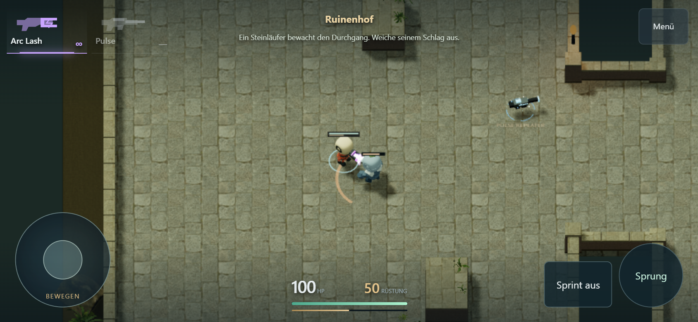
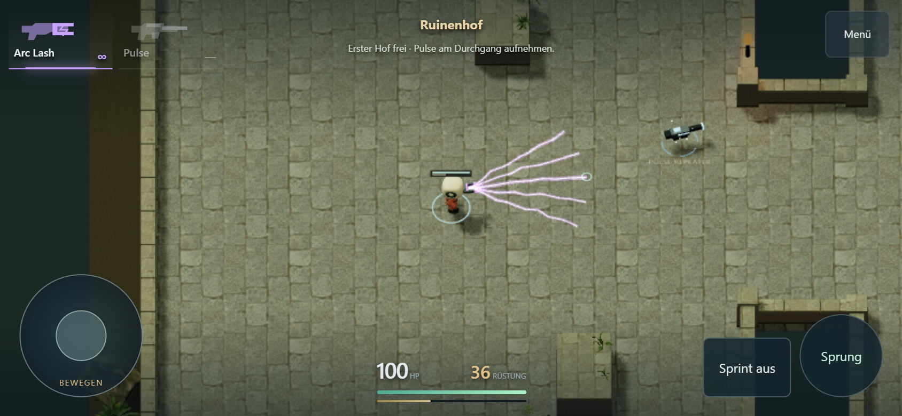
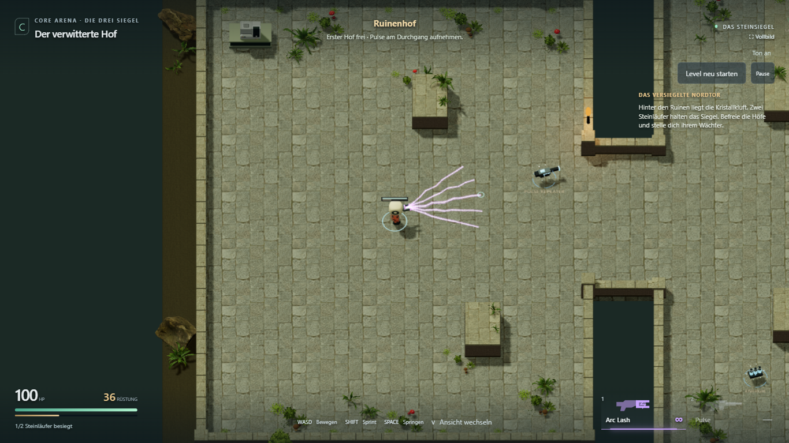

# Sprint, mobile Ansicht und Arc Lash

Stand: 29. Oktober 2026. Nutzerauftrag umgesetzt; persönlicher Handytest offen.

## Spielverhalten

- Sprint: **9,18 statt 10,8 m/s**, exakt 15 % weniger Solltempo. Gehen bleibt 7,2 m/s.
- Mobile: Zoomfaktor **1,45 statt 1,15**; Figuren/Umgebung erscheinen damit rund
  **26 % größer als bisher**. Desktop-Kamera bleibt gleich.
- Arc Lash: Klick/Tippen startet eine **0,6-s-Salve mit fünf flackernden Strahlen**
  und längerem elektrischem Geräusch. Halten wiederholt alle 0,8 s.
- Automatische Zielwahl rund um den Spieler innerhalb von **5 m**; ein erreichbares
  Ziel bleibt während der Salve gebunden. Beim Weglaufen oder Verlust der Sicht
  wird neu gesucht. Ohne Ziel zeigt der **60°-Fächer** in die anvisierte Richtung.
- Weitere Ziele im Fächer können mitgetroffen werden. **35 Schaden pro Gegner und
  vollständiger Salve**, verteilt auf fünf Impulse zu 7; mehrere Strahlen auf
  denselben Gegner vervielfachen den Schaden nicht.
- Alle Strahlen prüfen echte 3D-Kollision. Wände/Deckung stoppen sie, Waffenwechsel
  und Tod/Reset brechen die Salve ab. Pulse bleibt manuell gezielt.

## Prüfung

`npm test`: **54/54 bestanden**. Automatische Zielwahl auch entgegen dem Cursor,
mehrere Ziele, Reichweitenende, bewegter Schütze/Gegner, Deckung, Waffenwechsel,
Reset und unveränderte Pulse-Treffer geprüft. Bewegung/Kamera, Sprünge, Gegner,
Boss und Checkpoint bleiben abgedeckt.

Die Physikprüfung toleriert bei diagonaler Strecke einen einzelnen 60-Hz-Schritt:
Rapier verbraucht bei 9,18 m/s einmal einen Schritt für einen ruhenden Bodenkontakt.
Die tatsächliche Endgeschwindigkeit wird separat auf 9,18 m/s geprüft. Keine Änderung
der Kollisionsparameter oder Sprungphysik.

Vier sichtbare Chromium-Browserfälle mit echten Eingaben bestanden:

1. Desktop: Menü → zwei Wächter → Pulse → Checkpoint → Tod/Retry → Boss-Sieg →
   Steinkern → Ausgang → vollständiger Reset.
2. Desktop: bewusst hinter den Spieler klicken, automatische Zielerfassung,
   Strahlen bleiben nach Loslassen aktiv, vollständiger Salvenschaden, Halten bis
   zum Wächter-Sieg.
3. Touch-Querformat **844 × 390**: derselbe Ablauf mit Tippen/Halten und Joystick.
4. Touch: neue Kameragröße, Gehen/Sprint an/aus mit zweitem Finger, Waffenaufnahme,
   Pulse-Schuss, Seitenterrasse, Sprung, Kamerawechsel und Neustart.

Keine Browser-Laufzeitfehler in diesen Fällen. Produktions- und Test-Build bestanden;
die bereits bestehende Vite-Warnung zum großen Three/Rapier-Bundle bleibt bestehen.
Die Touch-Prüfung emuliert ein Smartphone; sie ersetzt keinen Android-/iPhone-Test.

## Aufnahmen aus dem Spiel

Mobile während automatischer Zielerfassung:

Fächer ohne Ziel, damit die ganze Breite sichtbar ist:

Desktop:

[Browserbericht](arc-mobile/report.json)

Roadmap: freigegebene Abstimmung erledigt; L1.5b bleibt persönliche Spiel- und
Leistungsabnahme. Keine zusätzlichen Gegner, Karten oder neuen Meilensteine.
