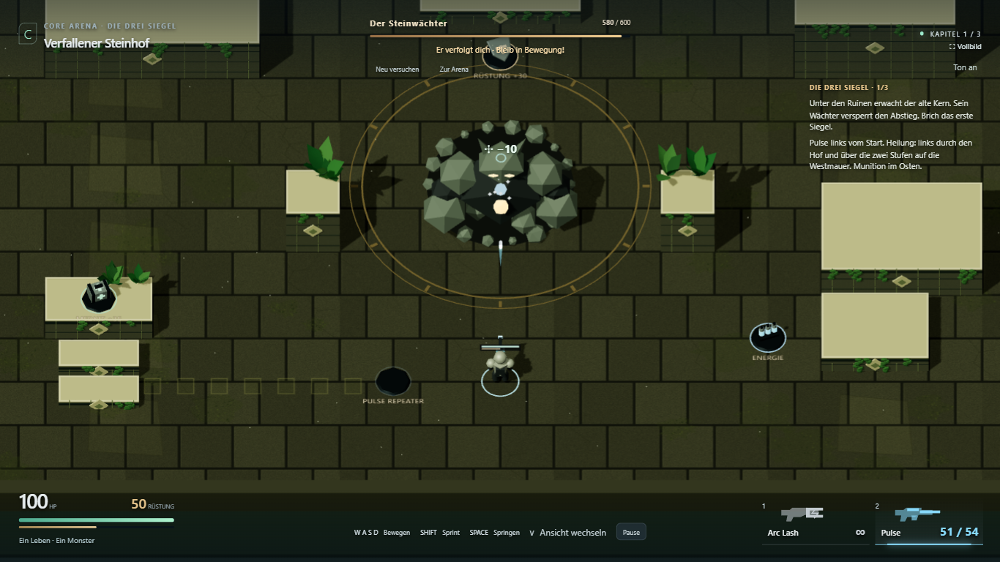
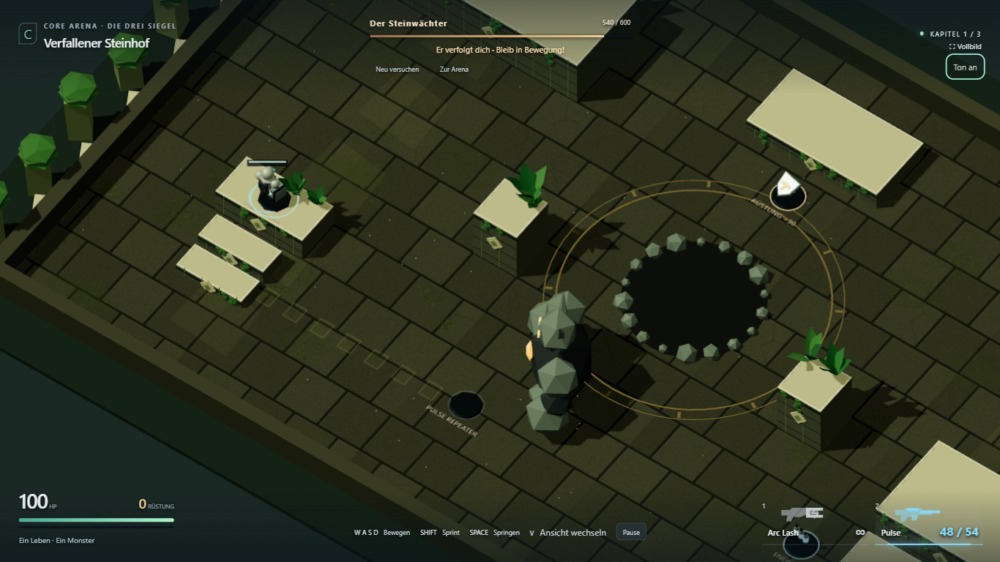
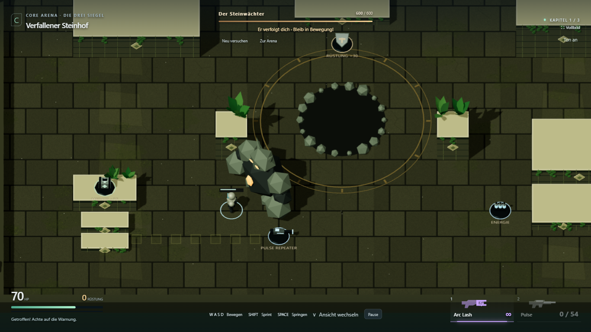

# Steinhof: erste Qualitätsrunde

27. Oktober 2026. Umgesetzt und technisch geprüft. Persönliche Klang-/Spielabnahme offen.

## Umfang

- Erste synthetische Tonfassung ohne externe Assets oder neue Abhängigkeiten:
  Arc/Pulse, bestätigte Treffer, eigener Schaden, Schritte, Sprung/Landung,
  Angriffsvorbereitung/Einschlag, Pickups und Sieg. Start erst nach Nutzereingabe,
  Ton-an/aus-Button, Pause-Muting und Aufräumen beim Verlassen.
- Kurze Trefferanzeige am Wächter, leichte Körperreaktion und Randimpuls bei eigenem
  Schaden. Keine Änderung der Zielberechnung oder Simulation durch Präsentationseffekte.
- Faustschlag mit Rücknahme, Vorstoß in den letzten sieben Vorbereitungsticks und
  tiefer ausgestreckter Faust am tatsächlichen Schadenszeitpunkt; anschließende Erholung.
- Kleine Wegsuche ausschließlich für den Steinhof: Graph aus mit Körperabstand
  erweiterten Deckungsgrenzen. Erneute Planung bei Zielwechsel; reale Rapier-Sweeps
  und Bodenprüfung bleiben für jeden Bewegungsschritt zuständig. Erhöhte Ziele
  bekommen einen Ansatzpunkt am Boden. Kein Klettern oder Teleportieren.
- Zwei niedrige Stufen an der Westmauer, eingearbeitete Wegsteine und ein Hinweis
  bei niedrigen HP führen zum vorhandenen Medkit. Position/Menge des Medkits bleiben erhalten.

## Prüfung

- `npm test`: **41/41 bestanden**. Neuer realer Physikablauf um eine Säule und
  Annäherung an eine erhöhte Heilungsplattform. Der erste Navigationstest fand ein
  zu frühes Abbiegen vor einem Eckpunkt; die Wegpunkt-Toleranz wurde korrigiert und
  der gesamte Kern-/Physiksatz erneut erfolgreich ausgeführt.
- Produktionsbuild und TypeScript-Prüfung bestanden; bestehende Bundlegrößenwarnung bleibt.
- `npx playwright test tests/e2e/stone-quality.spec.ts tests/e2e/campaign.spec.ts tests/e2e/pve.spec.ts --project=chromium-1366`:
  **7/7 ohne Retry bestanden**. Vollständige Drei-Boss-Kampagne, Verfolgung und
  Treffer, echter Nahkampf/Seitenschritt, Niederlage/Pause/Restart, Touch-Aufnahme
  und Feuer, neuer Feedback-/Heilungsablauf sowie Umweg um echte Deckung.
- AudioContext nach Eingabe aktiv, tatsächliche Signalenergie am Ausgang gemessen
  (>0,001 und <1), Stummschaltung verhindert weitere Sounds, Pause friert Spielfluss
  und Soundereignisse ein. Das belegt technische Ausgabe, keine subjektive Hörabnahme.
- Heilungsnachweis: regulären Schaden zugelassen, zum Westaufgang gelaufen,
  gesprungen, reale Standfläche `broken-wall` erreicht, Medkitmenge reduziert und HP erhöht.
- Chromium Desktop 1366×768, bestehender Touch-Fall 844×390/DPR 2. Kein neuer Test
  auf echter Smartphone-Hardware und kein Performancebenchmark.

[Laufstatistik](stone-quality/browser-results.json).

